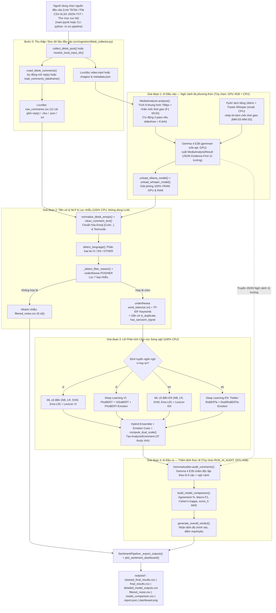

# Tài liệu Giải thích Chi tiết Cấu trúc, Cách hoạt động & Từ điển Dữ liệu Dự án

> **Đối tượng dự án:** Hệ thống Phân tích Cảm xúc Bình luận TikTok Song ngữ (`vi` / `en`) Đa phương thức (`e:\A\Sentiment-Analysis`).
> **Nguyên tắc kiến trúc cốt lõi:** Chỉ dùng mô hình AI tạo sinh (**Gemma 4 E2B**) tại **Đầu vào** (đọc ngữ cảnh video/ảnh) và **Đầu ra** (thẩm định thực tế & tổng kết); toàn bộ phần lõi ở giữa chạy bằng **NLP (`underthesea`) + Học máy cổ điển + Luật từ điển + Học sâu chuyên biệt** trên CPU.

---

## Mục lục

- [1. Bản đồ cấu trúc toàn bộ dự án](#1-bản-đồ-cấu-trúc-toàn-bộ-dự-án)
- [2. Luồng hoạt động từ đầu đến cuối (End-to-End Flow)](#2-luồng-hoạt-động-từ-đầu-đến-cuối-end-to-end-flow)
- [3. Giải thích chi tiết từng thành phần mã nguồn (`src/`)](#3-giải-thích-chi-tiết-từng-thành-phần-mã-nguồn-src)
- [4. Từ điển dữ liệu đầu vào & mô hình lưu đệm (`data/` và `models/`)](#4-từ-điển-dữ-liệu-đầu-vào--mô-hình-lưu-đệm-data-và-models)
- [5. Từ điển dữ liệu kết quả đầu ra (`outputs/<post_id>/`)](#5-từ-điển-dữ-liệu-kết-quả-đầu-ra-outputspost_id)
- [6. Bảng tra cứu tham số cấu hình &amp; vận hành (`main.ipynb` &amp; CLI)](#6-bảng-tra-cứu-tham-số-cấu-hình--vận-hành-mainipynb--cli)

---

## 1. Bản đồ cấu trúc toàn bộ dự án

### 1.1. Cây thư mục tổng thể

```text
e:\A\Sentiment-Analysis\
├── AI_Local/gemma4-e2b/                  # Hạ tầng AI cục bộ chạy qua Docker Ollama
│   ├── docker-compose.yml                # Cấu hình container GPU, bộ nhớ KV Cache 4GB VRAM
│   ├── Modelfile                         # Định nghĩa mô hình tùy biến `gemma4-e2b-opt`
│   ├── ollama_models/                    # Lưu trữ trọng số GGUF của Gemma 4 E2B trên ổ E:
│   └── test.ipynb                        # Notebook kiểm thử kết nối Ollama độc lập
│
├── data/                                 # KHO DỮ LIỆU THU THẬP THÔ (Đầu vào)
│   ├── samples/                          # Dữ liệu mẫu tĩnh (sample_comments.csv)
│   └── <post_id>/                        # Tự động sinh theo từng link TikTok
│       ├── video.mp4 (hoặc images/)      # Video gốc tải về (hoặc bộ ảnh Photo Mode)
│       ├── metadata.json                 # Siêu dữ liệu bài đăng (caption, likes, duration...)
│       └── raw_comments.csv              # Toàn bộ bình luận thô thu thập từ trình duyệt
│
├── models/classical_ml/                  # BỘ ĐỆM MÔ HÌNH HỌC MÁY CỔ ĐIỂN (Cache .joblib)
│   ├── vi/                               # Nhánh Tiếng Việt: NB, LR, Linear SVM, Emotion LR
│   │   ├── polarity_models.joblib
│   │   ├── emotion_ml_model.joblib
│   │   └── benchmark_metrics.json
│   └── en/                               # Nhánh Tiếng Anh: NB, LR, Linear SVM, Emotion LR
│       ├── polarity_models.joblib
│       ├── emotion_ml_model.joblib
│       └── benchmark_metrics.json
│
├── outputs/                              # KHO KẾT QUẢ CUỐI CÙNG SAU XỬ LÝ (Đầu ra)
│   └── <run_name>/                       # Khớp mã bài đăng, tên file hoặc tên thư mục nguồn
│       ├── cleaned_final_results.csv     # Bản tóm gọn 10 cột lõi (hoặc 14 cột khi bật AI Audit, sắp theo likes giảm dần)
│       ├── final_results.csv             # Các thuộc tính phân tích hữu ích (18 cột lõi, hoặc 24 cột khi bật AI Audit)
│       ├── detailed_model_outputs.csv    # Thuộc tính kỹ thuật, xác suất & dự đoán từng mô hình (20 cột, hoặc 23 cột khi bật AI Audit)
│       ├── filtered_noise.csv            # 8 cột tách riêng bình luận nhiễu/ngôn ngữ khác
│       ├── model_comparison.csv          # Bảng so sánh 8 mô hình/nhánh (tự ẩn cột vs_gemma nếu tắt AI Audit)
│       ├── report.json                   # Toàn bộ dữ liệu tổng hợp dạng JSON phân cấp
│       └── dashboard.png                 # Biểu đồ 2x2 trực quan hóa kết quả
│
├── src/                                  # MÃ NGUỒN CHÍNH (Package Python)
│   ├── __init__.py                       # Xuất biểu tượng (Lazy Export) cho toàn gói src
│   ├── ingestion/
│   │   ├── __init__.py
│   │   └── tiktok_collector.py           # Bước 0: Tải video/ảnh & crawl bình luận TikTok
│   ├── preprocessing/
│   │   ├── __init__.py
│   │   └── text_cleaner.py               # Giai đoạn 2: Lọc nhiễu, nhận diện VI/EN, underthesea, TF-IDF
│   ├── models/
│   │   ├── __init__.py
│   │   ├── media_context.py              # Giai đoạn 1: OpenCV + PyAV/Whisper + Gemma 4 E2B (Input)
│   │   ├── classical_ml.py               # Giai đoạn 3A: Từ điển song ngữ + NB/LR/SVM + Benchmark
│   │   ├── sentiment_engine.py           # Giai đoạn 3B: PhoBERT/ViSoBERT/RoBERTa + Hybrid + Thang điểm
│   │   └── gemma_auditor.py              # Giai đoạn 4: Gemma 4 E2B (Output) thẩm định & so sánh mô hình
│   ├── visualization.py                  # Vẽ bảng điều khiển dashboard.png (2x2)
│   └── pipeline.py                       # Điều phối End-to-End & Giao diện dòng lệnh CLI
│
├── main.ipynb                            # Notebook 6 ô chạy 1-click từ link TikTok
├── requirements.txt                      # Danh sách thư viện Python yêu cầu
├── README.md                             # Hướng dẫn cài đặt và sử dụng nhanh
└── Bao_Cao_Du_An_Sentiment_Analysis.docx # Báo cáo đồ án chuẩn học thuật Word (.docx)
```

### 1.2. Giải thích cấu hình hạ tầng AI cục bộ (`AI_Local/gemma4-e2b/`)

Hai tệp cấu hình trong `AI_Local/gemma4-e2b/` quyết định việc mô hình đa phương thức **Gemma 4 E2B** chạy ổn định trên card đồ họa laptop giới hạn **4 GB VRAM** (NVIDIA RTX 3050):

| Tệp                   | Tham số / Biến                | Giá trị                              | Ý nghĩa kỹ thuật & tác dụng thực tế                                                                                                                                                                    |
| :--------------------- | :------------------------------ | :------------------------------------- | :------------------------------------------------------------------------------------------------------------------------------------------------------------------------------------------------------------- |
| `docker-compose.yml` | `ports`                       | `"11434:11434"`                      | Mở cổng API REST chuẩn của Ollama để mã Python (`requests`) gọi tại `http://localhost:11434`.                                                                                                     |
| `docker-compose.yml` | `volumes`                     | `E:/.../ollama_models:/root/.ollama` | Lưu trọng số mô hình trực tiếp lên ổ `E:`, giữ nguyên mô hình khi khởi động lại container.                                                                                                  |
| `docker-compose.yml` | `OLLAMA_FLASH_ATTENTION`      | `1`                                  | Bật thuật toán **Flash Attention**, giảm lượng VRAM tiêu thụ của phép tính Attention khi nạp chuỗi nhiều khung hình ảnh.                                                                 |
| `docker-compose.yml` | `OLLAMA_KV_CACHE_TYPE`        | `q8_0`                               | Lượng tử hóa bộ nhớ đệm ngữ cảnh (KV Cache) xuống 8-bit, giúp giảm khoảng 40% VRAM mà gần như không giảm độ chính xác.                                                                  |
| `docker-compose.yml` | `OLLAMA_MAX_LOADED_MODELS`    | `1`                                  | Chỉ cho phép nạp tối đa 1 mô hình vào VRAM tại một thời điểm, ngăn lỗi tràn bộ nhớ GPU.                                                                                                      |
| `docker-compose.yml` | `OLLAMA_KEEP_ALIVE`           | `10m`                                | Tự động giữ mô hình trên VRAM trong 10 phút giữa các batch liên tiếp ở Giai đoạn 4 để tránh nạp lại nhiều lần.                                                                           |
| `Modelfile`          | `FROM gemma4:e2b`             | `gemma4:e2b`                         | Kế thừa ảnh mô hình nền đa phương thức Gemma 4 E2B của Google.                                                                                                                                      |
| `Modelfile`          | `PARAMETER num_ctx`           | `16384`                              | Mở rộng cửa sổ ngữ cảnh từ 4.096 mặc định lên **16.384 tokens** (đủ chứa tối đa 10 khung hình video + lời thoại Whisper + Prompt), nhưng không quá lớn để làm tràn 4 GB VRAM. |
| `Modelfile`          | `PARAMETER num_gpu`           | `99`                                 | Ép đẩy toàn bộ các lớp mạng của Gemma 4 E2B lên GPU rời để đạt tốc độ suy luận cao nhất.                                                                                                   |
| `Modelfile`          | `temperature / top_p / top_k` | `1.0 / 0.95 / 64`                    | Giá trị mặc định ở cấp Modelfile; khi gọi API ở Giai đoạn 1 và Giai đoạn 4, code Python ghi đè xuống `0.15` và `0.10` để AI trả lời chuẩn xác theo JSON Schema.                    |

---

## 2. Luồng hoạt động từ đầu đến cuối (End-to-End Flow)

### 2.1. Sơ đồ luồng dữ liệu tổng thể



### 2.2. Chu kỳ quản lý tài nguyên (CPU ↔ GPU 4GB)

Để chạy trơn tru đồng thời **Gemma 4 E2B (VLM)**, **Faster-Whisper** và tối đa **5 mô hình Transformer (PhoBERT/RoBERTa)** trên laptop 4 GB VRAM, đường ống điều phối thứ tự tải tài nguyên theo đúng chu kỳ 3 pha:

1. **Pha 1 — Chiếm GPU (`Giai đoạn 1`, nếu có media & bật `run_media_analysis=True`):** Ollama nạp `gemma4-e2b-opt` lên GPU 4 GB để đọc tối đa 8 khung hình 768px (hoặc chạy 2-pass với slideshow dài) + transcript Whisper có mốc thời gian và sinh JSON ngữ cảnh Evidence-First. Song song đó, `faster-whisper` bản `small` chạy bằng `int8` trên **CPU**. Kết thúc pha, `unload_ollama_model()` gửi `"keep_alive": 0` để đẩy Gemma khỏi VRAM và `unload_whisper_model()` giải phóng Whisper khỏi RAM.
2. **Pha 2 — Thuần CPU (`Giai đoạn 2 & 3`):** Toàn bộ xử lý `underthesea`, trích TF-IDF, bộ mô hình Scikit-learn (`.joblib`), bộ luật từ điển và các mô hình HuggingFace (`torch`, `device="cpu"`) chạy trên RAM + CPU đa nhân. Các mô hình Transformer được **tải lười (lazy load)** theo đúng ngôn ngữ xuất hiện (ví dụ video toàn tiếng Anh sẽ không nạp 3 mô hình tiếng Việt).
3. **Pha 3 — Chiếm lại GPU (`Giai đoạn 4`, tùy chọn):** Chỉ chạy khi `run_ai_audit=True` — Ollama nạp lại `gemma4-e2b-opt` lên GPU để chấm độc lập theo từng lô 8 bình luận và viết đánh giá tổng kết. Nếu người dùng chọn tắt Giai đoạn 4 (`run_ai_audit=False` hoặc `--no-ai-audit`), pipeline bỏ qua hoàn toàn pha này.

### 2.3. Truy vết thực tế một bình luận xuyên suốt 4 giai đoạn (Data Trace)

Lấy đúng 1 bình luận thật từ lần chạy video `7709458511838612744` (`"Phim Việt thoại sảng phết 2026: Chị Chị Em Em 3 - Phần 1"`):

1. **Bước 0 (`data/7709458511838612744/raw_comments.csv`):**
   - `comment_id = "7710022854226035457"`, `username = "19036388441017tech"`, `nickname = "Babydon'tcry"`, `likes = 153`, `reply_count = 11`, `created_at = "2026-11-20 06:06:49"`.
   - `comment` gốc: `"Thời phong kiến đã có trao nhẫn cầu hôn rồi à mn lại còn trao nhẫn nữa"`.
2. **Giai đoạn 2 (`PreprocessedComment`):**
   - `detect_language` phát hiện ký tự đặc trưng tiếng Việt (`ơ, ê, à, ầ, ô, ữ`) → `language = "vi"`.
   - `clean_comment_text` thay teencode `"mn"` thành `"mọi người"` → `cleaned_text = "Thời phong kiến đã có trao nhẫn cầu hôn rồi à mọi người lại còn trao nhẫn nữa"`.
   - Kiểm tra qua 7 tầng lọc nhiễu → vượt qua hết → `is_valid = True`, `filter_reason = "VALID"`.
   - `underthesea.word_tokenize` nối từ ghép → `segmented_text = "Thời phong_kiến đã có trao nhẫn cầu_hôn rồi à mọi người lại còn trao_nhẫn nữa"`.
   - Không trùng lặp (`is_duplicate = False`), không có emoji/cụm cà khịa (`has_sarcasm_signal = False`).
3. **Giai đoạn 3 (`AnalyzedComment`):**
   - Định tuyến vào nhánh **Tiếng Việt**:
     + `TF-IDF + NB` → `NEG`, `TF-IDF + LR` → `POS`, `TF-IDF + Linear SVM` → `POS`, `Lexicon` → `NEU`, `ViSoBERT` → `NEG`, `PhoBERT` → `POS`, `Emotion ML` → `Disgust`.
     + `PhoBERT Emotion` dự đoán → `emotion_label = "Surprise"` (`emotion_vi = "Ngạc nhiên"`, `emotion_confidence = 0.9666`).
     + Cộng trọng số Hybrid `0.40 PhoBERT + 0.20 ViSoBERT + 0.25 SVM + 0.15 Lexicon` → `score_POS = 0.5683`, `score_NEG = 0.2687`, `score_NEU = 0.1629` → `polarity_label = "POS"`, `polarity_confidence = 0.5683`.
     + `compute_dual_scale` tính `polarity_score = +0.2996`, `score_5 = 4`, `score_10 = 6.50`, `rating_level_vi = "Tích cực"`.
     + Vì `PhoBERT (POS) != ViSoBERT (NEG)` và `polarity_confidence = 0.5683 < 0.65` → gắn cờ `needs_audit = True`.
4. **Giai đoạn 4 (`GemmaAuditItem` & dòng số 2 của `outputs/7709458511838612744/final_results.csv`):**
   - Gemma 4 E2B đọc bình luận kèm ngữ cảnh video review phim phong kiến → đánh giá câu này thực chất chỉ đang nhận xét trung lập về chi tiết cốt truyện → `gemma_polarity = "NEU"`, `gemma_score_5 = 3`, `gemma_emotion = "Other"` (`"Trung tính / Khác"`), `gemma_is_sarcasm = False`, `gemma_agrees_polarity = False`, `gemma_agrees_emotion = False`, `gemma_reason = "Đây là một nhận xét mang tính chất suy ngẫm về cốt truyện/tình tiết."`.

---

## 3. Giải thích chi tiết từng thành phần mã nguồn (`src/`)

### 3.1. `src/__init__.py` — Cơ chế xuất biểu tượng lười (Lazy Export)

- Khai báo danh sách công khai `__all__` (36 lớp, hàm và hằng số) cùng từ điển ánh xạ `_EXPORT_MAP`.
- Dùng hàm `__getattr__(name)`: khi người dùng gọi `from src import SentimentPipeline`, Python mới tự động nạp đúng mô-đun con (`src.pipeline`), tránh tình trạng vừa `import src` đã phải kéo theo `torch`, `transformers`, `cv2` gây chậm khởi động.

### 3.2. `src/ingestion/tiktok_collector.py` — Bước 0: Thu thập & Đọc dữ liệu

| Thành phần                                  | Loại                       | Vai trò & logic hoạt động                                                                                                                                                                                                                                                                                                                                                             |
| :-------------------------------------------- | :-------------------------- | :---------------------------------------------------------------------------------------------------------------------------------------------------------------------------------------------------------------------------------------------------------------------------------------------------------------------------------------------------------------------------------------- |
| `TikTokMediaBundle`                         | `dataclass` (13 trường) | Đóng gói kết quả tải về gồm `url`, `resolved_url`, `post_id`, `media_type` (`"video"` hoặc `"image"`), `media_paths`, `caption`, `hashtags`, `uploader`, `title`, `duration`, `like_count`, `comment_count`, `metadata_path`.                                                                                                                     |
| `extract_post_id(url)`                      | Hàm                        | Dùng biểu thức chính quy trích chuỗi số ID cuối URL TikTok (`/video/<id>` hoặc `/photo/<id>`).                                                                                                                                                                                                                                                          |
| `_resolve_short_url(url)`                   | Hàm nội bộ               | Gửi HTTP HEAD/GET cho các link rút gọn như `vt.tiktok.com` / `vm.tiktok.com` để lấy đường dẫn đầy đủ chứa `@username/video/<id>`.                                                                                                                                                                                                                       |
| `_build_ytdlp_options(outtmpl, has_ffmpeg)` | Hàm nội bộ               | Nếu `shutil.which("ffmpeg")` có FFmpeg, cho phép `yt-dlp` tải và ghép luồng tốt nhất (`bv*+ba/b`); nếu máy **không có FFmpeg**, ép chọn luồng MP4 ghép sẵn (`b[ext=mp4]/best[ext=mp4]/b`).                                                                                                                                                            |
| `download_tiktok_media(url, data_dir)`      | Hàm chính                 | Giải quyết short link, tạo thư mục `data/<post_id>/`, chạy `yt-dlp` tải `video.mp4`. Nếu là bài đăng trượt ảnh (Photo Mode), chạy tải 2 tầng: Tầng 1 HTTP JSON, Tầng 2 dự phòng Microsoft Edge (`/api/item/detail/` + DOM), lưu thành `slide_01.jpg`, ... vào `data/<post_id>/images/`.                                                                       |
| `collect_tiktok_post(...)`                  | Hàm hợp nhất Bước 0       | Điều phối tải media + thu thập comment (mặc định `include_replies=True`, `max_replies_per_comment=None`): nếu Photo Mode cần fallback sang Edge thì gộp tải ảnh + crawl comment trong **cùng 1 cửa sổ Edge**.                                                                                                                                       |
| `_expand_visible_replies(...)`              | Hàm nội bộ               | Tự động bấm nút *"Xem X câu trả lời / Xem thêm / View replies"* trên DOM (bỏ qua nút *"Ẩn / Hide / Trả lời / Reply"*), có theo dõi stall theo từng thread để không lặp vô hạn.                                                                                                                                                                         |
| `_parse_comment_items(payload)`             | Hàm nội bộ               | Đọc JSON từ `/api/comment/list/` (gồm cả `reply_comment` preview) và `/api/comment/list/reply/` để bóc `comment_id`, `is_reply`, `parent_comment_id`, `reply_to_comment_id`, `reply_to_username`, `likes`, `reply_count`, `created_at`.                                                                                                              |
| `crawl_tiktok_comments(...)`                | Hàm chính                 | Mở Microsoft Edge thật (`channel="msedge"`), tạm dừng xử lý popup/CAPTCHA nếu bật, cuộn + mở rộng reply tới khi đủ `max_comments`, ghi ra `data/<post_id>/raw_comments.csv` (12 cột).                                                                                                                                                               |
| `load_comments_dataframe(source)`           | Hàm tiện ích             | Đọc linh hoạt `.csv`, `.xlsx`/`.xls`, `.json` hoặc `.txt` (hỗ trợ cả tiêu đề 2 dòng xuất từ pipeline và ép kiểu `str` cho các cột ID 19 chữ số), chuẩn hóa cột `"comment"` cùng đầy đủ metadata.                                                                                                                                                 |

### 3.3. `src/models/media_context.py` — Giai đoạn 1: AI Đầu vào (Gemma 4 E2B + Whisper)

| Thành phần                                  | Loại                       | Vai trò & logic hoạt động                                                                                                                                                                                                                                                                                                                                                            |
| :-------------------------------------------- | :-------------------------- | :--------------------------------------------------------------------------------------------------------------------------------------------------------------------------------------------------------------------------------------------------------------------------------------------------------------------------------------------------------------------------------------- |
| `MEDIA_RESPONSE_SCHEMA`                     | `dict` (JSON Schema)      | Schema Evidence-First **11 trường** bắt buộc: 3 trường trích xuất bằng chứng trước (`chu_tren_man_hinh`, `dien_bien_hinh_anh`, `chi_tiet_va_luan_diem`) → `tom_tat_ngan` (cốt lõi 3–5 câu) → 7 trường phân loại (`chu_de_chinh`, `muc_dich_chinh`, `quan_diem_noi_dung`, `doi_tuong_chinh`, `sac_thai_noi_dung`, `tu_khoa`, `luu_y_danh_gia_comment`).                                  |
| `MediaAnalysisResult`                       | `dataclass` (18 trường) | Lưu toàn bộ 11 trường ngữ cảnh + thông tin kỹ thuật (`media_type`, `source_paths`, `num_frames_used`, `has_audio`, `caption`, `transcript`, `raw_response`).                                                                                                                                                                                                      |
| `MediaAnalyzer.extract_video_frames(...)`   | Phương thức              | Bỏ 3% đầu (fade-in) & 5% cuối (outro), lấy `max_frames=8` khung hình `768px` (JPEG 90), đọc timestamp thực (`CAP_PROP_POS_MSEC`), có fallback đọc tuần tự resize ngay để chống OOM trên video VFR, và đóng dấu nhãn `F1 00:02` sau khi resize.                                                                                                               |
| `MediaAnalyzer._decode_audio_16k_mono(...)` | Phương thức              | Dùng `av` (**PyAV**) đọc luồng audio từ `.mp4` và resample sang mảng `float32` đơn kênh `16.000 Hz` trực tiếp trong RAM.                                                                                                                                                                                                                                      |
| `MediaAnalyzer.transcribe_audio(...)`       | Phương thức              | Nạp `WhisperModel("small", device="cpu", compute_type="int8")`, lọc `#hashtag`/`@mention`/URL/emoji trước khi truyền `initial_prompt`, bật `condition_on_previous_text=False`, lọc `no_speech_prob < 0.7`, xuất lời thoại kèm mốc thời gian `[MM:SS-MM:SS]`.                                                                                                  |
| `MediaAnalyzer.analyze(...)`                | Phương thức chính       | Hỗ trợ tự động **2-pass** khi bài slideshow dài hơn `max_frames` (Pass 1 đọc OCR theo lô 4 ảnh, Pass 2 tổng hợp JSON 11 trường), truyền `num_ctx=16384`, `repeat_penalty=1.1`, `temperature=0.1`.                                                                                                                                                              |
| `unload_ollama_model() / unload_whisper_model()` | Phương thức         | Đẩy Gemma 4 E2B khỏi VRAM (`keep_alive=0`) và giải phóng Faster-Whisper khỏi RAM (`gc.collect()`) ngay sau Giai đoạn 1.                                                                                                                                                                                                                                      |

### 3.4. `src/preprocessing/text_cleaner.py` (678 dòng) — Giai đoạn 2: NLP & Lọc nhiễu song ngữ

| Thành phần                                        | Loại                       | Vai trò & logic hoạt động                                                                                                                                                                                                                                                                                                                                                                      |
| :-------------------------------------------------- | :-------------------------- | :------------------------------------------------------------------------------------------------------------------------------------------------------------------------------------------------------------------------------------------------------------------------------------------------------------------------------------------------------------------------------------------------- |
| `PreprocessedComment`                             | `dataclass` (10 trường) | Chứa `original_text`, `cleaned_text`, `segmented_text`, `ml_text`, `language` (`vi` \| `en` \| `other`), `tokens`, `is_valid`, `filter_reason`, `is_duplicate`, `has_sarcasm_signal`.                                                                                                                                                                                   |
| `normalize_tiktok_emojis(text)`                   | Hàm                        | Chuyển hơn 25 mã emoji chữ của TikTok như `[Cười chảy nước mắt]`, `[Khóc]`, `[Yêu]`, `[Phẫn nộ]` về đúng ký tự Unicode (`😂`, `😭`, `😍`, `😡`).                                                                                                                                                                                                              |
| `detect_language(text)`                           | Hàm 4 tầng                | 1) Có chữ ngoài Latin (Nga, Trung, Nhật, Hàn, Ả Rập...) → `other`; 2) Có từ chức năng/ký tự riêng Tây Ban Nha/Bồ Đào Nha/Pháp nhưng thiếu dấu riêng tiếng Việt → `other`; 3) Có dấu riêng Việt (`ă, â, đ, ê, ô, ơ, ư`, thanh hỏi/ngã/nặng...) hoặc ≥ 2 từ chức năng Việt → `vi`; 4) Chữ ASCII / có từ chức năng tiếng Anh → `en`. |
| `clean_comment_text(...)`                         | Hàm                        | Chuẩn hóa Unicode NFKC, xóa khoảng trắng thừa; với tiếng Việt thay thế hơn 40 từ **teencode an toàn** (`ko`/`k` → `không`, `dc`/`đc` → `được`, `mn` → `mọi người`, `tr` → `trời`...) và chủ động giữ nguyên các từ dễ gây hiểu nhầm (`bt`, `v`, `t`).                                                                        |
| `_safe_word_tokenize / _safe_pos_tag / _safe_ner` | Hàm bọc `underthesea`   | Gọi thư viện `underthesea` cho tiếng Việt (`word_tokenize(..., format="text")` để nối từ ghép bằng `_`), với tiếng Anh tách từ đơn giản giữ lại nguyên âm và emoji.                                                                                                                                                                                                   |
| `_is_name_only_comment(...)`                      | Hàm                        | Dùng `pos_tag` (`Np`) và `ner` (`PER`) kiểm tra xem toàn bộ câu có phải chỉ là tên người hay không. Có 3 lá chắn chống lọc nhầm: bỏ qua chuỗi viết hoa toàn bộ (`ALL-CAPS` như `"HOLY TRANSITION"`), yêu cầu ít nhất 2 từ chữ cái, và kiểm tra không chứa từ ngữ cảm xúc theo token nguyên vẹn.                                             |
| `_detect_filter_reason(...)`                      | Hàm                        | Quyết định mã lọc: `FILTERED_EMPTY`, `FILTERED_UNSUPPORTED_LANG`, `FILTERED_URL_OR_SYMBOL`, `FILTERED_TAG_FRIEND`, `FILTERED_NAME_ONLY`, `FILTERED_SPAM_AD`, `FILTERED_MEANINGLESS`, hoặc `"VALID"`.                                                                                                                                                                         |
| `_has_sarcasm_signal(...)`                        | Hàm                        | Gắn `True` nếu phát hiện dấu hiệu nói mỉa như `cười muốn bịnh`, `cười xỉu`, `diễn sâu`, `hề hước`, hoặc từ khen đi kèm emoji `😂`/`🤣`/`🙄`/`🤡`.                                                                                                                                                                                                       |
| `TextPreprocessor.process_batch(comments)`        | Phương thức              | Xử lý hàng loạt tất cả bình luận, chuẩn hóa và đánh dấu cờ trùng lặp `is_duplicate` (không phân biệt chữ hoa/thường sau khi đã thấy bản đầu tiên).                                                                                                                                                                                                                 |
| `extract_keywords_tfidf(...)`                     | Hàm                        | Dùng `TfidfVectorizer(ngram_range=(1, 2))` trên tập `ml_text` (đã loại stopword song ngữ Việt–Anh) để lấy Top 10 từ khóa cho 3 nhóm: `overall`, `positive`, `negative`.                                                                                                                                                                                                   |

### 3.5. `src/models/classical_ml.py` (886 dòng) — Giai đoạn 3A: ML cổ điển & Bộ từ điển song ngữ

| Thành phần                                | Loại                   | Vai trò & logic hoạt động                                                                                                                                                                                                                                                                                                                                                                                                                                                                                                                                                                                                                                                                               |
| :------------------------------------------ | :---------------------- | :---------------------------------------------------------------------------------------------------------------------------------------------------------------------------------------------------------------------------------------------------------------------------------------------------------------------------------------------------------------------------------------------------------------------------------------------------------------------------------------------------------------------------------------------------------------------------------------------------------------------------------------------------------------------------------------------------------- |
| `BilingualLexiconScorer`                  | Lớp luật & từ điển | Chấm điểm cảm xúc dựa trên từ điển dương/âm riêng cho `vi` (`_VI_POSITIVE_LEXICON`, `_VI_NEGATIVE_LEXICON`) và `en` (`_EN_POSITIVE_LEXICON`, `_EN_NEGATIVE_LEXICON`). Áp dụng phủ định trong cửa sổ 2 từ trước (`không`, `chẳng`, `not`, `never` → nhân `-0.85`), tăng/giảm mức độ (`quá`, `rất`, `freaking` → nhân `1.45`; `hơi`, `slightly` → nhân `0.70`), và nhận diện cấu trúc leo thang tiếng Việt như `"chứ không"` (`"thù luôn chứ không ghét nữa"` → cộng thêm điểm cực trị thay vì đảo dấu). Quy đổi tổng điểm về xác suất `{POS, NEG, NEU}` qua hàm `softmax`/`tanh`. |
| `_build_tfidf_vectorizer()`               | Hàm                    | Tạo `FeatureUnion` gồm 2 nhánh TF-IDF song song: mức từ (`word`, `1–2 n-gram`, `max_features=18000`, `sublinear_tf=True`) và mức ký tự trong biên từ (`char_wb`, `3–5 n-gram`, `max_features=18000`).                                                                                                                                                                                                                                                                                                                                                                                                                                                                          |
| `_load_vi_corpora() / _load_en_corpora()` | Hàm tải dữ liệu     | Tải trực tiếp file CSV/TXT qua `huggingface_hub` và GitHub raw (`h-i-e-u/vietnamese-SA-dataset` + `ura-hcmut/UIT-VSMEC` cho VI; `cardiffnlp/tweeteval` cho EN), tránh hoàn toàn thư viện `datasets`/`pyarrow` bị chặn DLL trên Windows.                                                                                                                                                                                                                                                                                                                                                                                                                                             |
| `_LanguageMLBundle`                       | Lớp per-language       | Quản lý riêng cho từng ngôn ngữ (`vi` hoặc `en`): huấn luyện 3 bộ phân loại cực tính (`MultinomialNB`, `LogisticRegression`, `CalibratedClassifierCV(LinearSVC, cv=3)`) và 1 bộ phân loại 7 cảm xúc (`LogisticRegression`), tính Accuracy/Macro-F1 lưu vào `benchmark_metrics.json`, và cache model xuống đĩa dưới dạng `.joblib`.                                                                                                                                                                                                                                                                                                                            |
| `ClassicalMLSuite`                        | Lớp tổng hợp         | Cung cấp giao diện thống nhất `ensure_loaded(lang)`, `predict_polarity_all(texts, languages)`, `predict_emotion(texts, languages)` tự định tuyến từng câu về đúng `_LanguageMLBundle("vi")` hoặc `_LanguageMLBundle("en")`.                                                                                                                                                                                                                                                                                                                                                                                                                                                         |

### 3.6. `src/models/sentiment_engine.py` (684 dòng) — Giai đoạn 3B: Học sâu, Hybrid Ensemble & Thang điểm kép

| Thành phần                                       | Chi tiết xử lý                                                                                                                                                                                                                                                                                                                                                                                                                                                                                                                                                                                                                                                                                                                                                                     |
| :------------------------------------------------- | :------------------------------------------------------------------------------------------------------------------------------------------------------------------------------------------------------------------------------------------------------------------------------------------------------------------------------------------------------------------------------------------------------------------------------------------------------------------------------------------------------------------------------------------------------------------------------------------------------------------------------------------------------------------------------------------------------------------------------------------------------------------------------------ |
| `AnalyzedComment` (`dataclass`, 35 trường)   | Lưu toàn bộ metadata, kết quả tiền xử lý, xác suất/nhãn/điểm số của Hybrid (`polarity_*`, `score_5`, `score_10`, `emotion_*`), nhãn dự đoán của 7 mô hình riêng lẻ (`pred_nb` .. `emotion_ml_label`), và từ điển `model_probs`.                                                                                                                                                                                                                                                                                                                                                                                                                                                                                                             |
| `compute_dual_scale(...)`                        | Quy đổi xác suất Hybrid thành 3 thang điểm nhất quán tuyệt đối với `polarity_label`:1. Tính độ hích cảm xúc `nudge`: `-0.08 * emo_conf` (nếu `Anger`/`Disgust` ≥ 0.5), `-0.04 * emo_conf` (nếu `Sadness`/`Fear` ≥ 0.5), `+0.06 * emo_conf` (nếu `Enjoyment` ≥ 0.5).2. `raw = p_pos - p_neg + nudge`.3. Khóa vùng theo nhãn:   - `NEG`: kẹp `polarity_score` trong `[-1.0, -0.21]`; `score_5 = 1` nếu `<= -0.60`, ngược lại `2`.   - `POS`: kẹp `polarity_score` trong `[+0.21, +1.0]`; `score_5 = 5` nếu `>= +0.60`, ngược lại `4`.   - `NEU`: kẹp `raw * (1 - 0.5 * p_neu)` trong `[-0.19, +0.19]`; khóa cứng `score_5 = 3`.4. `score_10 = round((polarity_score + 1.0) * 5.0, 2)`. |
| `_HFSequenceClassifier`                          | Wrapper tải lười mô hình `AutoModelForSequenceClassification` + `AutoTokenizer` trên `CPU` (`batch_size=32`, `max_length=256`, suy luận dưới `torch.inference_mode()`), áp dụng Softmax và chuẩn hóa nhãn qua `_norm_vi_polarity_label`, `_norm_en_polarity_label`, `_norm_emotion_label`.                                                                                                                                                                                                                                                                                                                                                                                                                                                           |
| `CommentAnalyzer._apply_emotion_cues(...)`       | Cộng thêm xác suất `0.15–0.30` vào đúng cung bậc cảm xúc khi câu chứa cụm từ chỉ báo mạnh (`_FEAR_CUES` như `"scared"`, `"sợ quá"`; `_ANGER_CUES`; `_DISGUST_CUES`; `_SADNESS_CUES`; `_JOY_CUES` như `"peak"`, `"fire"`) rồi chuẩn hóa tổng = 1.                                                                                                                                                                                                                                                                                                                                                                                                                                                                                        |
| Trọng số `Hybrid Ensemble`                     | - **Nhánh Tiếng Việt (`lang == "vi"`):** `0.40 * PhoBERT + 0.20 * ViSoBERT + 0.25 * Linear_SVM_VI + 0.15 * Lexicon_VI`.- **Nhánh Tiếng Anh (`lang == "en"`):** `0.60 * Twitter_RoBERTa + 0.25 * Linear_SVM_EN + 0.15 * Lexicon_EN`.                                                                                                                                                                                                                                                                                                                                                                                                                                                                                                                          |
| Đồng bộ `Emotion–Polarity` & `needs_audit` | Nếu `emotion_label ∈ {Anger, Disgust, Fear}` (`conf >= 0.55`) VÀ `Lexicon(NEG) >= 0.50` → cộng `+0.25` vào `NEG`, nhân `0.65` vào `POS` rồi chuẩn hóa lại.Gắn `needs_audit = True` nếu `(ViSoBERT != PhoBERT)` hoặc `(polarity_confidence < 0.65)` hoặc `(has_sarcasm_signal == True)`.                                                                                                                                                                                                                                                                                                                                                                                                                                                         |
| `CommentAnalyzer.summarize(...)`                 | Tổng hợp thống kê toàn bài (`language_counts`, `polarity_counts/percentages`, `emotion_counts/percentages`, `score_5_counts`, điểm trung bình, `overall_tendency` — nếu cả POS và NEG đều ≥ 35% thì kết luận `"Tranh cãi (Trái chiều)"`, và `top_examples` xếp hạng theo `likes` giảm dần). Nếu `deduplicate_stats=True`, các bình luận `is_duplicate=True` bị loại khỏi phép tính thống kê tỷ lệ.                                                                                                                                                                                                                                                                                                                        |

### 3.7. `src/models/gemma_auditor.py` (653 dòng) — Giai đoạn 4: AI Đầu ra (Thẩm định & Đối chiếu)

- **`GemmaAuditItem` (`dataclass`, 10 trường):** Chứa kết quả thẩm định độc lập của Gemma cho từng bình luận (`comment_index`, `gemma_audited`, `gemma_polarity`, `gemma_emotion`, `gemma_emotion_vi`, `gemma_score_5`, `gemma_is_sarcasm`, `gemma_agrees_polarity`, `gemma_agrees_emotion`, `gemma_reason`).
- **`_format_video_context(media_result)`:** Đóng gói 8 trường ngữ cảnh video từ Giai đoạn 1 thành văn bản ngắn gọn để đưa vào đầu mỗi batch gửi Gemma chấm bình luận.
- **`GemmaAuditor.audit_comments(...)`:** Chia 100% bình luận hợp lệ (hoặc giới hạn `audit_limit` nếu đặt) thành các lô **`chunk_size = 8` bình luận**, gọi `/api/chat` (`temperature=0.1`, ép `BATCH_AUDIT_SCHEMA`). Mỗi câu sau khi nhận JSON đều qua hàm `_reconcile_polarity_and_score()` để bảo đảm `POS ∈ {4, 5}`, `NEU = 3`, `NEG ∈ {1, 2}`.
- **`build_model_comparison(analyzed, audits, timings)`:** Tính phân bố POS/NEU/NEG (%) cho 7 mô hình/nhánh cực tính (`NB`, `LR`, `SVM`, `Lexicon`, `ViSoBERT`, `PhoBERT/RoBERTa`, `Hybrid Ensemble`) + hàng chuẩn `Gemma 4 E2B`, và 2 mô hình cảm xúc (`Emotion LR`, `PhoBERT-Emotion/DistilRoBERTa`). Nếu có dữ liệu thẩm định Gemma, dùng `scikit-learn` tính **4 thước đo đối chiếu**: `Agreement (%)`, `Macro-F1`, `Cohen's Kappa` và `score_5 MAE` (riêng cho Hybrid).
- **`GemmaAuditor.generate_overall_verdict(...)`:** Gửi bảng tổng hợp đối chiếu để Gemma 4 E2B sinh JSON theo `VERDICT_SCHEMA` gồm `accuracy_verdict`, `best_model`, danh sách `strengths`, `weaknesses` và đoạn tóm tắt `summary_vi`.

### 3.8. `src/visualization.py` (192 dòng) & `src/pipeline.py` (573 dòng)

- **`plot_sentiment_dashboard(report, save_path)`:** Vẽ lưới 2×2 biểu đồ kích thước `(15, 10)` inch:
  + Ô `[0, 0]`: Nếu có Gemma Audit → vẽ cột đôi **Hybrid System vs Gemma 4 E2B**; nếu không → vẽ cột đơn **POS / NEU / NEG**.
  + Ô `[0, 1]`: Thanh ngang sắp xếp giảm dần **7 cung bậc cảm xúc**.
  + Ô `[1, 0]`: Biểu đồ cột **Thang điểm 1–5** kèm tiêu đề hiển thị điểm TB thang 5 và thang 10.
  + Ô `[1, 1]`: Nếu có Gemma Audit → thanh ngang đôi **Agreement (%) & Macro-F1 (%) vs Gemma 4**; nếu không → thanh chồng 100% phân bố `POS / NEU / NEG` của 7 mô hình.
- **`SentimentPipeline` (`src/pipeline.py`):** Điều phối khép kín từ `_infer_run_name()` → Bước 0 → Giai đoạn 1 → Xả VRAM → Giai đoạn 2 → Giai đoạn 3 → Giai đoạn 4 → `_export_outputs()` xuất 4 tệp JSON/CSV + `plot_sentiment_dashboard()` xuất `dashboard.png`. Đồng thời cung cấp `main()` chạy bằng dòng lệnh CLI.

---

## 4. Từ điển dữ liệu đầu vào & mô hình lưu đệm (`data/` và `models/`)

### 4.1. `data/<post_id>/metadata.json` — Giải thích đủ 13 thuộc tính

| STT | Tên thuộc tính | Kiểu                 | Ý nghĩa & Nguồn tạo                                                                                                                                |
| :-- | :---------------- | :-------------------- | :----------------------------------------------------------------------------------------------------------------------------------------------------- |
| 1   | `url`           | `str`               | Đường dẫn TikTok gốc người dùng truyền vào.                                                                                                  |
| 2   | `resolved_url`  | `str`               | Đường dẫn đầy đủ sau khi giải mã short link (`vt.tiktok.com` → `www.tiktok.com/@user/video/...`).                                       |
| 3   | `post_id`       | `str`               | Mã định danh duy nhất của bài đăng TikTok (ví dụ `"7709458511838612744"`), dùng làm tên thư mục trong cả `data/` và `outputs/`. |
| 4   | `media_type`    | `str`               | Loại nội dung: `"video"` (bài đăng video) hoặc `"images"` (bài đăng trượt ảnh Photo Mode).                                             |
| 5   | `media_paths`   | `list[str]`         | Danh sách đường dẫn tới tệp video (`video.mp4`) hoặc các ảnh đã tải về.                                                                |
| 6   | `caption`       | `str`               | Nội dung mô tả bài đăng lấy từ trường `description` của `yt-dlp` (hoặc DOM trang web ở Photo Mode).                                   |
| 7   | `hashtags`      | `list[str]`         | Danh sách các hashtag `#...` trích xuất từ `caption` qua `extract_hashtags()`.                                                              |
| 8   | `uploader`      | `str`               | Tên định danh (`handle` / `uploader_id`) của chủ kênh đăng video (ví dụ `"ducreaction"`).                                              |
| 9   | `title`         | `str`               | Tiêu đề bài đăng trên TikTok (do `yt-dlp` trích xuất).                                                                                      |
| 10  | `duration`      | `float` \| `null` | Thời lượng video tính bằng giây (`245.0` giây; `null` nếu là bài đăng ảnh).                                                           |
| 11  | `like_count`    | `int`               | Tổng số lượt tim (likes) của bài đăng tại thời điểm thu thập.                                                                             |
| 12  | `comment_count` | `int`               | Tổng số lượng bình luận hiển thị công khai của bài đăng.                                                                                  |
| 13  | `metadata_path` | `str`               | Đường dẫn lưu chính tệp `metadata.json` này.                                                                                                 |

### 4.2. `data/<post_id>/raw_comments.csv` — Giải thích đủ 12 cột (gồm cả bình luận trả lời)

| STT | Tên cột               | Kiểu   | Ví dụ thực tế                                  | Ý nghĩa                                                                                                              |
| :-- | :---------------------- | :------ | :------------------------------------------------- | :--------------------------------------------------------------------------------------------------------------------- |
| 1   | `comment`             | `str` | `"ê làm sao mà D có được cái giọng..."` | Nội dung nguyên văn của bình luận thu thập từ TikTok (chưa qua lọc hay chuẩn hóa).                         |
| 2   | `comment_id`          | `str` | `"7709509346682979093"`                          | Mã định danh duy nhất của bình luận trên hệ thống TikTok (`cid`), lưu dưới dạng chuỗi tránh sai số float. |
| 3   | `is_reply`            | `bool` | `False` / `True`                                | Đánh dấu `True` nếu đây là bình luận trả lời (reply) dưới một bình luận khác.                               |
| 4   | `parent_comment_id`   | `str` | `"7709509346682979093"`                          | Mã `comment_id` của bình luận gốc (rỗng nếu là bình luận chính).                                              |
| 5   | `reply_to_comment_id` | `str` | `"7709510000000000001"`                          | Mã `comment_id` của bình luận con được trả lời trực tiếp (nếu reply lồng cấp 2+).                              |
| 6   | `reply_to_username`   | `str` | `"flaycnn"`                                      | Tài khoản được nhắc/trả lời trong nhánh reply (nếu có).                                                            |
| 7   | `username`            | `str` | `"flaycnn"`                                      | Tên tài khoản (`unique_id`) của người bình luận.                                                             |
| 8   | `nickname`            | `str` | `"mây trời lơ ngơ ☁️"`                     | Tên hiển thị của người bình luận.                                                                              |
| 9   | `likes`               | `int` | `3230`                                           | Số lượt thích (tim) của bình luận, dùng để sắp xếp các bình luận tiêu biểu (`top_examples`).        |
| 10  | `reply_count`         | `int` | `16`                                             | Số lượng phản hồi con dưới bình luận này.                                                                    |
| 11  | `created_at`          | `str` | `"2026-11-18 20:54:06"`                          | Thời điểm đăng bình luận đã quy đổi từ Unix timestamp sang định dạng `YYYY-MM-DD HH:MM:SS`.           |
| 12  | `post_url`            | `str` | `"https://www.tiktok.com/@ducreaction/..."`      | Đường dẫn bài đăng TikTok nơi thu thập bình luận.                                                           |

### 4.3. Kho đệm mô hình Học máy cổ điển (`models/classical_ml/{vi,en}/`)

Mỗi thư mục ngôn ngữ (`vi/` và `en/`) chứa 3 tệp được sinh tự động ở lần chạy đầu tiên và tái sử dụng ngay ở các lần chạy sau:

- **`polarity_models.joblib`**: Lưu từ điển gồm bộ vector hóa TF-IDF hỗn hợp (`FeatureUnion` word + char) cùng 3 mô hình đã khớp (`tfidf_nb`, `tfidf_lr`, `tfidf_svm`).
- **`emotion_ml_model.joblib`**: Lưu bộ vector hóa TF-IDF hỗn hợp và mô hình `LogisticRegression` cho bài toán 7 cung bậc cảm xúc.
- **`benchmark_metrics.json`**: Chứa đúng 6 khóa gốc ghi lại kết quả kiểm chứng trên tập test công khai: `polarity_train_size`, `polarity_test_size`, `polarity_models` (có `accuracy`, `macro_f1` cho `tfidf_nb`, `tfidf_lr`, `tfidf_svm`), `emotion_train_size`, `emotion_test_size`, `emotion_lr`.

---

## 5. Từ điển dữ liệu kết quả đầu ra (`outputs/<run_name>/`)

Để người đọc dễ sử dụng mà không bị rối bởi quá nhiều cột kỹ thuật, kết quả bình luận sạch được tách thành **3 tệp CSV rõ ràng**:
- **`cleaned_final_results.csv`**: Bản tóm gọn nhanh (10 cột lõi hoặc 14 cột khi bật AI Audit, sắp theo `likes` giảm dần).
- **`final_results.csv`**: Bản phân tích chuẩn chỉ giữ các **thuộc tính hữu ích** (18 cột lõi hoặc 24 cột khi bật AI Audit).
- **`detailed_model_outputs.csv`**: Toàn bộ **thuộc tính kỹ thuật phụ, xác suất và dự đoán từng mô hình** (20 cột hoặc 23 cột khi bật AI Audit).

### 5.1. `final_results.csv` — Các thuộc tính phân tích hữu ích (18 cột lõi + 6 cột AI Audit)

Tệp `final_results.csv` chỉ chứa các **bình luận sạch hợp lệ thuộc Tiếng Việt (`vi`) hoặc Tiếng Anh (`en`)**, tiêu đề 2 dòng (tên biến tiếng Anh + chú thích tiếng Việt). Nếu tắt Giai đoạn 4 (`run_ai_audit=False`), 6 cột AI (`19–24`) được tự động ẩn đi.

| STT | Tên cột & Chú thích trong CSV | Kiểu | Nhóm | Ý nghĩa chi tiết |
| :-: | :--- | :--- | :--- | :--- |
| 1 | `comment_id` `<br>` `(mã bình luận)` | `str` | Định danh | Mã định danh bình luận từ TikTok (`cid`). |
| 2 | `is_reply` `<br>` `(là bình luận trả lời)` | `bool` | Hội thoại | `True` nếu là bình luận trả lời (reply), `False` nếu là bình luận chính. |
| 3 | `parent_comment_id` `<br>` `(mã bình luận gốc)` | `str` | Hội thoại | `comment_id` của bình luận gốc nếu `is_reply=True`. |
| 4 | `username` `<br>` `(tên tài khoản)` | `str` | Người dùng | Tên đăng nhập (`@handle`) của người viết. |
| 5 | `likes` `<br>` `(lượt thích)` | `int` | Tương tác | Số lượt tim của bình luận. |
| 6 | `reply_count` `<br>` `(số phản hồi)` | `int` | Tương tác | Số câu trả lời con dưới bình luận gốc. |
| 7 | `created_at` `<br>` `(thời gian đăng)` | `str` | Thời gian | Thời gian đăng (`YYYY-MM-DD HH:MM:SS`). |
| 8 | `language` `<br>` `(ngôn ngữ)` | `str` | Nội dung | Ngôn ngữ phát hiện: `"vi"` hoặc `"en"`. |
| 9 | `original_text` `<br>` `(nội dung gốc)` | `str` | Nội dung | Nội dung bình luận nguyên văn ban đầu. |
| 10 | `cleaned_text` `<br>` `(nội dung đã làm sạch)` | `str` | Nội dung | Văn bản đã đổi emoji chữ & chuẩn hóa teencode. |
| 11 | `polarity_label` `<br>` `(nhãn cực tính)` | `str` | Kết quả | Nhãn cực tính chính của Hybrid (`POS` / `NEU` / `NEG`). |
| 12 | `polarity_vi` `<br>` `(cực tính tiếng việt)` | `str` | Kết quả | Nhãn hiển thị tiếng Việt (`Tích cực` / `Trung tính` / `Tiêu cực`). |
| 13 | `polarity_confidence` `<br>` `(độ tự tin cực tính)` | `float` | Kết quả | Độ tự tin của Hybrid đối với nhãn `polarity_label` (`0..1`). |
| 14 | `score_5` `<br>` `(điểm thang 1-5)` | `int` | Thang điểm | Điểm 1–5 sao nhất quán 100% với `polarity_label`. |
| 15 | `score_10` `<br>` `(điểm thang 0-10)` | `float` | Thang điểm | Điểm quy đổi tuyến tính thang 0–10 (`0.00..10.00`). |
| 16 | `rating_level_vi` `<br>` `(mức độ đánh giá)` | `str` | Thang điểm | Diễn giải tiếng Việt của `score_5` (`Rất tiêu cực` .. `Rất tích cực`). |
| 17 | `emotion_vi` `<br>` `(cảm xúc 7 cung bậc)` | `str` | Cảm xúc | Tên tiếng Việt của 1 trong 7 cung bậc cảm xúc. |
| 18 | `emotion_confidence` `<br>` `(độ tự tin cảm xúc)` | `float` | Cảm xúc | Độ tự tin của cung bậc cảm xúc chiếm ưu thế (`0..1`). |
| 19 | `gemma_polarity` `<br>` `(cực tính gemma)` | `str` | AI Audit | Nhãn cực tính do Gemma 4 E2B đánh giá độc lập *(ẩn nếu tắt Audit)*. |
| 20 | `gemma_emotion_vi` `<br>` `(cảm xúc gemma)` | `str` | AI Audit | Tên cảm xúc tiếng Việt do Gemma 4 E2B chấm *(ẩn nếu tắt Audit)*. |
| 21 | `gemma_score_5` `<br>` `(điểm 1-5 gemma)` | `int` | AI Audit | Điểm 1–5 của Gemma 4 E2B *(ẩn nếu tắt Audit)*. |
| 22 | `gemma_is_sarcasm` `<br>` `(nói mỉa theo gemma)` | `bool` | AI Audit | Kết luận nói mỉa / châm biếm của Gemma *(ẩn nếu tắt Audit)*. |
| 23 | `gemma_agrees_polarity` `<br>` `(khớp cực tính với gemma)` | `bool` | AI Audit | `True` nếu Hybrid trùng nhãn cực tính với Gemma *(ẩn nếu tắt Audit)*. |
| 24 | `gemma_reason` `<br>` `(lý do gemma giải thích)` | `str` | AI Audit | Giải thích ngắn gọn bằng tiếng Việt của Gemma *(ẩn nếu tắt Audit)*. |

---

### 5.2. `cleaned_final_results.csv` — Bản tóm gọn nhanh (10 cột lõi, hoặc 14 cột khi bật AI Audit)

Tệp `cleaned_final_results.csv` sắp xếp sẵn theo `likes` giảm dần để đọc nhanh các bình luận nổi bật nhất:

| STT | Tên cột & Chú thích trong CSV | Nhóm thông tin | Ý nghĩa |
| :-: | :--- | :--- | :--- |
| 1 | `username` `<br>` `(tên tài khoản)` | Người dùng | Tên tài khoản người bình luận. |
| 2 | `is_reply` `<br>` `(là bình luận trả lời)` | Hội thoại | Phân biệt comment chính (`False`) và reply (`True`). |
| 3 | `likes` `<br>` `(lượt thích)` | Tương tác | Số lượt tim, dùng làm khóa sắp xếp giảm dần. |
| 4 | `created_at` `<br>` `(thời gian đăng)` | Thời gian | Thời điểm đăng bình luận. |
| 5 | `language` `<br>` `(ngôn ngữ)` | Ngôn ngữ | `vi` hoặc `en`. |
| 6 | `original_text` `<br>` `(nội dung gốc)` | Nội dung | Nội dung gốc nguyên văn. |
| 7 | `polarity_vi` `<br>` `(cực tính hệ thống)` | Kết quả | `Tích cực` / `Trung tính` / `Tiêu cực`. |
| 8 | `score_5` `<br>` `(điểm thang 1-5)` | Thang điểm | Điểm sao `1..5`. |
| 9 | `score_10` `<br>` `(điểm thang 0-10)` | Thang điểm | Điểm chi tiết `0.00..10.00`. |
| 10 | `emotion_vi` `<br>` `(cảm xúc 7 cung bậc)` | Cảm xúc | Cảm xúc tiếng Việt 7 cung bậc. |
| 11 | `gemma_polarity_vi` `<br>` `(cực tính gemma tiếng việt)` | AI Audit | Cực tính tiếng Việt theo Gemma *(tự ẩn nếu tắt Audit)*. |
| 12 | `gemma_score_5` `<br>` `(điểm 1-5 gemma)` | AI Audit | Điểm `1..5` theo Gemma *(tự ẩn nếu tắt Audit)*. |
| 13 | `gemma_is_sarcasm` `<br>` `(nói mỉa theo gemma)` | AI Audit | Cờ nói mỉa của Gemma *(tự ẩn nếu tắt Audit)*. |
| 14 | `gemma_reason` `<br>` `(lý do gemma giải thích)` | AI Audit | Lý do ngắn của Gemma *(tự ẩn nếu tắt Audit)*. |

---

### 5.2b. `detailed_model_outputs.csv` — Chi tiết kỹ thuật, xác suất & dự đoán từng mô hình (20 cột lõi + 3 cột AI Audit)

Tệp `detailed_model_outputs.csv` lưu toàn bộ các thuộc tính kỹ thuật phục vụ nghiên cứu, gỡ lỗi và đối chiếu từng mô hình mà không làm nặng `final_results.csv`:

| Nhóm cột | Các cột bao gồm |
| :--- | :--- |
| **Khóa liên kết (3)** | `comment_id`, `username`, `original_text` |
| **NLP & Metadata phụ (5)** | `nickname`, `segmented_text`, `is_duplicate`, `has_sarcasm_signal`, `needs_audit` |
| **Xác suất & Điểm liên tục (5)** | `polarity_score` (`-1..+1`), `score_POS`, `score_NEG`, `score_NEU`, `emotion_label` (nhãn chuẩn tiếng Anh) |
| **Dự đoán 7 mô hình đơn lẻ (7)** | `pred_nb`, `pred_lr`, `pred_svm`, `pred_lexicon`, `pred_visobert`, `pred_dl_primary`, `emotion_ml_label` |
| **Gemma Audit bổ sung (3 — tự ẩn nếu tắt Audit)** | `gemma_audited`, `gemma_emotion`, `gemma_agrees_emotion` |

---

### 5.3. `filtered_noise.csv` — Giải thích đủ 8 cột & 7 mã lọc nhiễu

Tệp này lưu toàn bộ bình luận bị loại bỏ khỏi phân tích cảm xúc để người dùng đối chiếu không lo hệ thống "xóa nhầm dữ liệu mà không báo".

| STT | Tên cột         | Kiểu   | Ý nghĩa                                                                                                                                         |
| :-- | :---------------- | :------ | :------------------------------------------------------------------------------------------------------------------------------------------------ |
| 1   | `comment_id`    | `str` | Mã định danh bình luận trên TikTok.                                                                                                         |
| 2   | `username`      | `str` | Tài khoản người bình luận.                                                                                                                  |
| 3   | `nickname`      | `str` | Tên hiển thị của người bình luận.                                                                                                         |
| 4   | `likes`         | `int` | Số lượt thích của bình luận bị lọc.                                                                                                      |
| 5   | `language`      | `str` | Kết quả nhận diện ngôn ngữ từ Giai đoạn 2: `"vi"`, `"en"`, hoặc `"other"` (ví dụ câu tiếng Nga, Tây Ban Nha, Bồ Đào Nha). |
| 6   | `original_text` | `str` | Nội dung gốc nguyên văn của bình luận bị loại.                                                                                           |
| 7   | `cleaned_text`  | `str` | Nội dung sau bước làm sạch khoảng trắng / chuẩn hóa emoji chữ.                                                                          |
| 8   | `filter_reason` | `str` | Mã lý do lọc (1 trong 7 giá trị chuẩn dưới đây).                                                                                        |

**Ý nghĩa 7 giá trị của cột `filter_reason`:**

1. `FILTERED_EMPTY`: Chuỗi rỗng hoặc chỉ có khoảng trắng.
2. `FILTERED_UNSUPPORTED_LANG`: Ngôn ngữ khác ngoài Tiếng Việt và Tiếng Anh (`language == "other"`).
3. `FILTERED_URL_OR_SYMBOL`: Chỉ chứa đường link URL, con số rời rạc, dấu chấm câu hoặc toàn bộ là icon/emoji (ví dụ `"😂😂😂"`, `"🔥🔥"`).
4. `FILTERED_TAG_FRIEND`: Bình luận chỉ gắn thẻ tài khoản `@username` hoặc gọi tên bạn bè đi kèm 1–2 từ kêu gọi ngắn (ví dụ `"@Băng Tâm 😂"`, `"@chloe @Leah"`).
5. `FILTERED_NAME_ONLY`: Chỉ gồm tên riêng người Việt (từ 2 từ trở lên, phát hiện qua `underthesea.ner`/`pos_tag`) mà không chứa từ bày tỏ cảm xúc.
6. `FILTERED_SPAM_AD`: Bình luận chứa từ khóa quảng cáo, bán hàng, tuyển sỉ, mời nhắn tin Zalo/IB.
7. `FILTERED_MEANINGLESS`: Các từ rác đơn lẻ không có nghĩa đánh giá như `"fyp"`, `"hóng"`, `"xin in4"`, `"chấm"`, `"."`.

---

### 5.4. `model_comparison.csv` — Giải thích đủ 15 cột

Tệp này tổng hợp bảng so sánh hiệu năng toàn diện giữa ML cổ điển, Luật từ điển, Deep Learning, Hybrid Ensemble và Gemma 4 E2B (có tối đa 10 dòng: 8 dòng cho bài toán `Polarity (3 lớp)` và 2 dòng cho bài toán `Emotion (7 cung bậc)`).

| STT | Tên cột                  | Kiểu              | Ý nghĩa & Giải thích các trường hợp ô trống                                                                                                                                                                                                                       |
| :-- | :------------------------- | :----------------- | :-------------------------------------------------------------------------------------------------------------------------------------------------------------------------------------------------------------------------------------------------------------------------- |
| 1   | `model`                  | `str`            | Tên mô hình hoặc tổ hợp (ví dụ `TF-IDF + Linear SVM`, `Hybrid Ensemble (Hệ thống chính)`, `Gemma 4 E2B (Thẩm định ngữ cảnh)`).                                                                                                                        |
| 2   | `family`                 | `str`            | Họ phương pháp: `Classical ML`, `Rule-based NLP`, `Deep Learning`, `Hybrid ML + DL`, hoặc `Multimodal LLM Reference`.                                                                                                                                        |
| 3   | `total_comments`         | `float`          | Số lượng bình luận mà mô hình này dự đoán trên tập hợp lệ (ví dụ ViSoBERT chỉ đếm riêng các bình luận `vi`, còn Hybrid đếm tất cả `vi + en`). Để trống ở 2 hàng bài toán Emotion.                                                  |
| 4   | `pos_count`              | `float`          | Số bình luận được mô hình dự đoán là Tích cực (`POS`).                                                                                                                                                                                                      |
| 5   | `neu_count`              | `float`          | Số bình luận được mô hình dự đoán là Trung tính (`NEU`).                                                                                                                                                                                                     |
| 6   | `neg_count`              | `float`          | Số bình luận được mô hình dự đoán là Tiêu cực (`NEG`).                                                                                                                                                                                                      |
| 7   | `pos_pct`                | `float`          | Tỷ lệ `%` dự đoán `POS` tính trên `total_comments` của mô hình đó.                                                                                                                                                                                        |
| 8   | `neu_pct`                | `float`          | Tỷ lệ `%` dự đoán `NEU`.                                                                                                                                                                                                                                           |
| 9   | `neg_pct`                | `float`          | Tỷ lệ `%` dự đoán `NEG`.                                                                                                                                                                                                                                           |
| 10  | `agreement_vs_gemma_pct` | `float` \| rỗng | Tỷ lệ `%` mô hình đoán trùng nhãn với Gemma 4 E2B (đối với hàng Emotion là tỷ lệ trùng 7 cung bậc cảm xúc). **Rỗng nếu `RUN_AI_AUDIT = False`**.                                                                                            |
| 11  | `macro_f1_vs_gemma`      | `float` \| rỗng | Điểm cân bằng `Macro-F1` (0..1) so với nhãn Gemma 4 E2B; giúp phát hiện mô hình bị đoán thiên lệch 1 lớp.                                                                                                                                                |
| 12  | `cohen_kappa_vs_gemma`   | `float` \| rỗng | Hệ số đồng thuận Cohen's Kappa (-1..+1) đã trừ yếu tố trùng hợp ngẫu nhiên. Để trống ở 2 hàng Emotion.                                                                                                                                                   |
| 13  | `score_5_mae_vs_gemma`   | `float` \| rỗng | Sai số tuyệt đối trung bình trên thang 1–5 sao so với `gemma_score_5`. **Chỉ có giá trị ở hàng `Hybrid Ensemble` và `Gemma 4 E2B (0.0)`** vì các mô hình đơn lẻ không xuất điểm 5 bậc.                                               |
| 14  | `inference_time_sec`     | `float` \| rỗng | Thời gian chạy thực tế (giây) đo bằng `time.perf_counter()` cho mô hình/nhánh tương ứng (3 mô hình NB/LR/SVM dùng chung tổng thời gian của bước `classical_ml_polarity_sec`; hàng Hybrid là phép cộng trọng số tức thời nên để trống). |
| 15  | `task`                   | `str`            | Phân loại bài toán của hàng đó: `"Polarity (3 lớp)"` hoặc `"Emotion (7 cung bậc)"`.                                                                                                                                                                          |

---

### 5.5. `report.json` — Giải thích cấu trúc 10 nhánh JSON gốc

| STT | Khóa gốc (`report.json`) | Kiểu                | Nội dung lưu trữ                                                                                                                                                                                                                                                |
| :-- | :--------------------------- | :------------------- | :----------------------------------------------------------------------------------------------------------------------------------------------------------------------------------------------------------------------------------------------------------------- |
| 1   | `run_name`                 | `str`              | Mã định danh lượt chạy (`<post_id>`, ví dụ `"7709458511838612744"`).                                                                                                                                                                                   |
| 2   | `tiktok_metadata`          | `dict` \| `null` | Toàn bộ 13 trường của `metadata.json` (sẽ là `null` nếu người dùng chạy thẳng từ tệp CSV cục bộ mà không qua `TIKTOK_URL`).                                                                                                               |
| 3   | `media_analysis`           | `dict` \| `null` | Toàn bộ 15 trường từ Giai đoạn 1 (`transcript`, `chu_de_chinh`, `muc_dich_chinh`, `quan_diem_noi_dung`, `doi_tuong_chinh`, `sac_thai_noi_dung`, `tom_tat_ngan`, `tu_khoa`, `luu_y_danh_gia_comment`...).                                  |
| 4   | `noise_filter_summary`     | `dict`             | Gồm 5 khóa: `total_raw_comments`, `valid_comments`, `filtered_noise_count`, `duplicate_valid_count`, và `filter_reasons` (đếm số lượng từng mã lỗi).                                                                                          |
| 5   | `keywords_tfidf`           | `dict`             | Gồm 3 danh sách (`overall`, `positive`, `negative`), mỗi phần tử gồm `keyword` và `tfidf_score` (Top 10 từ khóa sạch nổi bật nhất).                                                                                                         |
| 6   | `sentiment_summary`        | `dict`             | Gồm 16 trường thống kê tổng hợp từ `CommentAnalyzer.summarize()`: phân bố ngôn ngữ, polarity, 7 cảm xúc, thang điểm 1–5, điểm trung bình 3 thang, `overall_tendency`, `classical_ml_benchmark`, `model_timings_sec`, `top_examples`. |
| 7   | `model_comparison`         | `dict`             | Gồm 2 danh sách: `polarity_models` và `emotion_models` (dữ liệu nguồn để xuất `model_comparison.csv`).                                                                                                                                              |
| 8   | `ai_audit_verdict`         | `dict` \| `null` | Tổng kết từ Gemma 4 E2B ở cuối Giai đoạn 4: `accuracy_verdict`, `best_model`, `strengths`, `weaknesses`, `summary_vi`, `audited_count`, `sarcasm_detected_count`, `sarcasm_rate_pct`.                                                       |
| 9   | `comments`                 | `list[dict]`       | Danh sách đầy đủ từng bình luận hợp lệ gồm toàn bộ 35 trường của `AnalyzedComment` (kèm từ điển xác suất `model_probs` của từng mô hình) + nhánh con `gemma_audit`.                                                               |
| 10  | `filtered_noise`           | `list[dict]`       | Danh sách các bình luận nhiễu (`language`, `original_text`, `cleaned_text`, `filter_reason`).                                                                                                                                                         |

---

### 5.6. `dashboard.png` — Hướng dẫn đọc 4 biểu đồ (lưới 2×2)

Biểu đồ do `plot_sentiment_dashboard()` trong `src/visualization.py` sinh ra có phần tiêu đề trên cùng hiển thị **Chủ đề chính** (do Gemma 4 E2B rút ra ở Giai đoạn 1), kèm số lượng **Bình luận hợp lệ (`VI` / `EN`)** và **Đã lọc nhiễu**:

- **Góc trên – trái (`Sắc thái Polarity`):** Khi có thẩm định Gemma (`RUN_AI_AUDIT=True`), vẽ biểu đồ cột đôi so sánh trực tiếp số lượng `POS / NEU / NEG` giữa **Hybrid System** và **Gemma 4 E2B**. Khi tắt audit (`RUN_AI_AUDIT=False`), vẽ cột đơn phân bố 3 nhãn kèm xu hướng chung.
- **Góc trên – phải (`Phân bố 7 cung bậc cảm xúc`):** Biểu đồ thanh ngang xếp từ cảm xúc xuất hiện nhiều nhất xuống ít nhất (`Vui vẻ / Hài lòng`, `Chán ghét / Khó chịu`, `Buồn bã`, `Ngạc nhiên`, `Tức giận`, `Lo lắng / Sợ hãi`, `Trung tính / Khác`).
- **Góc dưới – trái (`Thang điểm 1–5`):** Đếm số bình luận rơi vào từng mức sao từ `1 (Rất tiêu cực)` đến `5 (Rất tích cực)` kèm giá trị trung bình thang 5 và thang 10 trên tiêu đề phụ.
- **Góc dưới – phải (`So sánh các mô hình`):** Khi có Gemma Audit, vẽ thanh ngang so sánh **Agreement (%)** và **Macro-F1 (%)** của từng mô hình (`NB`, `LR`, `SVM`, `Lexicon`, `ViSoBERT`, `PhoBERT/Twitter-RoBERTa`, `Hybrid Ensemble`) so với Gemma 4 E2B. Khi chưa chạy Audit, tự động chuyển sang biểu đồ thanh chồng 100% tỷ lệ `POS % / NEU % / NEG %` để đối chiếu độ thiên lệch giữa các mô hình.

---

## 6. Bảng tra cứu tham số cấu hình & vận hành (`main.ipynb` & CLI)

| Tham số (`SentimentPipeline.run`) | Cờ CLI (`python -m src.pipeline`) | Mặc định   | Tác dụng & Khuyến nghị chỉnh                                                                                                                                                    |
| :----------------------------------- | :----------------------------------- | :------------ | :----------------------------------------------------------------------------------------------------------------------------------------------------------------------------------- |
| `tiktok_url`                       | `--url`                            | `None`      | Dán link video/ảnh TikTok (hỗ trợ cả `vt.tiktok.com` lẫn `www.tiktok.com`).                                                                                                |
| `input_dir`                        | `--input-dir`                      | `None`      | Trỏ thẳng vào thư mục cục bộ đã có sẵn comment/media/metadata (ví dụ `data/<post_id>`).                                                                                       |
| `media_input`                      | `--media`                          | `None`      | Truyền đường dẫn video/ảnh cục bộ nếu không tải từ link TikTok.                                                                                                          |
| `comments_source`                  | `--comments`                       | `None`      | Truyền trực tiếp tệp `.csv`, `.xlsx`, `.xls`, `.json`, hoặc `.txt` (hỗ trợ nạp lại cả file output 2 dòng tiêu đề).                                                       |
| `run_media_analysis`               | `--skip-media`                     | `True`      | Bật/tắt Giai đoạn 1 (Gemma 4 E2B đọc video/ảnh) ngay cả khi có media.                                                                                                            |
| `enable_audio`                     | `--no-audio`                       | `True`      | Bật/tắt bước giải mã âm thanh bằng PyAV + Whisper ở Giai đoạn 1.                                                                                                                 |
| `run_ai_audit`                     | `--ai-audit` / `--no-ai-audit` / `--skip-audit` | `True` | Bật/tắt Giai đoạn 4 (Gemma 4 E2B thẩm định kết quả Giai đoạn 3). Tắt nếu chỉ cần kết quả ML/DL nhanh mà không cần kiểm tra lại bằng AI.                         |
| `audit_limit`                      | `--audit-limit`                    | `None`      | `None` = chấm **100%** bình luận hợp lệ; đặt số nguyên (ví dụ `80`) nếu muốn giới hạn thời gian chạy.                                                                      |
| `max_comments`                     | `--max-comments`                   | `200`       | Số lượng bình luận thô tối đa (bao gồm cả reply nếu bật) khi crawl trên trình duyệt Edge.                                                                                     |
| `include_replies`                  | `--no-replies`                     | `True`      | Bật/tắt tự động bấm mở rộng và thu thập các bình luận trả lời (reply).                                                                                                         |
| `max_replies_per_comment`          | `--max-replies-per-comment`        | `None`      | Giới hạn số reply tối đa cho mỗi bình luận chính (`None` = lấy hết cho tới khi chạm `max_comments`).                                                                          |
| `deduplicate_stats`                | `--deduplicate-stats`              | `False`     | Đặt `True` nếu muốn loại bỏ các bình luận copy-paste lặp lại (`is_duplicate=True`) khỏi bảng tỷ lệ `%` tổng hợp.                                              |
| `unload_ollama_after_stage1`       | *(mặc định bật)*               | `True`      | Tự động xả VRAM Gemma (`keep_alive=0`) và RAM Whisper (`unload_whisper_model()`) ngay sau Giai đoạn 1.                                                                        |
| `data_dir`                         | `--data-dir`                       | `"data"`    | Thư mục gốc lưu toàn bộ dữ liệu thu thập thô (`data/<post_id>/`).                                                                                                        |
| `output_dir`                       | `--output`                         | `"outputs"` | Thư mục gốc xuất toàn bộ kết quả xử lý cuối cùng (`outputs/<run_name>/`).                                                                                               |
