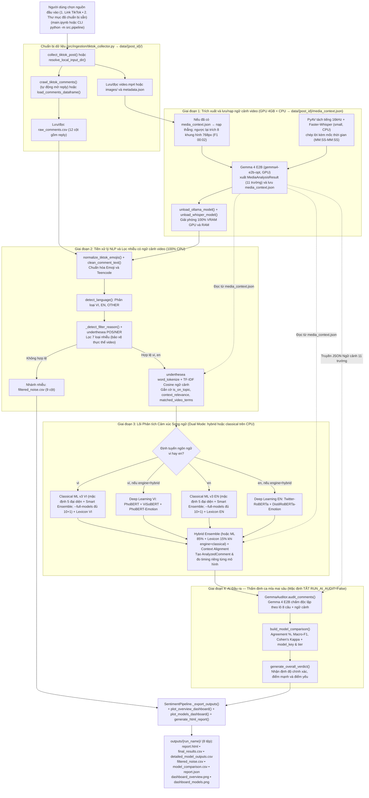

# Tài liệu Giải thích Chi tiết Cấu trúc, Cách hoạt động & Từ điển Dữ liệu Dự án

> **Đối tượng dự án:** Hệ thống Phân tích Cảm xúc Bình luận TikTok Song ngữ (`vi` / `en`) Đa phương thức (`e:\A\Sentiment-Analysis`).
> **Nguyên tắc kiến trúc cốt lõi:** Chỉ dùng mô hình AI tạo sinh (**Gemma 4 E2B**) tại **Đầu vào** (đọc ngữ cảnh video/ảnh) và **Đầu ra** (tùy chọn thẩm định thực tế & tổng kết); toàn bộ phần lõi ở giữa chạy trên CPU với **NLP (`underthesea`) + 5 họ Classical ML v3** (mặc định chạy **5 đại diện cho 5 họ + Smart Meta-Ensemble** để gọn và nhanh, hoặc `--full-models` cho đủ 10+1: `LinearSVC`/`NBSVM`/`RBF-SVM`, `NB`/`CNB`, `LR`/`Ridge`/`SGD`, `RF`/`HistGB`) + **Luật từ điển + Deep Learning (`PhoBERT`, `ViSoBERT`, `Twitter-RoBERTa`)**, hỗ trợ chuyển nhanh qua `--engine hybrid | classical`.

---

## Mục lục

- [1. Bản đồ cấu trúc toàn bộ dự án](#1-bản-đồ-cấu-trúc-toàn-bộ-dự-án)
- [2. Luồng hoạt động từ đầu đến cuối (End-to-End Flow)](#2-luồng-hoạt-động-từ-đầu-đến-cuối-end-to-end-flow)
- [3. Giải thích chi tiết từng thành phần mã nguồn (`src/`)](#3-giải-thích-chi-tiết-từng-thành-phần-mã-nguồn-src)
- [4. Từ điển dữ liệu đầu vào & mô hình lưu đệm (`data/` và `models/`)](#4-từ-điển-dữ-liệu-đầu-vào--mô-hình-lưu-đệm-data-và-models)
- [5. Từ điển dữ liệu kết quả đầu ra (`outputs/<run_name>/`)](#5-từ-điển-dữ-liệu-kết-quả-đầu-ra-outputsrun_name)
- [6. Bảng tra cứu tham số cấu hình &amp; vận hành (`main.ipynb` &amp; CLI)](#6-bảng-tra-cứu-tham-số-cấu-hình--vận-hành-mainipynb--cli)

---

## 1. Bản đồ cấu trúc toàn bộ dự án

### 1.1. Cây thư mục tổng thể

```text
e:\A\Sentiment-Analysis\
├── AI_Local/gemma4-e2b/                  # Hạ tầng AI cục bộ chạy qua Docker Ollama
│   ├── docker-compose.yml                # Cấu hình container GPU, bộ nhớ KV Cache 4GB VRAM
│   ├── Modelfile                         # Định nghĩa mô hình tùy biến `gemma4-e2b-opt`
│   └── ollama_models/                    # Lưu trữ trọng số GGUF của Gemma 4 E2B trên ổ E:
│
├── data/                                 # KHO DỮ LIỆU CHUẨN BỊ ĐẦU VÀO
│   └── <post_id>/                        # Tự động sinh theo từng link TikTok
│       ├── video.mp4 (hoặc images/)      # Video gốc tải về (hoặc bộ ảnh Photo Mode)
│       ├── metadata.json                 # Siêu dữ liệu bài đăng (caption, likes, duration...)
│       ├── raw_comments.csv              # Toàn bộ bình luận thô thu thập từ trình duyệt
│       └── media_context.json            # Nội dung video/ảnh do Whisper + Gemma 4 trích xuất (tái sử dụng cho Giai đoạn 2–3)
│
├── models/classical_ml/                  # BỘ ĐỆM MÔ HÌNH CLASSICAL ML v3 (Cache .joblib)
│   ├── vi/                               # Nhánh Tiếng Việt: 10+1 Polarity & 6+1 Emotion (5 họ ML, 3 biến thể SVM)
│   │   ├── polarity_models.joblib
│   │   ├── emotion_ml_model.joblib
│   │   └── benchmark_metrics.json
│   └── en/                               # Nhánh Tiếng Anh: 10+1 Polarity & 6+1 Emotion (5 họ ML, 3 biến thể SVM)
│       ├── polarity_models.joblib
│       ├── emotion_ml_model.joblib
│       └── benchmark_metrics.json
│
├── outputs/                              # KHO KẾT QUẢ CUỐI CÙNG SAU XỬ LÝ (8 tệp)
│   └── <run_name>/                       # Khớp mã bài đăng hoặc tên thư mục nguồn
│       ├── report.html                   # Báo cáo tương tác 1 tệp tự chứa (offline): Tổng quan, Live Pipeline Funnel, 5 họ ML + Ma trận đồng thuận, Comment X-Ray
│       ├── final_results.csv             # Bảng kết quả dễ đọc (12 cột lõi hoặc 16 cột khi bật AI Audit; tiêu đề song ngữ 2 dòng Anh–Việt, sắp theo lượt thích giảm dần)
│       ├── detailed_model_outputs.csv    # Thuộc tính kỹ thuật, ID gốc, ngữ cảnh video, xác suất & dự đoán các mô hình đang chạy (tự ẩn cột rỗng ở chế độ mặc định; 42–46 cột khi bật --full-models, +5 cột khi bật AI Audit)
│       ├── filtered_noise.csv            # 9 cột tách riêng bình luận nhiễu kèm lý do tiếng Việt (tiêu đề song ngữ 2 dòng Anh–Việt)
│       ├── model_comparison.csv          # Bảng so sánh các mô hình/nhánh kèm timing riêng từng mô hình (11 cột lõi hoặc 14 cột khi bật AI Audit)
│       ├── report.json                   # Báo cáo tổng hợp JSON gọn (pipeline_stages, ensemble_formula, benchmark rút gọn, không chứa confusion_matrix)
│       ├── dashboard_overview.png        # Biểu đồ 2x2 tổng quan khán giả (Polarity, 7 cảm xúc, Bám sát video, Từ khóa TF-IDF)
│       └── dashboard_models.png          # Biểu đồ 2x2 phân tích & giải thích 5 họ mô hình (Dự đoán theo họ, Benchmark Test Macro-F1, Tốc độ, Top Features)
│
├── src/                                  # MÃ NGUỒN CHÍNH (Package Python)
│   ├── __init__.py                       # Xuất biểu tượng (Lazy Export) cho toàn gói src (36 biểu tượng)
│   ├── ingestion/
│   │   ├── __init__.py
│   │   └── tiktok_collector.py           # Chuẩn bị dữ liệu: Tải video/ảnh & crawl bình luận TikTok
│   ├── preprocessing/
│   │   ├── __init__.py
│   │   └── text_cleaner.py               # Giai đoạn 2: Lọc nhiễu bảo vệ thực thể video, nhận diện VI/EN, underthesea, TF-IDF ngữ cảnh
│   ├── models/
│   │   ├── __init__.py
│   │   ├── media_context.py              # Giai đoạn 1: OpenCV + PyAV/Whisper + Gemma 4 E2B -> lưu/nạp media_context.json
│   │   ├── classical_ml.py               # Giai đoạn 3A: FeatureUnion (Word+Char TF-IDF + 15 Social Features), 5 họ ML (5 đại diện mặc định hoặc full 10+1) + Smart Meta-Ensemble & timing từng model
│   │   ├── sentiment_engine.py           # Giai đoạn 3B: Dual-mode Hybrid (ML v3 + PhoBERT/ViSoBERT/RoBERTa) hoặc Classical thuần (--engine classical) + Context Alignment
│   │   └── gemma_auditor.py              # Giai đoạn 4 (mặc định tắt): Gemma 4 E2B thẩm định ca mỉa mai sâu & so sánh mô hình (model_key, tier, timing riêng)
│   ├── visualization.py                  # Vẽ dashboard_overview.png, dashboard_models.png (và plot_sentiment_dashboard tương thích ngược)
│   ├── report_html.py                    # Sinh báo cáo HTML tương tác tự chứa report.html (Pipeline Funnel, 5 họ ML, Agreement Heatmap, Comment X-Ray)
│   └── pipeline.py                       # Điều phối End-to-End, ghi pipeline_stages & giao diện dòng lệnh CLI
│
├── main.ipynb                            # Notebook 6 ô chạy 1-click từ link TikTok
├── requirements.txt                      # Danh sách thư viện Python yêu cầu
├── README.md                             # Hướng dẫn cài đặt và sử dụng nhanh
└── Bao_Cao_Du_An_Sentiment_Analysis.docx # Báo cáo đồ án chuẩn học thuật Word (.docx)
```

### 1.2. Giải thích cấu hình hạ tầng AI cục bộ (`AI_Local/gemma4-e2b/`)

Hai tệp cấu hình trong `AI_Local/gemma4-e2b/` quyết định việc mô hình đa phương thức **Gemma 4 E2B** chạy ổn định trên card đồ họa laptop giới hạn **4 GB VRAM** (NVIDIA RTX 3050):

| Tệp                   | Tham số / Biến                | Giá trị                              | Ý nghĩa kỹ thuật & tác dụng thực tế                                                                                                                                                                    |
| :--------------------- | :------------------------------ | :------------------------------------- | :------------------------------------------------------------------------------------------------------------------------------------------------------------------------------------------------------------- |
| `docker-compose.yml` | `ports`                       | `"11434:11434"`                      | Mở cổng API REST chuẩn của Ollama để mã Python (`requests`) gọi tại `http://localhost:11434`.                                                                                                     |
| `docker-compose.yml` | `volumes`                     | `./ollama_models:/root/.ollama`<br>`./Modelfile:/Modelfile` | Dùng đường dẫn tương đối di động gắn thư mục trọng số `ollama_models/` và `Modelfile` trực tiếp vào container, giữ nguyên mô hình khi khởi động lại. |
| `docker-compose.yml` | `OLLAMA_FLASH_ATTENTION`      | `1`                                  | Bật thuật toán **Flash Attention**, giảm lượng VRAM tiêu thụ của phép tính Attention khi nạp chuỗi nhiều khung hình ảnh.                                                                 |
| `docker-compose.yml` | `OLLAMA_KV_CACHE_TYPE`        | `q8_0`                               | Lượng tử hóa bộ nhớ đệm ngữ cảnh (KV Cache) xuống 8-bit, giúp giảm khoảng 40% VRAM mà gần như không giảm độ chính xác.                                                                  |
| `docker-compose.yml` | `OLLAMA_MAX_LOADED_MODELS`    | `1`                                  | Chỉ cho phép nạp tối đa 1 mô hình vào VRAM tại một thời điểm, ngăn lỗi tràn bộ nhớ GPU.                                                                                                      |
| `docker-compose.yml` | `OLLAMA_KEEP_ALIVE`           | `10m`                                | Tự động giữ mô hình trên VRAM trong 10 phút giữa các batch liên tiếp ở Giai đoạn 4 để tránh nạp lại nhiều lần.                                                                           |
| `Modelfile`          | `FROM gemma4:e2b`             | `gemma4:e2b`                         | Kế thừa ảnh mô hình nền đa phương thức Gemma 4 E2B của Google.                                                                                                                                      |
| `Modelfile`          | `PARAMETER num_ctx`           | `16384`                              | Mở rộng cửa sổ ngữ cảnh từ 4.096 mặc định lên **16.384 tokens** (đủ chứa tối đa 8 khung hình video `768px` + lời thoại Whisper + Prompt), nhưng không quá lớn để làm tràn 4 GB VRAM. |
| `Modelfile`          | `PARAMETER num_gpu`           | `99`                                 | Ép đẩy toàn bộ các lớp mạng của Gemma 4 E2B lên GPU rời để đạt tốc độ suy luận cao nhất.                                                                                                   |
| `Modelfile`          | `temperature / top_p / top_k` | `1.0 / 0.95 / 64`                    | Giá trị mặc định ở cấp Modelfile; khi gọi API ở Giai đoạn 1 và Giai đoạn 4, code Python ghi đè xuống `0.10` để AI trả lời chuẩn xác theo JSON Schema.                    |

---

## 2. Luồng hoạt động từ đầu đến cuối (End-to-End Flow)

### 2.1. Sơ đồ luồng dữ liệu tổng thể



### 2.2. Chu kỳ quản lý tài nguyên (CPU ↔ GPU 4GB)

Để chạy trơn tru đồng thời **Gemma 4 E2B (VLM)**, **Faster-Whisper** và tối đa **5 mô hình Transformer (PhoBERT/RoBERTa)** trên laptop 4 GB VRAM, đường ống điều phối thứ tự tải tài nguyên theo đúng chu kỳ 3 pha:

1. **Pha 1 — Chiếm GPU (`Giai đoạn 1`, nếu có media & bật `run_media_analysis=True`):** Ollama nạp `gemma4-e2b-opt` lên GPU 4 GB để đọc tối đa 8 khung hình 768px (hoặc chạy 2-pass với slideshow dài) + transcript Whisper có mốc thời gian và sinh JSON ngữ cảnh Evidence-First. Song song đó, `faster-whisper` bản `small` chạy bằng `int8` trên **CPU**. Kết thúc pha, `unload_ollama_model()` gửi `"keep_alive": 0` để đẩy Gemma khỏi VRAM và `unload_whisper_model()` giải phóng Whisper khỏi RAM.
2. **Pha 2 — Thuần CPU (`Giai đoạn 2 & 3`):** Toàn bộ xử lý `underthesea`, trích TF-IDF, bộ mô hình Scikit-learn (`.joblib`), bộ luật từ điển và các mô hình HuggingFace (`torch`, `device="cpu"`) chạy trên RAM + CPU đa nhân. Các mô hình Transformer được **tải lười (lazy load)** theo đúng ngôn ngữ xuất hiện (ví dụ video toàn tiếng Anh sẽ không nạp 3 mô hình tiếng Việt).
3. **Pha 3 — Chiếm lại GPU (`Giai đoạn 4`, tùy chọn):** Chỉ chạy khi `run_ai_audit=True` — Ollama nạp lại `gemma4-e2b-opt` lên GPU để chấm độc lập theo từng lô 8 bình luận và viết đánh giá tổng kết. Nếu người dùng chọn tắt Giai đoạn 4 (`run_ai_audit=False` hoặc `--no-ai-audit`), pipeline bỏ qua hoàn toàn pha này.

### 2.3. Truy vết thực tế một bình luận xuyên suốt 4 giai đoạn (Data Trace)

Lấy đúng 1 bình luận thật từ lần chạy video `7709458511838612744` (`"Phim Việt thoại sảng phết 2026: Chị Chị Em Em 3 - Phần 1"`):

1. **Chuẩn bị dữ liệu (`data/7709458511838612744/raw_comments.csv` & `media_context.json`):**
   - `comment_id = "7710022854226035457"`, `username = "19036388441017tech"`, `nickname = "Babydon'tcry"`, `likes = 153`, `reply_count = 11`, `created_at = "2026-11-20 06:06:49"`.
   - `comment` gốc: `"Thời phong kiến đã có trao nhẫn cầu hôn rồi à mn lại còn trao nhẫn nữa"`.
2. **Giai đoạn 2 (`PreprocessedComment`):**
   - `detect_language` phát hiện ký tự đặc trưng tiếng Việt (`ơ, ê, à, ầ, ô, ữ`) → `language = "vi"`.
   - `clean_comment_text` thay teencode `"mn"` thành `"mọi người"` → `cleaned_text = "Thời phong kiến đã có trao nhẫn cầu hôn rồi à mọi người lại còn trao nhẫn nữa"`.
   - Kiểm tra qua 7 tầng lọc nhiễu → vượt qua hết → `is_valid = True`, `filter_reason = ""`.
   - `underthesea.word_tokenize` nối từ ghép → `segmented_text = "Thời phong_kiến đã có trao nhẫn cầu_hôn rồi à mọi người lại còn trao_nhẫn nữa"`.
   - Không trùng lặp (`is_duplicate = False`), không có emoji/cụm cà khịa (`has_sarcasm_signal = False`).
3. **Giai đoạn 3 (`AnalyzedComment`):**
   - Định tuyến vào nhánh **Tiếng Việt**:
     + `TF-IDF + NB` → `NEG`, `TF-IDF + LR` → `POS`, `TF-IDF + Linear SVM` → `POS`, `Lexicon` → `NEU`, `ViSoBERT` → `NEG`, `PhoBERT` → `POS`, `Emotion ML` → `Disgust`.
     + `PhoBERT Emotion` dự đoán → `emotion_label = "Surprise"` (`emotion_vi = "Ngạc nhiên"`, `emotion_confidence = 0.9666`).
     + Cộng trọng số Hybrid `0.40 PhoBERT + 0.20 ViSoBERT + 0.25 SVM + 0.15 Lexicon` → `score_POS = 0.5683`, `score_NEG = 0.2687`, `score_NEU = 0.1629` → `polarity_label = "POS"`, `polarity_confidence = 0.5683`.
     + `compute_polarity_score` tính `polarity_score = +0.2996`.
     + Vì `PhoBERT (POS) != ViSoBERT (NEG)` và `polarity_confidence = 0.5683 < 0.65` → gắn cờ `needs_audit = True`.
4. **Giai đoạn 4 (`GemmaAuditItem` & dòng số 2 của `outputs/7709458511838612744/final_results.csv`):**
   - Gemma 4 E2B đọc bình luận kèm ngữ cảnh video review phim phong kiến → đánh giá câu này thực chất chỉ đang nhận xét trung lập về chi tiết cốt truyện → `gemma_polarity = "NEU"`, `gemma_emotion = "Other"` (`"Trung tính / Khác"`), `gemma_is_sarcasm = False`, `gemma_agrees_polarity = False`, `gemma_agrees_emotion = False`, `gemma_reason = "Đây là một nhận xét mang tính chất suy ngẫm về cốt truyện/tình tiết."`.

---

## 3. Giải thích chi tiết từng thành phần mã nguồn (`src/`)

### 3.1. `src/__init__.py` — Cơ chế xuất biểu tượng lười (Lazy Export)

- Khai báo danh sách công khai `__all__` (**36 lớp, hàm và hằng số**, gồm thêm `generate_html_report`, `plot_overview_dashboard`, `plot_models_dashboard`) cùng từ điển ánh xạ `_EXPORT_MAP`.
- Dùng hàm `__getattr__(name)`: khi người dùng gọi `from src import SentimentPipeline`, Python mới tự động nạp đúng mô-đun con (`src.pipeline`), tránh tình trạng vừa `import src` đã phải kéo theo `torch`, `transformers`, `cv2` gây chậm khởi động.

### 3.2. `src/ingestion/tiktok_collector.py` — Chuẩn bị dữ liệu: Thu thập & Đọc dữ liệu

| Thành phần                                  | Loại                       | Vai trò & logic hoạt động                                                                                                                                                                                                                                                                                                                                                             |
| :-------------------------------------------- | :-------------------------- | :---------------------------------------------------------------------------------------------------------------------------------------------------------------------------------------------------------------------------------------------------------------------------------------------------------------------------------------------------------------------------------------- |
| `TikTokMediaBundle`                         | `dataclass` (13 trường) | Đóng gói kết quả tải về gồm `url`, `resolved_url`, `post_id`, `media_type` (`"video"` hoặc `"image"`), `media_paths`, `caption`, `hashtags`, `uploader`, `title`, `duration`, `like_count`, `comment_count`, `metadata_path`.                                                                                                                     |
| `extract_post_id(url)`                      | Hàm                        | Dùng biểu thức chính quy trích chuỗi số ID cuối URL TikTok (`/video/<id>` hoặc `/photo/<id>`).                                                                                                                                                                                                                                                          |
| `_resolve_short_url(url)`                   | Hàm nội bộ               | Gửi HTTP HEAD/GET cho các link rút gọn như `vt.tiktok.com` / `vm.tiktok.com` để lấy đường dẫn đầy đủ chứa `@username/video/<id>`.                                                                                                                                                                                                                       |
| `_build_ytdlp_options(outtmpl, has_ffmpeg)` | Hàm nội bộ               | Nếu `shutil.which("ffmpeg")` có FFmpeg, cho phép `yt-dlp` tải và ghép luồng tốt nhất (`bv*+ba/b`); nếu máy **không có FFmpeg**, ép chọn luồng MP4 ghép sẵn (`b[ext=mp4]/best[ext=mp4]/b`).                                                                                                                                                            |
| `download_tiktok_media(url, data_dir)`      | Hàm chính                 | Giải quyết short link, tạo thư mục `data/<post_id>/`, chạy `yt-dlp` tải `video.mp4`. Nếu là bài đăng trượt ảnh (Photo Mode), chạy tải 2 tầng: Tầng 1 HTTP JSON, Tầng 2 dự phòng Microsoft Edge (`/api/item/detail/` + DOM), lưu thành `slide_01.jpg`, ... vào `data/<post_id>/images/`.                                                                       |
| `collect_tiktok_post(...)`                  | Hàm chuẩn bị dữ liệu       | Điều phối tải media + thu thập comment (mặc định `include_replies=True`, `max_replies_per_comment=None`): nếu Photo Mode cần fallback sang Edge thì gộp tải ảnh + crawl comment trong **cùng 1 cửa sổ Edge**.                                                                                                                                       |
| `_expand_visible_replies(...)`              | Hàm nội bộ               | Tự động bấm nút *"Xem X câu trả lời / Xem thêm / View replies"* trên DOM (bỏ qua nút *"Ẩn / Hide / Trả lời / Reply"*), có theo dõi stall theo từng thread để không lặp vô hạn.                                                                                                                                                                         |
| `_parse_comment_items(payload)`             | Hàm nội bộ               | Đọc JSON từ `/api/comment/list/` (gồm cả `reply_comment` preview) và `/api/comment/list/reply/` để bóc `comment_id`, `is_reply`, `parent_comment_id`, `reply_to_comment_id`, `reply_to_username`, `likes`, `reply_count`, `created_at`.                                                                                                              |
| `crawl_tiktok_comments(...)`                | Hàm chính                 | Mở Microsoft Edge thật (`channel="msedge"`), tạm dừng xử lý popup/CAPTCHA nếu bật, cuộn + mở rộng reply tới khi đủ `max_comments`, ghi ra `data/<post_id>/raw_comments.csv` (12 cột).                                                                                                                                                               |
| `load_comments_dataframe(source)`           | Hàm tiện ích             | Đọc `.csv` hoặc `.json` (hỗ trợ cả tiêu đề 2 dòng xuất từ pipeline và ép kiểu `str` cho các cột ID 19 chữ số), chuẩn hóa cột `"comment"` cùng đầy đủ metadata.                                                                                                                                                 |

### 3.3. `src/models/media_context.py` — Giai đoạn 1: AI Đầu vào (Gemma 4 E2B + Whisper)

| Thành phần                                  | Loại                       | Vai trò & logic hoạt động                                                                                                                                                                                                                                                                                                                                                            |
| :-------------------------------------------- | :-------------------------- | :--------------------------------------------------------------------------------------------------------------------------------------------------------------------------------------------------------------------------------------------------------------------------------------------------------------------------------------------------------------------------------------- |
| `MEDIA_RESPONSE_SCHEMA`                     | `dict` (JSON Schema)      | Schema Evidence-First **11 trường** bắt buộc: 3 trường trích xuất bằng chứng trước (`chu_tren_man_hinh`, `dien_bien_hinh_anh`, `chi_tiet_va_luan_diem`) → `tom_tat_ngan` (cốt lõi 3–5 câu) → 7 trường phân loại (`chu_de_chinh`, `muc_dich_chinh`, `quan_diem_noi_dung`, `doi_tuong_chinh`, `sac_thai_noi_dung`, `tu_khoa`, `luu_y_danh_gia_comment`).                                  |
| `MediaAnalysisResult`                       | `dataclass` (17 trường) | Lưu toàn bộ 11 trường ngữ cảnh + thông tin kỹ thuật (`media_type`, `source_paths`, `num_frames_used`, `has_audio`, `caption`, `transcript`).                                                                                                                                                                                                      |
| `MediaAnalyzer.extract_video_frames(...)`   | Phương thức              | Bỏ 3% đầu (fade-in) & 5% cuối (outro), lấy `max_frames=8` khung hình `768px` (JPEG 90), đọc timestamp thực (`CAP_PROP_POS_MSEC`), có fallback đọc tuần tự resize ngay để chống OOM trên video VFR, và đóng dấu nhãn `F1 00:02` sau khi resize.                                                                                                               |
| `MediaAnalyzer._decode_audio_16k_mono(...)` | Phương thức              | Dùng `av` (**PyAV**) đọc luồng audio từ `.mp4` và resample sang mảng `float32` đơn kênh `16.000 Hz` trực tiếp trong RAM.                                                                                                                                                                                                                                      |
| `MediaAnalyzer.transcribe_audio(...)`       | Phương thức              | Nạp `WhisperModel("small", device="cpu", compute_type="int8")`, lọc `#hashtag`/`@mention`/URL/emoji trước khi truyền `initial_prompt`, bật `condition_on_previous_text=False`, lọc `no_speech_prob < 0.7`, xuất lời thoại kèm mốc thời gian `[MM:SS-MM:SS]`.                                                                                                  |
| `MediaAnalyzer.analyze(...)`                | Phương thức chính       | Hỗ trợ tự động **2-pass** khi bài slideshow dài hơn `max_frames` (Pass 1 đọc OCR theo lô 4 ảnh, Pass 2 tổng hợp JSON 11 trường), truyền `num_ctx=16384`, `repeat_penalty=1.1`, `temperature=0.1`.                                                                                                                                                              |
| `unload_ollama_model() / unload_whisper_model()` | Phương thức         | Đẩy Gemma 4 E2B khỏi VRAM (`keep_alive=0`) và giải phóng Faster-Whisper khỏi RAM (`gc.collect()`) ngay sau Giai đoạn 1.                                                                                                                                                                                                                                      |

### 3.4. `src/preprocessing/text_cleaner.py` — Giai đoạn 2: NLP & Lọc nhiễu song ngữ

| Thành phần                                        | Loại                       | Vai trò & logic hoạt động                                                                                                                                                                                                                                                                                                                                                                      |
| :-------------------------------------------------- | :-------------------------- | :------------------------------------------------------------------------------------------------------------------------------------------------------------------------------------------------------------------------------------------------------------------------------------------------------------------------------------------------------------------------------------------------- |
| `PreprocessedComment`                             | `dataclass` (13 trường) | Chứa `original_text`, `cleaned_text`, `segmented_text`, `ml_text`, `tokens`, `language` (`vi` \| `en` \| `other`), `is_valid`, `filter_reason`, `is_duplicate`, `has_sarcasm_signal`, `matched_video_terms`, `context_relevance`, `is_on_topic`.                                                                                                                     |
| `normalize_tiktok_emojis(text)`                   | Hàm                        | Chuyển hơn 25 mã emoji chữ của TikTok như `[Cười chảy nước mắt]`, `[Khóc]`, `[Yêu]`, `[Phẫn nộ]` về đúng ký tự Unicode (`😂`, `😭`, `😍`, `😡`).                                                                                                                                                                                                              |
| `detect_language(text)`                           | Hàm 4 tầng                | 1) Có chữ ngoài Latin (Nga, Trung, Nhật, Hàn, Ả Rập...) → `other`; 2) Có từ chức năng/ký tự riêng Tây Ban Nha/Bồ Đào Nha/Pháp nhưng thiếu dấu riêng tiếng Việt → `other`; 3) Có dấu riêng Việt (`ă, â, đ, ê, ô, ơ, ư`, thanh hỏi/ngã/nặng...) hoặc ≥ 2 từ chức năng Việt → `vi`; 4) Chữ ASCII / có từ chức năng tiếng Anh → `en`. |
| `clean_comment_text(...)`                         | Hàm                        | Chuẩn hóa Unicode NFKC, xóa khoảng trắng thừa; với tiếng Việt thay thế hơn 40 từ **teencode an toàn** (`ko`/`k` → `không`, `dc`/`đc` → `được`, `mn` → `mọi người`, `tr` → `trời`...) và chủ động giữ nguyên các từ dễ gây hiểu nhầm (`bt`, `v`, `t`).                                                                        |
| `_safe_word_tokenize / _safe_pos_tag / _safe_ner` | Hàm bọc `underthesea`   | Gọi thư viện `underthesea` cho tiếng Việt (`word_tokenize(..., format="text")` để nối từ ghép bằng `_`), với tiếng Anh tách từ đơn giản giữ lại nguyên âm và emoji.                                                                                                                                                                                                   |
| `_is_name_only_comment(...)`                      | Hàm                        | Dùng `pos_tag` (`Np`) và `ner` (`PER`) kiểm tra xem toàn bộ câu có phải chỉ là tên người hay không. Có 3 lá chắn chống lọc nhầm: bỏ qua chuỗi viết hoa toàn bộ (`ALL-CAPS` như `"HOLY TRANSITION"`), yêu cầu ít nhất 2 từ chữ cái, và kiểm tra không chứa từ ngữ cảm xúc theo token nguyên vẹn.                                             |
| `_detect_filter_reason(...)`                      | Hàm                        | Quyết định mã lọc: `FILTERED_EMPTY`, `FILTERED_UNSUPPORTED_LANG`, `FILTERED_URL_OR_SYMBOL`, `FILTERED_TAG_FRIEND`, `FILTERED_NAME_ONLY`, `FILTERED_SPAM_AD`, `FILTERED_MEANINGLESS`, hoặc `""` (hợp lệ).                                                                                                                                                                         |
| `_has_sarcasm_signal(...)`                        | Hàm                        | Gắn `True` nếu phát hiện dấu hiệu nói mỉa như `cười muốn bịnh`, `cười xỉu`, `diễn sâu`, `hề hước`, hoặc từ khen đi kèm emoji `😂`/`🤣`/`🙄`/`🤡`.                                                                                                                                                                                                       |
| `TextPreprocessor.process_batch(comments)`        | Phương thức              | Xử lý hàng loạt tất cả bình luận, chuẩn hóa và đánh dấu cờ trùng lặp `is_duplicate` (không phân biệt chữ hoa/thường sau khi đã thấy bản đầu tiên).                                                                                                                                                                                                                 |
| `extract_keywords_tfidf(...)`                     | Hàm                        | Dùng `TfidfVectorizer(ngram_range=(1, 2))` trên tập `ml_text` (đã loại stopword song ngữ Việt–Anh) để lấy Top 10 từ khóa cho 3 nhóm: `overall`, `positive`, `negative`.                                                                                                                                                                                                   |

### 3.5. `src/models/classical_ml.py` — Giai đoạn 3A: Classical ML v3 (5 họ thuật toán + OOF Meta-Ensemble) & Từ điển song ngữ

| Thành phần | Loại | Vai trò & logic hoạt động |
| :--- | :--- | :--- |
| `BilingualLexiconScorer` | Lớp luật & từ điển | Chấm điểm cảm xúc dựa trên từ điển dương/âm riêng cho `vi` và `en`, xử lý tăng/giảm cường độ (`±2` từ: ×`1.35` / ×`0.70`), phủ định (`2` từ trước, hỗ trợ `"chứ không"` / `"no more"`), quy đổi qua hàm mũ `exp(...)` về `{POS, NEG, NEU}`. |
| `CORE_POLARITY_MODEL_KEYS` / `CORE_EMOTION_MODEL_KEYS` & `*_META` | Hằng số cấu hình | Định nghĩa **5 đại diện cho 5 họ Polarity** (`tfidf_cnb`, `tfidf_lr`, `tfidf_svm`, `tfidf_rf`, `tfidf_tree` + `ml_ensemble`), **3 đại diện Emotion** (`emo_cnb`, `emo_lr`, `emo_svm` + `emo_ensemble`), và metadata `POLARITY_MODEL_META` / `EMOTION_MODEL_META` (`display_name`, `short_name`, `family`, `family_vi`, `family_color`, `desc_vi`). |
| `_SocialLexiconFeatureTransformer` & `_SVDSocialFeatureExtractor` | Bộ trích xuất đặc trưng | Tạo **3 nhánh song song**: **Word TF-IDF (`1–3 n-gram`, `max_features=35000`)**, **Char-WB TF-IDF (`3–5 n-gram`, `max_features=30000`)**, và **15 Social/Lexicon Features** (độ dài, viết hoa, `!`, `?`, emoji cười/buồn/giận, từ khóa cảm xúc, độ lệch từ điển). Nhánh Tree & RBF-SVM dùng `TruncatedSVD(96)` nối trực tiếp với **15 Social Features nguyên bản** để không bị nén mờ. |
| `_load_vi_corpora() / _load_en_corpora()` | Hàm tải dữ liệu | Tải CSV/Parquet trực tiếp không cần `datasets`/`pyarrow`: Polarity VI (`uit_vsfc` + `vietnamese-SA-dataset`), Polarity EN (`cardiffnlp/tweeteval`), Emotion VI (`UIT-VSMEC`), Emotion EN (`dair-ai/emotion` ánh xạ về 7 lớp VSMEC). |
| `_LanguageMLBundle` (`ML_BUNDLE_SCHEMA_VERSION = 3`) | Lớp per-language | Huấn luyện & chọn lọc hyperparameter cho **10 mô hình Polarity thuộc 5 họ** (`MultinomialNB`, `ComplementNB(norm=False)`, `LogisticRegression`, `RidgeClassifier` + softmax calibration, `SGDClassifier(log_loss)`, `LinearSVC`, `NBSVM`, `Subsampled Calibrated RBF-SVM`, `RandomForest`, `HistGradientBoosting`), **Smart OOF Meta-Ensemble** (`oof_stacking_lr` hoặc `top4_weighted_soft_vote` / `top4_uniform_soft_vote`), và **6 mô hình ML Emotion** + **Emotion Soft-Vote Ensemble**. Khi suy luận (`full_models=False`), tự động chỉ chạy nhóm đại diện `CORE_*` + các nhánh phụ thuộc của `ml_ensemble` (bỏ `tfidf_rbf_svm` chậm/yếu và `tfidf_nb` dư thừa) và đo `last_polarity_timings` / `last_emotion_timings` riêng từng mô hình. |
| `ClassicalMLSuite` | Lớp tổng hợp | Cung cấp `ensure_loaded(lang)`, `predict_polarity_all(texts, languages, full_models=False)`, `predict_emotion_all(texts, languages, full_models=False)` tự định tuyến từng câu về `_LanguageMLBundle("vi")` hoặc `_LanguageMLBundle("en")` và tổng hợp `last_polarity_timings` / `last_emotion_timings`; hỗ trợ chạy CLI độc lập `python -m src.models.classical_ml --lang vi en --retrain`. |

### 3.6. `src/models/sentiment_engine.py` — Giai đoạn 3B: Dual-Mode (`hybrid` / `classical`), Học sâu & Context Alignment

| Thành phần | Chi tiết xử lý |
| :--- | :--- |
| `AnalyzedComment` (`dataclass`) | Lưu toàn bộ metadata, tiền xử lý, kết quả chính (`polarity_*`, `emotion_*`), ngữ cảnh video (`is_on_topic`, `context_relevance`, `matched_video_terms`, `context_alignment`), nhãn dự đoán riêng của các mô hình Classical ML v3 + Lexicon, Deep Learning (`pred_phobert`, `pred_visobert`, `pred_roberta`), và Emotion ML. |
| `CommentAnalyzer(engine_mode="hybrid" \| "classical", full_models=False)` | - **Chế độ `hybrid` (mặc định):** Kết hợp Transformer (`PhoBERT`, `ViSoBERT`, `Twitter-RoBERTa`, `PhoBERT-Emotion`, `DistilRoBERTa-Emotion`) với `ML Meta-Ensemble v3` và `Lexicon`. Khi `full_models=False`, bỏ qua không chạy thừa nhánh `ML Emotion` (vì kết quả cảm xúc dùng DL).<br>- **Chế độ `classical`:** Bỏ qua hoàn toàn `torch`/`transformers` (0% Deep Learning), dùng trực tiếp **`0.85 * ML_Ensemble + 0.15 * Lexicon`** cho Polarity và **`ML_Emotion_Ensemble`** cho Emotion; bổ sung `_has_strong_emotion_cue()` để chuyển bình luận `en` có `polarity_label == "NEU"` và `emotion_confidence < 0.72` (không có cue cảm xúc mạnh) về `"Other"` nhằm giảm gán nhầm sang `Anger`. |
| Trọng số `Ensemble` (`_ensemble_formula_info()`) | - **Hybrid (`vi`):** `0.40 * PhoBERT + 0.20 * ViSoBERT + 0.25 * ML_Ensemble_VI + 0.15 * Lexicon_VI`<br>- **Hybrid (`en`):** `0.60 * Twitter-RoBERTa + 0.25 * ML_Ensemble_EN + 0.15 * Lexicon_EN`<br>- **Classical (`vi` & `en`):** `0.85 * ML_Ensemble + 0.15 * Lexicon` |
| `compute_polarity_score(...)` | Quy đổi xác suất cuối thành điểm liên tục `[-1.0, +1.0]` nhất quán với `polarity_label` (`NEG` trong `[-1.0, -0.21]`, `POS` trong `[+0.21, +1.0]`, `NEU` trong `[-0.19, +0.19]`), có cộng `nudge` cảm xúc. |
| Đồng bộ `Emotion–Polarity` & `needs_audit` | Nếu `emotion_label ∈ {Anger, Disgust, Fear}` (`conf >= 0.55`) VÀ `Lexicon(NEG) >= 0.50` → cộng `+0.25` vào `NEG`, nhân `0.65` vào `POS` rồi chuẩn hóa. Đánh dấu `needs_audit = True` nếu mô hình chính bất đồng (`ViSoBERT != PhoBERT` ở Hybrid, hoặc bất đồng giữa `ML_Ensemble` và `LR`/`SVM`/`NBSVM`), `polarity_confidence < 0.65`, hoặc `has_sarcasm_signal == True`. |
| `CommentAnalyzer.summarize(...)` | Tổng hợp thống kê toàn bài (`engine_mode`, `full_models`, `ensemble_formula`, `language_counts`, `polarity_*`, `emotion_*`, `avg_polarity_score`, `avg_confidence`, `overall_tendency`, `on_topic_summary`, `top_examples`, `model_timings_sec`). Dùng `_compact_benchmark_metrics()` để rút gọn `classical_ml_benchmark` (loại bỏ `confusion_matrix` và `per_class`, chỉ giữ điểm tổng hợp, `top_features["polarity"]` top 8 và đường dẫn `benchmark_file`). |

### 3.7. `src/models/gemma_auditor.py` — Giai đoạn 4: AI Đầu ra (Thẩm định & Đối chiếu)

- **`GemmaAuditItem` (`dataclass`, 9 trường):** Chứa kết quả thẩm định độc lập của Gemma cho từng bình luận (`comment_index`, `gemma_audited`, `gemma_polarity`, `gemma_emotion`, `gemma_emotion_vi`, `gemma_is_sarcasm`, `gemma_agrees_polarity`, `gemma_agrees_emotion`, `gemma_reason`).
- **`_format_video_context(media_result)`:** Đóng gói ngữ cảnh video từ Giai đoạn 1 thành văn bản ngắn gọn đưa vào đầu mỗi batch gửi Gemma chấm bình luận.
- **`GemmaAuditor.audit_comments(...)`:** Chia bình luận hợp lệ (toàn bộ `all` hoặc chỉ `uncertain`, có thể giới hạn `audit_limit`) thành từng lô `chunk_size = 8`, gọi `/api/chat` (`temperature=0.1`, ép `BATCH_AUDIT_SCHEMA`), chuẩn hóa mỉa mai qua `_normalize_gemma_polarity()`.
- **`build_model_comparison(analyzed, audits, timings, full_models=False)`:** Gắn `model_key` và `tier` (`base` | `ensemble` | `system` | `reference`), lấy **`inference_time_sec` đo riêng từng mô hình** từ `timings["ml_model_timings_sec"]` / `ml_emo_model_timings_sec`. Khi `full_models=False` (mặc định): xuất **5 đại diện của 5 họ ML + `Classical ML Meta-Ensemble` + `Bilingual Lexicon + Rules` + (DL nếu Hybrid) + `Hệ thống chính`**, và nhánh Emotion gồm 3 đại diện + `ML Emotion Meta-Ensemble` + Hệ thống chính (ở `classical`, tổng **13 dòng** chưa bật Audit) hoặc chỉ DL Emotion (ở `hybrid`). Khi `full_models=True`: xuất đủ **10+1 Polarity** và **6+1 Emotion** (tổng **21 dòng** ở `classical`, **22–24 dòng** ở `hybrid` khi chưa bật Audit). Nếu có Gemma Audit, tính thêm `Agreement (%)`, `Macro-F1` và `Cohen's Kappa`.
- **`GemmaAuditor.generate_overall_verdict(...)`:** Gửi bảng tổng hợp đối chiếu để Gemma 4 E2B sinh JSON theo `VERDICT_SCHEMA` gồm `accuracy_verdict`, `best_model`, `strengths`, `weaknesses`, và `summary_vi`.

### 3.8. `src/visualization.py`, `src/report_html.py` & `src/pipeline.py`

- **`src/visualization.py`:** Tách thành 2 biểu đồ 2×2 chuyên biệt (kèm giữ `plot_sentiment_dashboard()` để tương thích ngược, đã sửa lỗi cắt số ở viền phải và legend che cột):
  + **`plot_overview_dashboard(report, save_path)` (`dashboard_overview.png`):** Sắc thái Polarity (Hệ thống vs Gemma nếu có), 7 cung bậc cảm xúc (kèm SL & `%`), Bám sát nội dung video (`On-topic` vs `Off-topic`), và Top từ khóa TF-IDF (`POS` xanh ↔ `NEG` đỏ).
  + **`plot_models_dashboard(report, save_path)` (`dashboard_models.png`):** Phân bố dự đoán (hoặc Agreement/F1 vs Gemma) nhóm theo `[Họ mô hình]` tách tầng Cơ sở / Ensemble bằng đường kẻ ngang, Benchmark Macro-F1 trên tập Test chuẩn (`vi`/`en`), Tốc độ suy luận riêng từng mô hình (`ms`/`s`), và Giải thích mô hình (Top Features `POS` ↔ `NEG`).
- **`src/report_html.py` (`generate_html_report()`):** Sinh báo cáo HTML tương tác 1 tệp tự chứa (**100% offline**, CSS + Vanilla JS inline) gồm 4 khu vực:
  1. **Tổng quan & Ngữ cảnh Video** (KPI cards, chủ đề, thực thể, tóm tắt & kết luận Gemma).
  2. **Cách Hệ thống Chạy (Live Pipeline Funnel)** hiển thị trạng thái & thời gian của `pipeline_stages` (`GĐ 0` → `GĐ 4`), chi tiết lọc nhiễu và công thức `ensemble_formula`.
  3. **Biểu diễn 5 Họ Mô hình & Giải thích** gồm thẻ giải thích từng họ, bảng so sánh theo tầng, **Ma trận đồng thuận (`_compute_agreement_matrix`)**, Top Features & Top từ khóa.
  4. **Comment X-Ray Explorer** nhúng dữ liệu JSON bình luận (phân trang 25 dòng, tìm kiếm & lọc nhanh `Ca khó`, `Mỉa mai`, `Mô hình bất đồng`, `Bám sát video`), bấm mở từng bình luận để xem quá trình tiền xử lý và phiếu bầu từng mô hình.
- **`SentimentPipeline` (`src/pipeline.py`):** Điều phối khép kín theo `--engine hybrid | classical` và `--full-models` (cùng `--retrain-ml`), ghi lại `pipeline_stages` + `total_duration_sec`, in bảng `TIẾN TRÌNH 4 GIAI ĐOẠN`, xuất **8 tệp** ra `outputs/<run_name>/` (`report.html`, `final_results.csv`, `detailed_model_outputs.csv`, `filtered_noise.csv`, `model_comparison.csv`, `report.json`, `dashboard_overview.png`, `dashboard_models.png`).

---

## 4. Từ điển dữ liệu đầu vào & mô hình lưu đệm (`data/` và `models/`)

### 4.1. `data/<post_id>/metadata.json` — Giải thích đủ 13 thuộc tính

| STT | Tên thuộc tính | Kiểu                 | Ý nghĩa & Nguồn tạo                                                                                                                                |
| :-- | :---------------- | :-------------------- | :----------------------------------------------------------------------------------------------------------------------------------------------------- |
| 1   | `url`           | `str`               | Đường dẫn TikTok gốc người dùng truyền vào.                                                                                                  |
| 2   | `resolved_url`  | `str`               | Đường dẫn đầy đủ sau khi giải mã short link (`vt.tiktok.com` → `www.tiktok.com/@user/video/...`).                                       |
| 3   | `post_id`       | `str`               | Mã định danh duy nhất của bài đăng TikTok (ví dụ `"7709458511838612744"`), dùng làm tên thư mục trong cả `data/` và `outputs/`. |
| 4   | `media_type`    | `str`               | Loại nội dung: `"video"` (bài đăng video) hoặc `"images"` (bài đăng trượt ảnh Photo Mode).                                             |
| 5   | `media_paths`   | `list[str]`         | Danh sách đường dẫn tới tệp video (`video.mp4`) hoặc các ảnh đã tải về.                                                                |
| 6   | `caption`       | `str`               | Nội dung mô tả bài đăng lấy từ trường `description` của `yt-dlp` (hoặc DOM trang web ở Photo Mode).                                   |
| 7   | `hashtags`      | `list[str]`         | Danh sách các hashtag `#...` trích xuất từ `caption` qua `extract_hashtags()`.                                                              |
| 8   | `uploader`      | `str`               | Tên định danh (`handle` / `uploader_id`) của chủ kênh đăng video (ví dụ `"ducreaction"`).                                              |
| 9   | `title`         | `str`               | Tiêu đề bài đăng trên TikTok (do `yt-dlp` trích xuất).                                                                                      |
| 10  | `duration`      | `float` \| `null` | Thời lượng video tính bằng giây (`245.0` giây; `null` nếu là bài đăng ảnh).                                                           |
| 11  | `like_count`    | `int`               | Tổng số lượt tim (likes) của bài đăng tại thời điểm thu thập.                                                                             |
| 12  | `comment_count` | `int`               | Tổng số lượng bình luận hiển thị công khai của bài đăng.                                                                                  |
| 13  | `metadata_path` | `str`               | Đường dẫn lưu chính tệp `metadata.json` này.                                                                                                 |

### 4.2. `data/<post_id>/raw_comments.csv` — Giải thích đủ 12 cột (gồm cả bình luận trả lời)

| STT | Tên cột               | Kiểu   | Ví dụ thực tế                                  | Ý nghĩa                                                                                                              |
| :-- | :---------------------- | :------ | :------------------------------------------------- | :--------------------------------------------------------------------------------------------------------------------- |
| 1   | `comment`             | `str` | `"ê làm sao mà D có được cái giọng..."` | Nội dung nguyên văn của bình luận thu thập từ TikTok (chưa qua lọc hay chuẩn hóa).                         |
| 2   | `comment_id`          | `str` | `"7709509346682979093"`                          | Mã định danh duy nhất của bình luận trên hệ thống TikTok (`cid`), lưu dưới dạng chuỗi tránh sai số float. |
| 3   | `is_reply`            | `bool` | `False` / `True`                                | Đánh dấu `True` nếu đây là bình luận trả lời (reply) dưới một bình luận khác.                               |
| 4   | `parent_comment_id`   | `str` | `"7709509346682979093"`                          | Mã `comment_id` của bình luận gốc (rỗng nếu là bình luận chính).                                              |
| 5   | `reply_to_comment_id` | `str` | `"7709510000000000001"`                          | Mã `comment_id` của bình luận con được trả lời trực tiếp (nếu reply lồng cấp 2+).                              |
| 6   | `reply_to_username`   | `str` | `"flaycnn"`                                      | Tài khoản được nhắc/trả lời trong nhánh reply (nếu có).                                                            |
| 7   | `username`            | `str` | `"flaycnn"`                                      | Tên tài khoản (`unique_id`) của người bình luận.                                                             |
| 8   | `nickname`            | `str` | `"mây trời lơ ngơ ☁️"`                     | Tên hiển thị của người bình luận.                                                                              |
| 9   | `likes`               | `int` | `3230`                                           | Số lượt thích (tim) của bình luận, dùng để sắp xếp các bình luận tiêu biểu (`top_examples`).        |
| 10  | `reply_count`         | `int` | `16`                                             | Số lượng phản hồi con dưới bình luận này.                                                                    |
| 11  | `created_at`          | `str` | `"2026-11-18 20:54:06"`                          | Thời điểm đăng bình luận đã quy đổi từ Unix timestamp sang định dạng `YYYY-MM-DD HH:MM:SS`.           |
| 12  | `post_url`            | `str` | `"https://www.tiktok.com/@ducreaction/..."`      | Đường dẫn bài đăng TikTok nơi thu thập bình luận.                                                           |

### 4.3. Kho đệm mô hình Học máy cổ điển (`models/classical_ml/{vi,en}/`)

Mỗi thư mục ngôn ngữ (`vi/` và `en/`) chứa 3 tệp chuẩn **schema v3** (`ML_BUNDLE_SCHEMA_VERSION = 3`) được sinh tự động ở lần chạy đầu tiên (hoặc huấn luyện lại bằng `--retrain-ml` / `python -m src.models.classical_ml --retrain`) và tái sử dụng ngay trong `< 1–2` giây ở các lần chạy sau:

- **`polarity_models.joblib`**: Lưu `schema_version = 3`, bộ trích xuất đặc trưng 3 nhánh (`word 1–3`, `char_wb 3–5`, `15 Social/Lexicon Features` + `TruncatedSVD(96)`), **10 mô hình Polarity đã tuning hyperparameter** (`tfidf_nb`, `tfidf_cnb`, `tfidf_lr`, `tfidf_ridge`, `tfidf_sgd`, `tfidf_svm`, `tfidf_nbsvm`, `tfidf_rbf_svm`, `tfidf_rf`, `tfidf_tree`) và **OOF Meta-Ensemble** (`ml_ensemble`) kèm `ensemble_strategy`.
- **`emotion_ml_model.joblib`**: Lưu bộ trích xuất đặc trưng cảm xúc cùng **6 mô hình phân loại 7 cung bậc cảm xúc** (`emo_cnb`, `emo_lr`, `emo_ridge`, `emo_svm`, `emo_nbsvm`, `emo_sgd`) tạo thành **Emotion Soft-Vote Ensemble** (`emo_ensemble`).
- **`benchmark_metrics.json`**: Ghi lại `schema_version`, `polarity_train_size`, `polarity_test_size`, `oof_pool`, `ensemble_strategy`, `polarity_models` (`accuracy`, `macro_f1`, `best_params` cho đủ 10 mô hình + `ml_ensemble`), `emotion_train_size`, `emotion_test_size`, và `emotion_models` (`emo_cnb`..`emo_sgd`, `emo_ensemble`).

---

## 5. Từ điển dữ liệu kết quả đầu ra (`outputs/<run_name>/`)

Để người đọc vừa dễ theo dõi kết quả chính vừa tra cứu được toàn bộ thông số kỹ thuật/mô hình, toàn bộ **4 tệp CSV** đầu ra đều dùng **tiêu đề song ngữ 2 dòng** theo chuẩn `english_key\n(mô tả tiếng việt)` (tương thích 100% với hàm `load_comments_dataframe()` nhờ cơ chế tách dòng đầu tiên), đồng bộ thứ tự dòng 1–1 qua `stt` và sắp xếp ổn định theo `likes` giảm dần:

- **`final_results.csv`**: Bảng kết quả dễ đọc cho người xem/báo cáo (**12 cột lõi** hoặc **16 cột** khi bật AI Audit) — đưa **Nội dung bình luận** và **Kết quả cảm xúc** lên ngay bên trái.
- **`detailed_model_outputs.csv`**: Toàn bộ **ID gốc, thuộc tính tiền xử lý, ngữ cảnh video, xác suất và dự đoán từng mô hình** (tối đa **46 cột lõi** ở chế độ `hybrid`, **42 cột lõi** ở chế độ `classical` khi bật `--full-models`; ở chế độ mặc định `full_models=False`, tự động ẩn các cột `pred_*` / `pred_emo_*` rỗng để bảng gọn chỉ còn các mô hình thực chạy; +5 cột nếu bật AI Audit).
- **`filtered_noise.csv`**: Tách riêng bình luận nhiễu/ngôn ngữ không hỗ trợ (**9 cột**), sắp theo `likes` giảm dần.
- **`model_comparison.csv`**: Bảng so sánh toàn diện các mô hình/nhánh (**11 cột lõi** hoặc **14 cột** khi bật AI Audit). Ở chế độ mặc định (`full_models=False`): **13 dòng** ở `--engine classical` (8 Polarity + 5 Emotion), **9–12 dòng** ở `--engine hybrid`; khi bật `--full-models`: **21 dòng** ở `--engine classical`, **22–24 dòng** ở `--engine hybrid` khi chưa bật Audit.
- **`report.json`**: Tệp tổng hợp gọn nhẹ (**11 khóa gốc**, có `pipeline_stages`, `ensemble_formula` và `classical_ml_benchmark` rút gọn).
- **`dashboard_overview.png` & `dashboard_models.png`**: 2 bảng biểu đồ 2×2 tách biệt cho phần **Tổng quan Khán giả** và **Phân tích & Giải thích 5 Họ Mô hình**.
- **`report.html`**: Báo cáo tương tác 1 tệp tự chứa (offline) hiển thị trực quan luồng 4 giai đoạn, thẻ 5 họ mô hình, ma trận đồng thuận và trình khám phá **Comment X-Ray**.

---

### 5.1. `final_results.csv` — Bảng kết quả dễ đọc (12 cột lõi + 4 cột AI Audit)

Tệp `final_results.csv` chỉ chứa các **bình luận sạch hợp lệ thuộc Tiếng Việt (`vi`) hoặc Tiếng Anh (`en`)**, sắp theo `likes` giảm dần (`_sort_rows_by_likes_desc()`). Nếu tắt Giai đoạn 4 (`run_ai_audit=False`), 4 cột AI Audit (`gemma_polarity_vi` .. `gemma_reason`) được tự động ẩn đi.

| STT | Tên cột song ngữ trong CSV (`dòng 1 / dòng 2`) | Kiểu | Nguồn / Mô hình | Ý nghĩa & Tóm tắt cách tạo |
| :-: | :--- | :--- | :--- | :--- |
| 1 | `stt` / `(số thứ tự)` | `int` | `pipeline.py` | Số thứ tự `1..N` sau khi sắp xếp theo `likes` giảm dần, **khớp 1–1** với cột `stt` trong `detailed_model_outputs.csv`. |
| 2 | `original_text` / `(nội dung bình luận)` | `str` | `raw_comments.csv` | Nội dung bình luận nguyên văn ban đầu trước khi chuẩn hóa/tách từ. |
| 3 | `polarity_vi` / `(sắc thái)` | `str` | **Hybrid Ensemble** (`sentiment_engine.py`) | Nhãn sắc thái tiếng Việt cuối cùng (`Tích cực` / `Trung tính` / `Tiêu cực`), ánh xạ từ `polarity_label` qua `LABEL_VI_MAP`. |
| 4 | `polarity_confidence` / `(độ tự tin sắc thái %)` | `str` | **Hybrid Ensemble** (`sentiment_engine.py`) | Xác suất lớn nhất trong 3 lớp `{POS, NEG, NEU}` sau tổ hợp Hybrid + đồng bộ Emotion–Polarity, định dạng `f"{val*100:.1f}%"` (ví dụ `67.9%`). |
| 5 | `emotion_vi` / `(cảm xúc)` | `str` | **PhoBERT-Emotion** (`vi`) / **DistilRoBERTa-Emotion** (`en`) + `_apply_emotion_cues()` | Tên tiếng Việt của 1 trong 7 cung bậc cảm xúc (ánh xạ từ `emotion_label` qua `EMOTION_VI_MAP`). |
| 6 | `emotion_confidence` / `(độ tự tin cảm xúc %)` | `str` | Mô hình Emotion DL + `_apply_emotion_cues()` | Xác suất của cung bậc cảm xúc chiếm ưu thế sau cộng điểm chỉ báo từ khóa và chuẩn hóa, định dạng `f"{val*100:.1f}%"`. |
| *7* | `gemma_polarity_vi` / `(sắc thái gemma)` | `str` | **Gemma 4 E2B** (`gemma_auditor.py`) | Nhãn sắc thái tiếng Việt do Gemma 4 E2B chấm độc lập theo ngữ cảnh video *(ẩn nếu tắt Audit)*. |
| *8* | `gemma_emotion_vi` / `(cảm xúc gemma)` | `str` | **Gemma 4 E2B** (`gemma_auditor.py`) | Tên 1 trong 7 cảm xúc tiếng Việt do Gemma 4 E2B chấm *(ẩn nếu tắt Audit)*. |
| *9* | `gemma_is_sarcasm` / `(nói mỉa theo gemma)` | `str` | **Gemma 4 E2B** (`gemma_auditor.py`) | `Có` hoặc `Không` cho biết bình luận có nói mỉa/ẩn ý sâu hay không *(ẩn nếu tắt Audit)*. |
| *10* | `gemma_reason` / `(lý do gemma giải thích)` | `str` | **Gemma 4 E2B** (`gemma_auditor.py`) | Giải thích ngắn gọn 1 câu bằng tiếng Việt của Gemma 4 E2B *(ẩn nếu tắt Audit)*. |
| 7 *(11)* | `likes` / `(lượt thích)` | `int` | `raw_comments.csv` | Số lượt tim nguyên (`_safe_int`), dùng làm khóa sắp xếp giảm dần ổn định (`sorted(..., reverse=True)`). |
| 8 *(12)* | `comment_type` / `(loại bình luận)` | `str` | `raw_comments.csv` | `"Trả lời"` nếu `is_reply == True`, ngược lại `"Bình luận chính"`. |
| 9 *(13)* | `username` / `(tài khoản)` | `str` | `raw_comments.csv` | Tên định danh tài khoản (`@handle`) của người viết bình luận. |
| 10 *(14)* | `language` / `(ngôn ngữ)` | `str` | `detect_language()` | `"Tiếng Việt"` (`vi`) hoặc `"Tiếng Anh"` (`en`), ánh xạ qua `_LANG_VI_MAP`. |
| 11 *(15)* | `created_at` / `(thời gian đăng)` | `str` | `raw_comments.csv` | Thời gian đăng bình luận định dạng `YYYY-MM-DD HH:MM:SS`. |
| 12 *(16)* | `reply_count` / `(số phản hồi)` | `int` | `raw_comments.csv` | Số lượng câu trả lời con dưới bình luận gốc (`_safe_int`). |

#### Chi tiết công thức tính các cột chính trong `final_results.csv`

1. **Cách tính `polarity_vi` (`Sắc thái`) và `polarity_confidence` (`Độ tự tin sắc thái %`):**
   - **Bước 1 — Tổ hợp xác suất có trọng số (`Hybrid` hoặc `Classical`)** cho từng lớp $c \in \{\text{POS}, \text{NEG}, \text{NEU}\}$ tùy theo `--engine` và ngôn ngữ:
     - **Chế độ `hybrid` — Nhánh Tiếng Việt (`language == "vi"`):**

       $$
       P_{\text{raw}}(c) = 0.40 \cdot P_{\text{PhoBERT}}(c) + 0.20 \cdot P_{\text{ViSoBERT}}(c) + 0.25 \cdot P_{\text{ML\_Ensemble\_VI}}(c) + 0.15 \cdot P_{\text{Lexicon\_VI}}(c)
       $$

       *(Trong đó `PhoBERT` và `ML_Ensemble_VI` chạy trên `segmented_text`, `ViSoBERT` chạy trên `cleaned_text`, `Lexicon_VI` kết hợp cả `segmented_text` và `cleaned_text`.)*
     - **Chế độ `hybrid` — Nhánh Tiếng Anh (`language == "en"`):**

       $$
       P_{\text{raw}}(c) = 0.60 \cdot P_{\text{Twitter-RoBERTa}}(c) + 0.25 \cdot P_{\text{ML\_Ensemble\_EN}}(c) + 0.15 \cdot P_{\text{Lexicon\_EN}}(c)
       $$

     - **Chế độ `classical` (`vi` & `en` — 0% Deep Learning):**

       $$
       P_{\text{raw}}(c) = 0.85 \cdot P_{\text{ML\_Ensemble}}(c) + 0.15 \cdot P_{\text{Lexicon}}(c)
       $$

   - **Bước 2 — Cơ chế đồng bộ `Emotion–Polarity`:**
     - Nếu `emotion_label` thuộc $\{\text{Anger}, \text{Disgust}, \text{Fear}\}$ **với** `emotion_confidence >= 0.55` **và** $P_{\text{Lexicon}}(\text{NEG}) \ge 0.50$:

       $$
       P_{\text{raw}}(\text{NEG}) \leftarrow P_{\text{raw}}(\text{NEG}) + 0.25, \qquad P_{\text{raw}}(\text{POS}) \leftarrow P_{\text{raw}}(\text{POS}) \times 0.65
       $$

   - **Bước 3 — Chuẩn hóa tổng xác suất về $1.0$ và chọn nhãn cuối:**

     $$
     P_{\text{final}}(c) = \text{round}\left(\frac{P_{\text{raw}}(c)}{P_{\text{raw}}(\text{POS}) + P_{\text{raw}}(\text{NEG}) + P_{\text{raw}}(\text{NEU})},\; 4\right)
     $$

     - `polarity_label = argmax_c P_final(c)`, rồi ánh xạ qua `LABEL_VI_MAP` (`POS → "Tích cực"`, `NEG → "Tiêu cực"`, `NEU → "Trung tính"`) thành `polarity_vi`.
     - `polarity_confidence = round(P_final(polarity_label), 4)`, hiển thị trong CSV dưới dạng `f"{polarity_confidence * 100:.1f}%"`.

2. **Cách tính `emotion_vi` (`Cảm xúc`) và `emotion_confidence` (`Độ tự tin cảm xúc %`):**
   - **Bước 1 — Phân phối xác suất gốc:**
     - **Chế độ `hybrid`:** Chạy `visolex/phobert-emotion` (`vi` trên `segmented_text`) hoặc `j-hartmann/emotion-english-distilroberta-base` (`en` trên `cleaned_text`).
     - **Chế độ `classical`:** Dùng **Emotion Soft-Vote Ensemble** (trung bình xác suất từ 6 mô hình Classical ML Emotion v3 đã khớp trên `UIT-VSMEC` cho `vi` / `dair-ai/emotion` cho `en`).
   - **Bước 2 — Tăng cường từ khóa chỉ báo (`_apply_emotion_cues()` trên `cleaned_text.lower()`):**
     - Nếu chứa từ khóa `_ANGER_CUES` (`"tức quá"`, `"bực mình"`, `"furious"`, ...): cộng `+0.25` vào `Anger`.
     - Nếu chứa `_DISGUST_CUES` (`"mắc ói"`, `"vô duyên"`, `"disgusting"`, `"cringe"`, ...): cộng `+0.25` vào `Disgust`.
     - Nếu chứa `_FEAR_CUES` (`"sợ quá"`, `"lo lắng"`, `"scared"`, `"terrified"`, ...): cộng `+0.30` vào `Fear`.
     - Nếu chứa `_SADNESS_CUES` (`"buồn quá"`, `"thất vọng"`, `"heartbroken"`, ...): cộng `+0.20` vào `Sadness`.
     - Nếu chứa `_JOY_CUES` (`"vui quá"`, `"tuyệt vời"`, `"peak"`, `"fire"`, `"smooth"`, ...): cộng `+0.15` vào `Enjoyment`.
   - **Bước 3 — Chuẩn hóa & xuất kết quả:**

     $$
     P_{\text{emo}}(e) = \text{round}\left(\frac{P_{\text{boosted}}(e)}{\sum_{k \in \text{7 nhãn}} P_{\text{boosted}}(k)},\; 4\right)
     $$

     - `emotion_label = argmax_e P_emo(e)` → ánh xạ `EMOTION_VI_MAP` thành `emotion_vi`; `emotion_confidence = round(P_emo(emotion_label), 4)` hiển thị dạng `%`.

3. **Cách tính 4 cột Gemma Audit (khi bật `RUN_AI_AUDIT = True`):**
   - **Ngữ cảnh đầu vào:** `_format_video_context(media_result)` ghép 6 trường ngữ cảnh (`chu_de_chinh`, `muc_dich_chinh`, `quan_diem_noi_dung`, `doi_tuong_chinh`, `sac_thai_noi_dung`, `tom_tat_ngan`) + tối đa 5 ý `chi_tiet_va_luan_diem` + `luu_y_danh_gia_comment`.
   - **Chấm theo lô:** `GemmaAuditor.audit_comments()` chia bình luận thành từng lô `batch_size = 8`, gọi `gemma4-e2b-opt` (`temperature=0.1`, ép `BATCH_AUDIT_SCHEMA`, tự chia đôi lô đệ quy nếu lỗi/thiếu `id`).
   - **Quy tắc chuẩn hóa mỉa mai (`_normalize_gemma_polarity`):** Nếu Gemma gắn `gemma_is_sarcasm = True` mà nhãn thô vẫn là `"POS"`, hệ thống tự động ép `gemma_polarity` về `"NEG"` trước khi dịch sang `gemma_polarity_vi`.

4. **Cách xác định `language` (`detect_language()`, 5 bước):**
   - Bước 1: Bỏ `@mention`, URL, `#hashtag`; nếu tỷ lệ chữ cái phi-Latin (Trung, Nhật, Hàn, Nga, Thái, Ả Rập...) `>= 0.35` → `"other"`.
   - Bước 2: Nếu có ký tự thuần Việt (`ă, đ, ơ, ư`, thanh hỏi/ngã/nặng, dấu kép) → `"vi"`.
   - Bước 3: Nếu có ký tự Latin ngoại ngữ hoặc Pinyin (`ñ, ¿, ¡, ç, ß, ä, ö, ü, ā, ē, ī, ō, ū, ǎ, ě, ǐ, ǒ, ǔ...`) hoặc mẫu Bồ Đào Nha (`-ão/-ões/-ães`, `kkkk+`) → `"other"`.
   - Bước 4: Đếm từ khóa ngoại ngữ Latin (`_OTHER_LATIN_STOPWORDS`); nếu áp đảo tiếng Anh và từ không dấu tiếng Việt (`_VI_UNACCENTED_WORDS`) → `"other"`.
   - Bước 5: Khi còn dấu Latin dùng chung (`á, é, ó, ê, ô, à...`), chỉ nhận `"vi"` nếu `_has_vietnamese_diacritic_word()` xác nhận đúng hình thái âm tiết Tiếng Việt (`<= 7` ký tự, không chứa `f, j, w, z` hay tổ hợp phụ âm ngoại lai); phần còn lại so sánh `_VI_UNACCENTED_WORDS` vs `_EN_SIGNAL_WORDS` (chuỗi thuần ASCII mặc định `"en"`).

---

### 5.2. `detailed_model_outputs.csv` — Toàn bộ thông số kỹ thuật, ngữ cảnh video, xác suất & dự đoán từng mô hình

Tệp `detailed_model_outputs.csv` giữ lại toàn bộ thông số kỹ thuật (tối đa **46 cột lõi** ở chế độ `hybrid` hoặc **42 cột lõi** ở chế độ `classical` khi bật `--full-models`, +5 cột khi bật AI Audit; ở chế độ mặc định `full_models=False`, `build_detailed_model_outputs_df()` tự động ẩn các cột `pred_*` / `pred_emo_*` không chạy hoặc rỗng toàn bảng như `pred_nb`, `pred_rbf_svm`, cũng như ẩn `pred_phobert`/`pred_visobert` nếu chỉ có `en`, ẩn `pred_roberta` nếu chỉ có `vi`, và ẩn toàn bộ cột `pred_emo_*` / `emotion_ml_label` khi chạy `hybrid` mặc định), đồng bộ thứ tự dòng 1–1 với `final_results.csv` theo cột `stt`.

#### Bảng chi tiết các cột (theo đúng thứ tự cột trong file)

| STT | Tên cột song ngữ (`dòng 1 / dòng 2`) | Kiểu | Giai đoạn | Định nghĩa & Công thức / Nguồn tạo |
| :-: | :--- | :--- | :--- | :--- |
| 1 | `stt` / `(số thứ tự)` | `int` | Xuất CSV | Thứ tự `1..N` sau khi sắp giảm dần theo `likes`, khớp 1–1 với `final_results.csv`. |
| 2 | `comment_id` / `(mã bình luận)` | `str` | Thu thập | ID 19 chữ số duy nhất của bình luận trên TikTok (`raw_comments.csv`). |
| 3 | `parent_comment_id` / `(mã bình luận gốc)` | `str` | Thu thập | ID của bình luận gốc nếu là reply (rỗng nếu là bình luận chính). |
| 4 | `username` / `(tài khoản)` | `str` | Thu thập | Tên tài khoản `@handle` của người bình luận. |
| 5 | `nickname` / `(tên hiển thị)` | `str` | Thu thập | Tên hiển thị đầy đủ trên TikTok (có thể chứa emoji/ký tự đặc biệt). |
| 6 | `likes` / `(lượt thích)` | `int` | Thu thập | Số lượt thích nguyên của bình luận. |
| 7 | `language` / `(ngôn ngữ)` | `str` | GĐ 2 | Ngôn ngữ bình luận (`Tiếng Việt` / `Tiếng Anh`), giúp đối chiếu trực tiếp mô hình đã dùng. |
| 8 | `original_text` / `(nội dung gốc)` | `str` | Thu thập | Nguyên văn bình luận thu thập từ TikTok. |
| 9 | `cleaned_text` / `(nội dung đã làm sạch)` | `str` | GĐ 2 | Chuỗi sau chuẩn hóa emoji TikTok, xóa URL, rút gọn ký tự lặp, thay `TEENCODE_MAP` (nếu `vi`), và xóa `@mention` (`analysis_clean`). |
| 10 | `segmented_text` / `(văn bản đã tách từ)` | `str` | GĐ 2 | Chuỗi token nối bằng khoảng trắng: `underthesea.word_tokenize(..., format="text")` cho `vi` (từ ghép nối bằng `_`), regex `[A-Za-z0-9']+\|[^\w\s]` cho `en`. |
| 11 | `is_duplicate` / `(bình luận trùng lặp)` | `bool` | GĐ 2 | `True` nếu `analysis_clean.lower()` (gom khoảng trắng) đã xuất hiện ở bình luận hợp lệ trước đó. |
| 12 | `has_sarcasm_signal` / `(dấu hiệu mỉa mai)` | `bool` | GĐ 2 | `True` nếu `(có emoji/cụm cười ∧ có từ tiêu cực)` **hoặc** `(có cụm đặt trong ngoặc kép ≥ 4 ký tự ∧ có emoji cười)`. |
| 13 | `needs_audit` / `(cần thẩm định kỹ)` | `bool` | GĐ 3 | Cờ đánh dấu ca khó/nghi ngờ mỉa mai cần ưu tiên Giai đoạn 4 kiểm tra. |
| 14 | `is_on_topic` / `(bám sát chủ đề video)` | `bool` | GĐ 2 | `True` nếu `len(matched_video_terms) > 0` **hoặc** `context_relevance >= 0.12`. |
| 15 | `context_relevance` / `(độ liên quan video 0-1)` | `float` | GĐ 2 | Điểm độ liên quan ngữ cảnh video trong `[0.0, 1.0]` từ TF-IDF Cosine Similarity + thưởng từ khóa khớp. |
| 16 | `matched_video_terms` / `(từ khóa video khớp)` | `str` | GĐ 2 | Danh sách các thực thể/từ khóa của video xuất hiện trong bình luận, ghép bằng `", "`. |
| 17 | `context_alignment` / `(liên hệ với nội dung video)` | `str` | GĐ 3 | Nhãn mô tả mối liên hệ thái độ của bình luận với nội dung video (1 trong 9 nhánh quy tắc). |
| 18 | `polarity_label` / `(nhãn sắc thái chuẩn)` | `str` | GĐ 3 | Nhãn cực tính chuẩn tiếng Anh (`POS` / `NEU` / `NEG`) = `argmax(score_POS, score_NEG, score_NEU)`. |
| 19 | `polarity_score` / `(điểm cực tính -1 đến +1)` | `float` | GĐ 3 | Điểm cực tính liên tục trong `[-1.0, +1.0]` từ `compute_polarity_score()`. |
| 20 | `score_POS` / `(xác suất tích cực)` | `float` | GĐ 3 | Xác suất lớp Tích cực $P_{\text{hybrid}}(\text{POS})$ (làm tròn 4 chữ số thập phân). |
| 21 | `score_NEG` / `(xác suất tiêu cực)` | `float` | GĐ 3 | Xác suất lớp Tiêu cực $P_{\text{hybrid}}(\text{NEG})$ (làm tròn 4 chữ số thập phân). |
| 22 | `score_NEU` / `(xác suất trung tính)` | `float` | GĐ 3 | Xác suất lớp Trung tính $P_{\text{hybrid}}(\text{NEU})$ (làm tròn 4 chữ số thập phân). |
| 23 | `emotion_label` / `(nhãn cảm xúc chuẩn)` | `str` | GĐ 3 | Nhãn tiếng Anh 1 trong 7 cảm xúc (`Anger`, `Sadness`, `Fear`, `Enjoyment`, `Disgust`, `Surprise`, `Other`). |
| 24 | `pred_nb` / `(dự đoán naive bayes)` | `str` | GĐ 3A | Nhãn riêng của **TF-IDF + Multinomial Naive Bayes**. |
| 25 | `pred_cnb` / `(dự đoán complement nb)` | `str` | GĐ 3A | Nhãn riêng của **TF-IDF + Complement Naive Bayes (`norm=False`)**. |
| 26 | `pred_lr` / `(dự đoán logistic regression)` | `str` | GĐ 3A | Nhãn riêng của **TF-IDF + Logistic Regression**. |
| 27 | `pred_ridge` / `(dự đoán ridge classifier)` | `str` | GĐ 3A | Nhãn riêng của **TF-IDF + Ridge Classifier** (hiệu chỉnh xác suất softmax). |
| 28 | `pred_sgd` / `(dự đoán sgd classifier)` | `str` | GĐ 3A | Nhãn riêng của **TF-IDF + SGD Classifier (`log_loss`)**. |
| 29 | `pred_svm` / `(dự đoán linear svm)` | `str` | GĐ 3A | Nhãn riêng của **TF-IDF + Calibrated LinearSVC**. |
| 30 | `pred_nbsvm` / `(dự đoán nbsvm)` | `str` | GĐ 3A | Nhãn riêng của **NBSVM** (Log-Count Ratio Naive Bayes + Linear SVM). |
| 31 | `pred_rbf_svm` / `(dự đoán rbf svm)` | `str` | GĐ 3A | Nhãn riêng của **SVD + Social RBF-SVM** (Calibrated Kernel SVC). |
| 32 | `pred_rf` / `(dự đoán random forest)` | `str` | GĐ 3A | Nhãn riêng của **SVD + Social Random Forest**. |
| 33 | `pred_tree` / `(dự đoán hist gradient boosting)` | `str` | GĐ 3A | Nhãn riêng của **SVD + Social HistGradientBoosting**. |
| 34 | `pred_ml_ensemble` / `(dự đoán ml ensemble)` | `str` | GĐ 3A | Nhãn tổng hợp của **Classical ML Meta-Ensemble v3** (`oof_stacking_lr` / soft-vote). |
| 35 | `pred_lexicon` / `(dự đoán từ điển luật)` | `str` | GĐ 3A | Nhãn riêng của **BilingualLexiconScorer** (từ điển song ngữ + luật phủ định/cường độ). |
| 36 | `dl_primary_model` / `(mô hình học sâu sử dụng)` | `str` | GĐ 3B | Tên mô hình Deep Learning chủ lực (`PhoBERT` hoặc `Twitter-RoBERTa`; tự ẩn khi `--engine classical`). |
| 37 | `pred_phobert` / `(dự đoán phobert - vi)` | `str` | GĐ 3B | Nhãn riêng của **PhoBERT** cho `vi` (`—` với dòng `en`; tự ẩn khi không có `vi` hoặc `--engine classical`). |
| 38 | `pred_visobert` / `(dự đoán visobert - vi)` | `str` | GĐ 3B | Nhãn riêng của **ViSoBERT** cho `vi` (`—` với dòng `en`; tự ẩn khi không có `vi` hoặc `--engine classical`). |
| 39 | `pred_roberta` / `(dự đoán twitter-roberta - en)` | `str` | GĐ 3B | Nhãn riêng của **Twitter-RoBERTa** cho `en` (`—` với dòng `vi`; tự ẩn khi không có `en` hoặc `--engine classical`). |
| 40 | `emotion_ml_label` / `(cảm xúc ml ensemble)` | `str` | GĐ 3A | Nhãn 7 cảm xúc tổng hợp từ **Emotion Soft-Vote Ensemble** (6 mô hình ML Emotion). |
| 41 | `pred_emo_cnb` / `(cảm xúc complement nb)` | `str` | GĐ 3A | Nhãn 7 cảm xúc riêng của **Emotion ComplementNB**. |
| 42 | `pred_emo_lr` / `(cảm xúc logistic regression)` | `str` | GĐ 3A | Nhãn 7 cảm xúc riêng của **Emotion Logistic Regression**. |
| 43 | `pred_emo_ridge` / `(cảm xúc ridge classifier)` | `str` | GĐ 3A | Nhãn 7 cảm xúc riêng của **Emotion Ridge Classifier**. |
| 44 | `pred_emo_svm` / `(cảm xúc linear svm)` | `str` | GĐ 3A | Nhãn 7 cảm xúc riêng của **Emotion LinearSVC**. |
| 45 | `pred_emo_nbsvm` / `(cảm xúc nbsvm)` | `str` | GĐ 3A | Nhãn 7 cảm xúc riêng của **Emotion NBSVM**. |
| 46 | `pred_emo_sgd` / `(cảm xúc sgd classifier)` | `str` | GĐ 3A | Nhãn 7 cảm xúc riêng của **Emotion SGD Classifier**. |
| *47* | `gemma_audited` / `(đã thẩm định gemma)` | `bool` | GĐ 4 | `True` nếu bình luận này đã được Gemma 4 E2B chấm thành công *(ẩn nếu tắt Audit)*. |
| *48* | `gemma_polarity` / `(nhãn sắc thái gemma)` | `str` | GĐ 4 | Nhãn chuẩn `POS`/`NEU`/`NEG` của Gemma 4 E2B *(ẩn nếu tắt Audit)*. |
| *49* | `gemma_emotion` / `(nhãn cảm xúc gemma)` | `str` | GĐ 4 | Nhãn chuẩn 1 trong 7 cảm xúc tiếng Anh của Gemma 4 E2B *(ẩn nếu tắt Audit)*. |
| *50* | `gemma_agrees_polarity` / `(khớp sắc thái với gemma)` | `bool` | GĐ 4 | Kết quả phép so sánh `gemma_polarity == polarity_label` *(ẩn nếu tắt Audit)*. |
| *51* | `gemma_agrees_emotion` / `(khớp cảm xúc với gemma)` | `bool` | GĐ 4 | Kết quả phép so sánh `gemma_emotion == emotion_label` *(ẩn nếu tắt Audit)*. |

#### Chi tiết công thức tính từng nhóm cột trong `detailed_model_outputs.csv`

1. **Nhóm Tiền xử lý & Cờ phát hiện (`cleaned_text`, `has_sarcasm_signal`, `needs_audit`):**
   - **Quy trình tạo `cleaned_text` (`clean_comment_text()` + `process_one()`):**
     1. `normalize_tiktok_emojis()`: thay >25 mã chữ dạng `[Cười chảy nước mắt]` → `😂`, `[Khóc]` → `😭`...
     2. Xóa URL (`https://...`, `www....`, `vt.tiktok.com/...`).
     3. Rút gọn ký tự lặp liên tiếp $\ge 4$ lần về 2 ký tự (regex `(.)\1{3,}` → `\1\1`, ví dụ `"đỉnhhhhh"` → `"đỉnhhh"` — giữ nét biểu cảm nhưng tránh vỡ từ điển).
     4. Nếu `language == "vi"`: thay thế >40 từ teencode an toàn trong `TEENCODE_MAP` (`ko/k/hk/khum → không`, `dc/đc → được`, `mn → mọi người`, ...; giữ nguyên `"bt"`, `"v"`, `"t"` để tránh thay nhầm từ đa nghĩa).
     5. Cuối cùng ở `process_one()`, xóa `@mention` và gom khoảng trắng thành chuỗi `analysis_clean` (dùng để tạo `cleaned_text`, `segmented_text`, `is_duplicate`, và đối chiếu ngữ cảnh).
   - **Công thức `has_sarcasm_signal`:**

     $$
     \text{has\_sarcasm\_signal} = (\text{has\_laugh} \land \text{has\_neg\_word}) \lor (\text{has\_quote} \land \text{has\_laugh})
     $$

     Trong đó `has_laugh` khớp `[😂🤣😆🤡]|:\)\)+|=+\)+`; `has_neg_word` kiểm 32 từ khóa tiêu cực/cà khịa (`ghét`, `vô duyên`, `cảm lạnh`, `cringe`, `mid`...); `has_quote` khớp cụm từ dài $\ge 4$ ký tự đặt trong `"..."` hoặc `“...”`.
   - **Công thức `needs_audit` (4 điều kiện OR):**

     $$
     \text{needs\_audit} = (\text{pred\_visobert} \ne \text{rỗng} \land \text{pred\_phobert} \ne \text{pred\_visobert}) \lor (\text{polarity\_confidence} < 0.65) \lor \text{has\_sarcasm\_signal} \lor \text{extra\_needs\_audit}
     $$

2. **Nhóm Ngữ cảnh Video (`matched_video_terms`, `context_relevance`, `is_on_topic`, `context_alignment`):**
   - **Bước 1 — Trích xuất hồ sơ ngữ cảnh (`_extract_media_context_profile()` từ `media_context.json`):**
     - Lấy `doi_tuong_chinh` và `tu_khoa`, tách cả cụm ngoài ngoặc và trong ngoặc đơn (ví dụ `"Các cường quốc (Mỹ, Châu Âu)"` → `"Các cường quốc"`, `"Mỹ"`, `"Châu Âu"`), bỏ stopword → tạo danh sách `terms` (và tập viết thường `protected_terms`).
     - Xây dựng **2 văn bản tham chiếu** đã loại bỏ URL, hashtag `#`, nhãn `[MM:SS-MM:SS]` và stopword (`_build_context_bow_doc()`):
       + `reference_doc`: ghép `chu_de_chinh` + `tom_tat_ngan` + `quan_diem_noi_dung` + `caption` + `doi_tuong_chinh` + `tu_khoa` + `chi_tiet_va_luan_diem` + `chu_tren_man_hinh` + tối đa `1.500` ký tự đầu của `transcript`.
       + `media_text_doc`: ghép riêng `caption` + tối đa `1.500` ký tự đầu của `transcript` gốc *(giúp bắt chính xác bình luận tiếng Anh trên video tiếng Anh ngay cả khi phần tóm tắt của Gemma viết bằng tiếng Việt)*.
   - **Bước 2 — Tính `matched_video_terms`:** tìm các phần tử trong `terms` xuất hiện nguyên vẹn trong `cleaned_text` theo ranh giới từ `(?<!\w)term(?!\w)` (không phân biệt hoa/thường).
   - **Bước 3 — Tính `context_relevance` và `is_on_topic` (`_score_context_relevance()`):**
     - Dùng `TfidfVectorizer(token_pattern=r"(?u)\b[\w']{2,}\b", ngram_range=(1, 2), sublinear_tf=True, min_df=1)` biến đổi cùng lúc `[reference_doc, media_text_doc, *valid_docs]`.
     - Tính độ tương đồng Cosine giữa từng bình luận $d_i$ với cả 2 văn bản tham chiếu và lấy giá trị lớn nhất:

       $$
       \text{cos\_sim}_i = \max\Big(\cos(d_i, \text{reference\_doc}),\; \cos(d_i, \text{media\_text\_doc})\Big)
       $$

     - Cộng điểm thưởng khớp thực thể/từ khóa video:

       $$
       \text{term\_bonus}_i = \min\Big(0.60,\; 0.25 \times |\text{matched\_video\_terms}_i|\Big)
       $$

     - Tính điểm liên quan cuối cùng trong `[0.0, 1.0]`:

       $$
       \text{context\_relevance}_i = \text{round}\Big(\text{clip}(1.8 \times \text{cos\_sim}_i + \text{term\_bonus}_i,\; 0.0,\; 1.0),\; 4\Big)
       $$

     - Gắn cờ chủ đề:

       $$
       \text{is\_on\_topic}_i = (|\text{matched\_video\_terms}_i| > 0) \lor (\text{context\_relevance}_i \ge 0.12)
       $$

   - **Bước 4 — Phân 9 nhánh `context_alignment` & cờ `extra_needs_audit` (`_compute_context_alignment()`):**
     *(Nếu không có `media_context.json`, trả về `""`, `extra_needs_audit=False`; hệ thống dùng regex `_AGREEMENT_CUE_PATTERN` cho từ đồng tình như `"đúng rồi"`, `"chuẩn"`, `"facts"`, `"agree"` và `_DISAGREEMENT_CUE_PATTERN` cho từ phản bác như `"vô lý"`, `"lấp liếm"`, `"disagree"`, `"nonsense"`, `"fake"`; kiểm tra video có chủ đề tranh luận qua `_CONTROVERSY_MARKERS`.)*

     | Điều kiện nhánh | Giá trị `context_alignment` | Kích hoạt `extra_needs_audit` |
     | :--- | :--- | :---: |
     | `has_sarcasm_signal == True` | `"Nghi ngờ mỉa mai / Cần AI kiểm tra ngữ cảnh"` | `True` |
     | `not is_on_topic` và `POS` và có từ đồng tình | `"Ủng hộ / Tích cực với video"` | `False` |
     | `not is_on_topic` và `NEG` và có từ phản bác | `"Phản bác / Tiêu cực với video"` | `False` |
     | `not is_on_topic` (các trường hợp còn lại) | `"Ít liên quan / Bình luận ngoài lề"` | `False` |
     | `is_on_topic` và `POS` và có từ phản bác | `"Nghi ngờ mỉa mai / Phản bác (cần AI kiểm tra)"` | `True` |
     | `is_on_topic` và `POS` (không có từ phản bác) | `"Ủng hộ / Tích cực với nội dung video"` | `False` |
     | `is_on_topic` và `NEG` và có từ phản bác | `"Phản bác / Chỉ trích nội dung video"` | `False` |
     | `is_on_topic` và `NEG` và (có từ đồng tình **hoặc** video thuộc chủ đề tranh luận) | `"Bức xúc / Tiêu cực về chủ đề video (cần xét đồng tình hay công kích)"` | `True` |
     | `is_on_topic` và `NEG` (còn lại) | `"Tiêu cực đối với nội dung video"` | `False` |
     | `is_on_topic` và `NEU` và `polarity_confidence < 0.70` | `"Thảo luận trung lập về chủ đề video (cần kiểm tra ẩn ý)"` | `True` |
     | `is_on_topic` và `NEU` và `polarity_confidence >= 0.70` | `"Thảo luận trung lập về chủ đề video"` | `False` |

3. **Công thức `polarity_score` (`Điểm cực tính liên tục [-1.0, +1.0]` — `compute_polarity_score()`):**
   - **Bước 1 — Tính độ hích cảm xúc (`nudge`):**

     $$
     \text{nudge} = \begin{cases} -0.08 \cdot \text{emo\_conf} & \text{nếu } \text{emotion\_label} \in \{\text{Anger}, \text{Disgust}\} \land \text{emo\_conf} \ge 0.5 \\ -0.04 \cdot \text{emo\_conf} & \text{nếu } \text{emotion\_label} \in \{\text{Sadness}, \text{Fear}\} \land \text{emo\_conf} \ge 0.5 \\ +0.06 \cdot \text{emo\_conf} & \text{nếu } \text{emotion\_label} = \text{Enjoyment} \land \text{emo\_conf} \ge 0.5 \\ 0.0 & \text{trường hợp còn lại} \end{cases}
     $$

   - **Bước 2 — Tính giá trị thô & khóa vùng nhất quán tuyệt đối với `polarity_label`:**

     $$
     \text{raw} = \text{score\_POS} - \text{score\_NEG} + \text{nudge}
     $$

     $$
     \text{polarity\_score} = \text{round}\!\left(\begin{cases} \text{clip}(\min(\text{raw},\; -0.21),\; -1.0,\; -0.21) & \text{nếu } \text{polarity\_label} = \text{NEG} \\ \text{clip}(\max(\text{raw},\; +0.21),\; +0.21,\; +1.0) & \text{nếu } \text{polarity\_label} = \text{POS} \\ \text{clip}(\text{raw} \cdot (1.0 - 0.5 \cdot \text{score\_NEU}),\; -0.19,\; +0.19) & \text{nếu } \text{polarity\_label} = \text{NEU} \end{cases},\; 4\right)
     $$

     *(Đảm bảo bình luận `NEG` luôn `< 0`, `POS` luôn `> 0`, và `NEU` luôn nằm gọn gần `0` trong `[-0.19, +0.19]`.)*

4. **Cách tính của các mô hình đơn lẻ (`pred_nb` .. `pred_emo_sgd`):**
   - **10 mô hình Polarity & 6 mô hình Emotion Classical ML v3:**
     - Dùng bộ trích xuất **Word TF-IDF (`1–3`)** + **Char-WB TF-IDF (`3–5`)** + **15 Social/Lexicon Features** (`_SocialLexiconFeatureTransformer`). Nhánh Tree (`RandomForest`, `HistGradientBoosting`) và `RBF-SVM` dùng **TruncatedSVD (96 chiều) + 15 Social Features nguyên bản** (`_SVDSocialFeatureExtractor`).
     - 10 mô hình Polarity được chọn siêu tham số qua validation split (`MultinomialNB`, `ComplementNB(norm=False)`, `LogisticRegression`, `RidgeClassifier`, `SGDClassifier`, `LinearSVC`, `NBSVM`, `Subsampled Calibrated RBF-SVM`, `RandomForest`, `HistGradientBoosting`) và kết hợp thành **Smart OOF Meta-Ensemble** (`oof_stacking_lr` hoặc top-4 soft vote). 6 mô hình Emotion (`ComplementNB`, `LogisticRegression`, `RidgeClassifier`, `LinearSVC`, `NBSVM`, `SGDClassifier`) được soft-vote thành `emotion_ml_label`.
   - **Mô hình `BilingualLexiconScorer` (`pred_lexicon`):**
     - Quét từng token trong từ điển `_VI_*_LEXICON` (hoặc `_EN_*_LEXICON` kèm chuẩn hóa kéo dài chữ cái như `peakkkk → peakk / peak`).
     - Nhân hệ số cường độ trong cửa sổ $\pm 2$ từ lân cận: từ tăng mạnh (`quá`, `rất`, `freaking`...) nhân `1.35`; từ giảm nhẹ (`hơi`, `slightly`...) nhân `0.70`.
     - Kiểm tra từ phủ định trong cửa sổ `2` từ đứng trước (bỏ qua đảo dấu từ âm nếu câu Việt có cụm leo thang `"chứ không"`, `"chứ ko"`, `"không chỉ"`, `"hơn cả"`):
       + Với `vi`: từ dương bị phủ định $\rightarrow \text{neg\_sum} += 0.9 \cdot \text{val}$; từ âm bị phủ định $\rightarrow \text{pos\_sum} += 0.4 \cdot \text{val}$.
       + Với `en`: từ dương bị phủ định (hoặc `"love"` khi có `"no more"`) $\rightarrow \text{neg\_sum} += 0.85 \cdot \text{val}$; từ âm bị phủ định $\rightarrow \text{pos\_sum} += 0.45 \cdot \text{val}$.
     - Quy đổi thành phân bố xác suất `{POS, NEG, NEU}` rồi lấy `argmax`:
       + Nếu $\text{pos\_sum} + \text{neg\_sum} < 0.15$: trả mặc định `{"POS": 0.15, "NEG": 0.15, "NEU": 0.70}`.
       + Ngược lại:

         $$
         r_{\text{POS}} = e^{\min(6.0,\; 1.15 \cdot \text{pos\_sum})},\quad r_{\text{NEG}} = e^{\min(6.0,\; 1.15 \cdot \text{neg\_sum})},\quad r_{\text{NEU}} = e^{\max(0.0,\; 1.2 - 0.35|\text{pos\_sum}-\text{neg\_sum}|)}
         $$

         $$
         P_{\text{lex}}(c) = \text{round}\left(\frac{r_c}{r_{\text{POS}} + r_{\text{NEG}} + r_{\text{NEU}}},\; 4\right)
         $$
   - **Các mô hình Deep Learning Polarity (`pred_phobert`, `pred_visobert`, `pred_roberta`):**
     - Chạy trên CPU (`batch_size=32`, `max_length=256`, `torch.inference_mode()`), tính `Softmax(logits)` rồi chọn `argmax`:
     - `pred_phobert`: `wonrax/phobert-base-vietnamese-sentiment` (input `segmented_text`), chỉ suy luận khi `language == "vi"`.
     - `pred_visobert`: `5CD-AI/Vietnamese-Sentiment-visobert` (input `cleaned_text`), chỉ suy luận khi `language == "vi"`.
     - `pred_roberta`: `cardiffnlp/twitter-roberta-base-sentiment-latest` (input `cleaned_text`), chỉ suy luận khi `language == "en"`.

---

### 5.3. `filtered_noise.csv` — Bình luận nhiễu bị lọc bỏ (9 cột, tiêu đề song ngữ)

Tệp này tách riêng toàn bộ bình luận không đưa vào phân tích cảm xúc (sắp theo `likes` giảm dần) để người dùng kiểm chứng lý do lọc:

| STT | Tên cột song ngữ (`dòng 1 / dòng 2`) | Kiểu | Ý nghĩa & Nguồn tạo |
| :-: | :--- | :--- | :--- |
| 1 | `stt` / `(số thứ tự)` | `int` | Thứ tự `1..M` sau khi sắp giảm dần theo `likes`. |
| 2 | `original_text` / `(nội dung gốc)` | `str` | Nguyên văn bình luận bị loại khỏi phân tích. |
| 3 | `filter_reason_vi` / `(lý do lọc)` | `str` | Giải thích thân thiện bằng tiếng Việt ánh xạ từ `FILTER_REASON_VI_MAP`. |
| 4 | `filter_reason` / `(mã lý do lọc)` | `str` | Mã chuẩn kỹ thuật (`FILTERED_*`) sinh bởi `_detect_filter_reason()`. |
| 5 | `language` / `(ngôn ngữ)` | `str` | `"Tiếng Việt"`, `"Tiếng Anh"`, hoặc `"Ngôn ngữ khác"` (qua `_LANG_VI_MAP`). |
| 6 | `likes` / `(lượt thích)` | `int` | Số lượt thích của bình luận bị lọc. |
| 7 | `username` / `(tài khoản)` | `str` | Tài khoản `@handle` của người viết. |
| 8 | `nickname` / `(tên hiển thị)` | `str` | Tên hiển thị của người viết. |
| 9 | `comment_id` / `(mã bình luận)` | `str` | Mã định danh bình luận gốc trên TikTok. |

**Thứ tự ưu tiên kiểm tra 7 tầng lọc trong `_detect_filter_reason()`** *(kèm cơ chế bảo vệ thực thể video `protected_terms` lấy từ `doi_tuong_chinh` & `tu_khoa` của `media_context.json`)*:

1. `FILTERED_EMPTY`: Chuỗi gốc rỗng hoặc chỉ toàn khoảng trắng.
2. `FILTERED_URL_OR_SYMBOL`: Sau khi xóa URL & `#hashtag`, phần còn lại rỗng, chỉ có chữ số/dấu câu/emoji (`_PURE_PUNCT_OR_EMOJI_PATTERN`), hoặc `cleaned_text` không chứa chữ cái nào.
3. `FILTERED_TAG_FRIEND`: Bình luận có `@mention` mà sau khi bỏ `@...` và từ gọi bạn bè (`_FRIEND_CALL_WORDS`: `ơi, nè, xem, bro, look...`) không còn từ chữ cái nào; hoặc bắt đầu bằng `@` và phần còn lại $\le 2$ từ không thuộc `_OPINION_OR_EMOTION_MARKERS`.
4. `FILTERED_SPAM_AD`: Khớp một trong 10 biểu thức quảng cáo/seeding (`_SPAM_AD_PATTERNS`: `"vào shop em"`, `"inbox tư vấn"`, `"nhắn zalo"`, `"tuyển ctv/sỉ"`, `"giỏ hàng góc trái"`, `"săn sale"`, số điện thoại `03/05/07/08/09xxxxxxxx`).
5. `FILTERED_UNSUPPORTED_LANG`: `detect_language()` trả về `"other"` (ngoài Tiếng Việt và Tiếng Anh).
6. `FILTERED_MEANINGLESS`: Câu $\le 2$ từ đều nằm trong `_MEANINGLESS_TOKENS` (`fyp`, `xuhuong`, `tem`, `first`, `hóng`, `chấm`, `up`, `ib`...). **Lá chắn thực thể:** Bỏ qua tầng lọc này nếu bình luận nhắc đúng thực thể trọng tâm trong `protected_terms`.
7. `FILTERED_NAME_ONLY`: Kiểm tra bởi `_is_name_only_comment()`: bình luận $\le 4$ từ, không viết IN HOA toàn bộ (`ALL-CAPS`), không thuộc `protected_terms`, không chứa từ cảm xúc (`_OPINION_OR_EMOTION_MARKERS`), và khi `language == "vi"` có ít nhất 2 từ đều được `underthesea.ner`/`pos_tag` gắn nhãn tên riêng (`PER` hoặc `Np`) với ít nhất 1 từ viết hoa chữ cái đầu.

---

### 5.4. `model_comparison.csv` — Bảng so sánh các mô hình (11 cột lõi + 3 cột AI Audit)

Tệp này tổng hợp kết quả đối chiếu giữa các họ **Classical ML v3**, **Lexicon**, **Deep Learning** (nếu bật `hybrid`), **Final Ensemble** và **Gemma 4 E2B** (nếu bật Audit), sinh bởi `build_model_comparison()` trong `src/models/gemma_auditor.py`:
- **Chế độ mặc định (`full_models=False`):** Hiển thị **5 đại diện cho 5 họ ML** (`Complement NB`, `Logistic Regression`, `Linear SVM`, `Random Forest`, `HistGradientBoosting`) + `Classical ML Meta-Ensemble` + `Bilingual Lexicon + Rules` + (DL nếu `hybrid`) + `Hệ thống chính`, và nhánh Emotion gồm 3 đại diện + `ML Emotion Meta-Ensemble` + Hệ thống chính (ở `classical`: tổng **13 dòng**) hoặc chỉ DL Emotion (ở `hybrid`).
- **Chế độ đầy đủ (`--full-models` / `full_models=True`):** Hiển thị toàn bộ **10+1 Polarity** và **6+1 Emotion** (tổng **21 dòng** ở `--engine classical`, **22–24 dòng** ở `--engine hybrid` khi chưa bật Audit).
- Các ô không áp dụng (như cột đếm POS/NEU/NEG ở các dòng `Emotion` hoặc thời gian ở bước tổng hợp `Hybrid/ML Ensemble + Lexicon`) hiển thị ký hiệu **`"—"`**.

| STT | Tên cột song ngữ (`dòng 1 / dòng 2`) | Kiểu | Nguồn & Công thức tính chi tiết |
| :-: | :--- | :--- | :--- |
| 1 | `task` / `(nhiệm vụ)` | `str` | `"Polarity (3 lớp)"` hoặc `"Emotion (7 cung bậc)"`. |
| 2 | `model` / `(mô hình)` | `str` | Tên mô hình hoặc tổ hợp (ví dụ `TF-IDF + Linear SVM`, `Hybrid Ensemble (Hệ thống chính)`). |
| 3 | `family` / `(nhóm phương pháp)` | `str` | Phân rõ 5 họ ML (`Classical ML (Generative)`, `Classical ML (Linear)`, `Classical ML (Margin / SVM)`, `Classical ML (Tree Bagging)`, `Classical ML (Tree Boosting)`), `Classical ML Ensemble`, `Rule-based NLP`, `Deep Learning`, `Hybrid ML + DL`, hoặc `Multimodal LLM Reference`. |
| 4 | `total_comments` / `(số bình luận)` | `int` / `—` | Tổng số bình luận mô hình này đánh giá. *(Riêng `ViSoBERT` chỉ tính trên tập `language == "vi"`; dòng `Emotion` hiển thị `"—"`).* |
| 5 | `pos_count` / `(tích cực SL)` | `int` / `—` | Số bình luận mô hình dự đoán nhãn `"POS"`. |
| 6 | `neu_count` / `(trung tính SL)` | `int` / `—` | Số bình luận mô hình dự đoán nhãn `"NEU"`. |
| 7 | `neg_count` / `(tiêu cực SL)` | `int` / `—` | Số bình luận mô hình dự đoán nhãn `"NEG"`. |
| 8 | `pos_pct` / `(tích cực %)` | `str` / `—` | Tỷ lệ `%`: `round(pos_count * 100 / total_comments, 2)` định dạng `f"{val:.2f}%"`. |
| 9 | `neu_pct` / `(trung tính %)` | `str` / `—` | Tỷ lệ `%`: `round(neu_count * 100 / total_comments, 2)` định dạng `f"{val:.2f}%"`. |
| 10 | `neg_pct` / `(tiêu cực %)` | `str` / `—` | Tỷ lệ `%`: `round(neg_count * 100 / total_comments, 2)` định dạng `f"{val:.2f}%"`. |
| *11* | `agreement_vs_gemma_pct` / `(khớp gemma %)` | `str` | *(Ẩn nếu tắt Audit)* Tỷ lệ trùng nhãn với Gemma 4 trên tập giao đã thẩm định: `round(số_câu_trùng * 100 / N_audit, 2)%`. |
| *12* | `macro_f1_vs_gemma` / `(macro-f1 so với gemma)` | `float` | *(Ẩn nếu tắt Audit)* `f1_score(y_gemma, y_model, average="macro", zero_division=0)` (3 nhãn cho Polarity; 7 nhãn cho Emotion). |
| *13* | `cohen_kappa_vs_gemma` / `(cohen kappa so với gemma)` | `float` / `—` | *(Ẩn nếu tắt Audit)* `cohen_kappa_score(y_gemma, y_model, labels=["POS", "NEG", "NEU"])` (đặt `0.0` nếu `NaN`; dòng `Emotion` là `"—"`). |
| 11 *(14)* | `inference_time_sec` / `(thời gian chạy giây)` | `float` / `—` | Thời gian suy luận đo **riêng từng mô hình** bằng `time.perf_counter()` (làm tròn 3–4 chữ số thập phân từ `ml_model_timings_sec` / `ml_emo_model_timings_sec` và thời gian từng Transformer; riêng bước tổng hợp `Hệ thống chính` cộng trọng số tức thời hiển thị `"—"`). |

---

### 5.5. `report.json` — Giải thích cấu trúc 11 khóa gốc tổng hợp gọn

| STT | Khóa gốc (`report.json`) | Kiểu | Nội dung & Công thức các chỉ số tổng hợp |
| :-: | :--- | :--- | :--- |
| 1 | `run_name` | `str` | Mã định danh lượt chạy (`<post_id>` hoặc tên thư mục nguồn). |
| 2 | `total_duration_sec` | `float` | Tổng thời gian thực thi toàn bộ pipeline (tính bằng giây, làm tròn 3 chữ số thập phân). |
| 3 | `pipeline_stages` | `list[dict]` | Danh sách **5 bước thực thi** (`GĐ 0` → `GĐ 4`), mỗi mục gồm `id`, `title`, `status` (`completed` \| `cached` \| `skipped` \| `failed`), `duration_sec`, `summary` và `metrics` tóm tắt — dùng cho bảng tiến trình CLI/Notebook và Live Pipeline Funnel trong `report.html`. |
| 4 | `tiktok_metadata` | `dict` \| `null` | Toàn bộ 13 trường của `metadata.json` (`null` nếu chạy từ thư mục `input_dir` không crawl mới). |
| 5 | `media_analysis` | `dict` \| `null` | Toàn bộ 17 trường ngữ cảnh từ `media_context.json` (`transcript`, 11 trường phân tích nội dung, metadata khung hình...). |
| 6 | `noise_filter_summary` | `dict` | Gồm 5 khóa: `total_raw_comments`, `valid_comments`, `filtered_noise_count`, `duplicate_valid_count`, và `filter_reasons`. |
| 7 | `keywords_tfidf` | `dict` | Dùng `TfidfVectorizer(ngram_range=(1,2), max_features=300)` trên danh từ/động từ/tính từ (qua `underthesea.pos_tag` cho `vi`) hoặc từ sạch không stopword (cho `en`), tính **giá trị trung bình theo cột** của ma trận TF-IDF (`mat.mean(axis=0)`), lấy **Top 10** cho 3 tập: `overall`, `positive` (`POS`), `negative` (`NEG`). |
| 8 | `sentiment_summary` | `dict` | Thống kê từ `CommentAnalyzer.summarize()` (nếu `deduplicate_stats=True` thì loại các bản ghi `is_duplicate=True`):<br>• `engine_mode` & `full_models`: chế độ chạy hiện tại.<br>• `ensemble_formula`: công thức trọng số tổ hợp đã áp dụng theo từng ngôn ngữ.<br>• `avg_polarity_score` & `avg_confidence`: trung bình cộng toàn tập.<br>• `overall_tendency`: `"Tranh cãi (Trái chiều)"` nếu `POS% >= 35%` **và** `NEG% >= 35%`; ngược lại lấy nhãn chiếm số lượng cao nhất.<br>• `on_topic_summary`: thống kê nhóm `is_on_topic == True` (`on_topic_count`, `on_topic_pct`, `off_topic_count`, `avg_context_relevance`, phân bố `POS/NEU/NEG`, và `alignment_counts`).<br>• `top_examples`: Top 3 bình luận tiêu biểu mỗi lớp `POS`/`NEG`/`NEU` sắp theo `(likes, polarity_confidence)` giảm dần.<br>• `classical_ml_benchmark`: bản **rút gọn** từ `_compact_benchmark_metrics()` (chỉ giữ kích thước tập, `accuracy` / `macro_f1` / `weighted_f1`, top 8 `top_features["polarity"]` và đường dẫn `benchmark_file` — bỏ `confusion_matrix` và `per_class` để giữ `report.json` gọn nhẹ).<br>• `model_timings_sec`: thời gian chạy theo từng pha và từng mô hình (`ml_model_timings_sec`). |
| 9 | `model_comparison` | `dict` | Dữ liệu JSON nguồn của `model_comparison.csv` (`polarity_models` và `emotion_models`, có thêm `model_key` và `tier`). |
| 10 | `ai_audit_verdict` | `dict` \| `null` | Tổng kết từ Gemma 4 E2B ở cuối Giai đoạn 4 (`accuracy_verdict`, `best_model`, `strengths`, `weaknesses`, `summary_vi`, `audited_count`, `sarcasm_detected_count`, `sarcasm_rate_pct`). |
| 11 | `ai_audit_status` | `dict` | Trạng thái thực thi Giai đoạn 4 (`requested`, `scope`, `ollama_ready`, `audited_count`, `total_comments`, `message`) giúp phân biệt rõ tắt thủ công vs lỗi kết nối Ollama. |

*(Chi tiết từng bình luận và bình luận nhiễu được lưu tách biệt trong `final_results.csv`, `detailed_model_outputs.csv` và `filtered_noise.csv` để giữ `report.json` gọn nhẹ.)*

---

### 5.6. `dashboard_overview.png` & `dashboard_models.png` — Hướng dẫn đọc 2 bảng biểu đồ (lưới 2×2)

Hệ thống tách phần trực quan tĩnh thành **2 tệp PNG** để tránh nhồi nhét và dễ thuyết trình *(hàm `plot_sentiment_dashboard()` vẫn được giữ lại để tương thích ngược)*:

1. **`dashboard_overview.png` (`plot_overview_dashboard()` — Tổng quan Khán giả):**
   - **Góc trên – trái (`Sắc thái Polarity`):** Cột đơn `POS / NEU / NEG` kèm số lượng & `%` (hoặc cột đôi so sánh trực tiếp **Hệ thống vs Gemma 4 E2B** khi bật AI Audit).
   - **Góc trên – phải (`Phân bố 7 cung bậc cảm xúc`):** Thanh ngang xếp giảm dần từ cảm xúc nhiều nhất đến ít nhất kèm số lượng & `%`.
   - **Góc dưới – trái (`Bám sát nội dung video`):** Cột đôi so sánh `POS / NEU / NEG` giữa nhóm **Bám sát video (`On-topic`)** và **Ngoài lề (`Off-topic`)** (tự chuyển sang phân bố ngôn ngữ `VI / EN` nếu không có ngữ cảnh video).
   - **Góc dưới – phải (`Từ khóa nổi bật theo sắc thái`):** Thanh đối xứng TF-IDF tách nhóm **Tích cực** (`+` màu xanh, bên phải) và **Tiêu cực** (`-` màu đỏ, bên trái), hoặc top `overall` nếu thiếu một nhóm.

2. **`dashboard_models.png` (`plot_models_dashboard()` — Phân tích & Giải thích Mô hình):**
   - **Góc trên – trái (`Phân bố dự đoán / Hiệu năng theo Họ mô hình`):** Gắn nhãn họ (`[Generative]`, `[Linear]`, `[SVM]`, `[Tree-Bag]`, `[Tree-Boost]`, `[Ensemble]`, `[Rule]`, `[DL]`) và kẻ đường gạch ngang phân tách tầng Cơ sở với tầng Tổ hợp (`Ensemble` / `Hệ thống chính`).
   - **Góc trên – phải (`Benchmark Tập Test Chuẩn`):** Thanh ngang `Macro-F1 (%)` của các mô hình Classical ML trên ngôn ngữ chính của video (`vi` hoặc `en`), làm nổi bật `ML Meta-Ensemble` bằng viền đậm.
   - **Góc dưới – trái (`Tốc độ suy luận từng mô hình`):** Thời gian chạy thực tế trên video hiện tại (`ms` hoặc `s`) lấy từ `inference_time_sec` riêng từng model.
   - **Góc dưới – phải (`Giải thích mô hình: Top Features`):** Biểu đồ thanh đối xứng từ trọng số `LogisticRegression`, cho thấy những từ/ký tự/tín hiệu nào kéo dự đoán về `POS` (xanh) hoặc `NEG` (đỏ).

---

### 5.7. `report.html` — Báo cáo tương tác 1 tệp tự chứa (Offline)

Tệp `report.html` do `generate_html_report()` (`src/report_html.py`) sinh ra chạy hoàn toàn cục bộ trên trình duyệt (không cần server, không gọi CDN), gồm **4 khu vực chính**:
1. **Tổng quan & Ngữ cảnh Video:** 4 thẻ KPI (tỷ lệ hợp lệ `VI`/`EN`, xu hướng sắc thái, cảm xúc chủ đạo, cấu hình chạy & tổng thời gian) cùng thông tin tóm tắt video/kết luận Gemma 4.
2. **Cách Hệ thống Chạy (Live Pipeline Funnel):** Sơ đồ nối ngang 5 bước `GĐ 0` → `GĐ 4` kèm huy hiệu trạng thái (`ĐÃ CHẠY` / `DÙNG CACHE` / `BỎ QUA`), thời gian từng bước, chi tiết lý do lọc nhiễu và khung công thức `ensemble_formula`.
3. **Biểu diễn 5 Họ Mô hình & Giải thích:** Thẻ mô tả từng họ kèm thanh tỷ lệ `POS/NEU/NEG`, bảng so sánh chi tiết theo tầng, **Ma trận đồng thuận (%)** giữa các mô hình trên video hiện tại, Top Features và Top từ khóa TF-IDF.
4. **Comment X-Ray Explorer:** Bảng tìm kiếm & lọc nhanh (`Tất cả`, `Tích cực`, `Trung tính`, `Tiêu cực`, `Ca khó`, `Nghi mỉa mai`, `Mô hình bất đồng`, `Bám sát video`), phân trang 25 dòng/trang; bấm vào từng dòng để mở ngăn **X-Ray** xem trọn vẹn `text gốc → làm sạch → tách từ`, độ liên quan video, xác suất cuối và **phiếu bầu của từng mô hình theo họ**.

---

## 6. Bảng tra cứu tham số cấu hình & vận hành (`main.ipynb` & CLI)

| Tham số (`SentimentPipeline.run`) | Cờ CLI (`python -m src.pipeline`) | Mặc định   | Tác dụng & Khuyến nghị chỉnh                                                                                                                                                    |
| :----------------------------------- | :----------------------------------- | :------------ | :----------------------------------------------------------------------------------------------------------------------------------------------------------------------------------- |
| `tiktok_url`                       | `--url`                            | `None`      | Dán link video/ảnh TikTok (hỗ trợ cả `vt.tiktok.com` lẫn `www.tiktok.com`).                                                                                                |
| `input_dir`                        | `--input-dir`                      | `None`      | Trỏ thẳng vào thư mục cục bộ đã chuẩn bị sẵn (`data/<post_id>`).                                                                                                               |
| `run_media_analysis`               | `--skip-media`                     | `True`      | Bật/tắt nạp/trích xuất ngữ cảnh video/ảnh (`media_context.json`).                                                                                                                |
| `force_reanalyze_media`            | `--reanalyze-media`                | `False`     | Đặt `True` nếu muốn buộc Gemma 4 + Whisper chạy lại ngay cả khi đã có `data/<post_id>/media_context.json`.                                                                     |
| `prepare_only`                     | `--prepare-only`                   | `False`     | Đặt `True` nếu chỉ muốn chuẩn bị đủ dữ liệu vào `data/<post_id>/` rồi dừng trước Giai đoạn 2–3.                                                                                  |
| `enable_audio`                     | `--no-audio`                       | `True`      | Bật/tắt bước giải mã âm thanh bằng PyAV + Whisper ở Giai đoạn 1.                                                                                                                 |
| `run_ai_audit` | `--ai-audit` / `--no-ai-audit` / `--skip-audit` | `None` (notebook hỏi) / `False` (CLI) | Bật/tắt Giai đoạn 4 (dùng Gemma 4 E2B kiểm tra mỉa mai sâu & đối chiếu mô hình; kiểm tra sẵn sàng Ollama trước khi chạy). |
| `audit_scope` | `--audit-scope` (`all` / `uncertain`) | `"all"` | Chọn thẩm định toàn bộ bình luận hợp lệ (`all`) hay chỉ các ca khó có cờ `needs_audit=True` (`uncertain`). |
| `audit_limit` | `--audit-limit` | `None` | Giới hạn số lượng tối đa câu gửi Gemma 4 sau khi đã lọc theo `audit_scope` (`None` = chấm 100%). |
| `max_comments` | `--max-comments` | `200` | Số lượng bình luận thô tối đa (bao gồm cả reply nếu bật) khi crawl trên trình duyệt Edge. |
| `include_replies` | `--no-replies` | `True` | Bật/tắt tự động bấm mở rộng và thu thập các bình luận trả lời (reply). |
| `max_replies_per_comment` | `--max-replies-per-comment` | `None` | Giới hạn số reply tối đa cho mỗi bình luận chính (`None` = lấy hết cho tới khi chạm `max_comments`). |
| `deduplicate_stats` | `--deduplicate-stats` | `False` | Đặt `True` nếu muốn loại bỏ các bình luận copy-paste lặp lại (`is_duplicate=True`) khỏi bảng tỷ lệ `%` tổng hợp. |
| `engine_mode` | `--engine` (`1`/`classical` hoặc `2`/`hybrid`) | `"hybrid"` *(notebook hỏi `1/2`)* | Chọn `1` / `classical` (ML truyền thống v3, 0% Deep Learning) hoặc `2` / `hybrid` (như hiện tại: ML v3 + Deep Learning VI/EN). |
| `full_models` | `--full-models` | `False` | `False`: chỉ chạy 5 đại diện cho 5 họ ML + Ensemble (và bỏ qua ML Emotion ở `hybrid`). `True`: chạy và xuất đủ 10+1 Polarity và 6+1 Emotion. |
| *(CLI only)*                       | `--retrain-ml`                     | `False`     | Huấn luyện lại cụm mô hình Classical ML v3 (VI & EN) trước khi chạy pipeline.                                                                                                    |
| `unload_ollama_after_stage1`       | *(mặc định bật)*               | `True`      | Tự động xả VRAM Gemma (`keep_alive=0`) và RAM Whisper (`unload_whisper_model()`) ngay sau Giai đoạn 1.                                                                        |
| `data_dir`                         | `--data-dir`                       | `"data"`    | Thư mục gốc lưu toàn bộ dữ liệu thu thập thô (`data/<post_id>/`).                                                                                                        |
| `output_dir`                       | `--output`                         | `"outputs"` | Thư mục gốc xuất toàn bộ kết quả xử lý cuối cùng (`outputs/<run_name>/`).                                                                                               |
| *(CLI only)*                       | `--save-chart`                     | `None`      | Đường dẫn lưu riêng thêm một bản sao của `dashboard_overview.png` (tùy chọn).                                                                                             |
