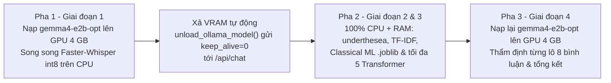

# Hướng dẫn Cài đặt & Vận hành Local AI Chi tiết (`Gemma 4 E2B` + `hand_env`)

Tài liệu này hướng dẫn từng bước từ máy trắng để thiết lập, kiểm thử và vận hành toàn bộ hệ thống **AI cục bộ (Local AI)** của dự án **Sentiment Analysis TikTok Song ngữ (`vi` / `en`)** trên Windows 10/11:
- **Mô hình VLM/LLM đa phương thức (`Gemma 4 E2B` — `gemma4-e2b-opt`):** Chạy qua **Docker Ollama** (hoặc Ollama Native), tối ưu cho GPU giới hạn **4 GB VRAM** (như NVIDIA GeForce RTX 3050 Laptop).
- **Môi trường Python (`hand_env`, Python 3.12):** Chạy **Faster-Whisper**, **PyAV**, **Underthesea**, **Scikit-learn** và tối đa **5 mô hình Transformer (PhoBERT / ViSoBERT / RoBERTa)** trên **CPU + RAM** để không tranh chấp VRAM với Gemma 4.

> **Lợi ích khi chạy 100% Local AI:** Không tốn chi phí API đám mây, không gửi video hay dữ liệu bình luận ra bên ngoài, và tận dụng mô hình đa phương thức đọc hiểu đồng thời **khung hình video/ảnh, chữ trên màn hình, lời thoại và văn bản bình luận song ngữ**.

---

## Mục lục

- [Tổng quan hệ sinh thái mô hình AI/ML cục bộ & Chu kỳ tài nguyên](#tổng-quan-hệ-sinh-thái-mô-hình-aiml-cục-bộ--chu-kỳ-tài-nguyên)
- [1. Yêu cầu phần cứng & Cài đặt phần mềm tiên quyết](#1-yêu-cầu-phần-cứng--cài-đặt-phần-mềm-tiên-quyết)
- [2. Cài đặt Local AI `Gemma 4 E2B` qua Docker Ollama (Khuyến nghị)](#2-cài-đặt-local-ai-gemma-4-e2b-qua-docker-ollama-khuyến-nghị)
- [3. Thiết lập môi trường Python (`hand_env`), Jupyter Kernel & Cache cục bộ](#3-thiết-lập-môi-trường-python-hand_env-jupyter-kernel--cache-cục-bộ)
- [4. Quy trình kiểm thử 5 tầng (Verification Checklist)](#4-quy-trình-kiểm-thử-5-tầng-verification-checklist)
- [5. Tùy chỉnh theo cấu hình phần cứng & Tham số vận hành Pipeline](#5-tùy-chỉnh-theo-cấu-hình-phần-cứng--tham-số-vận-hành-pipeline)
- [6. Vận hành hằng ngày, Bảo trì & Khắc phục lỗi thường gặp (Troubleshooting)](#6-vận-hành-hằng-ngày-bảo-trì--khắc-phục-lỗi-thường-gặp-troubleshooting)

---

## Tổng quan hệ sinh thái mô hình AI/ML cục bộ & Chu kỳ tài nguyên

### Toàn bộ các mô hình chạy cục bộ trong dự án

| Giai đoạn | Thành phần / Mã mô hình | Vai trò trong Pipeline | Thiết bị chạy | Vị trí lưu trữ cục bộ |
| :--- | :--- | :--- | :--- | :--- |
| **Giai đoạn 1** (AI Đầu vào) | `gemma4-e2b-opt` (build từ `gemma4:e2b`) | Đọc tối đa 10 khung hình (`512px`, JPEG `85%`) + caption + transcript, xuất JSON ngữ cảnh 8 trường (`temperature=0.15`) | **GPU (4 GB VRAM)** | `AI_Local/gemma4-e2b/ollama_models/` (~4.27 GB) |
| **Giai đoạn 1** (ASR) | `Faster-Whisper` (`small`, `int8`) + `PyAV` | Tách luồng âm thanh 16 kHz mono trong RAM (không cần FFmpeg) & chép lời tự nhận diện `vi` / `en` (`vad_filter=True`, `beam_size=5`) | **CPU + RAM** | Cache HuggingFace (`%USERPROFILE%\.cache\huggingface` hoặc `HF_HOME`) |
| **Giai đoạn 3A** (ML cổ điển) | `MultinomialNB`, `LogisticRegression`, `CalibratedClassifierCV(LinearSVC)` + `Emotion LR` | Huấn luyện & suy luận TF-IDF (`word` + `char_wb`) song ngữ từ `h-i-e-u/vietnamese-SA-dataset`, `ura-hcmut/UIT-VSMEC` và `cardiffnlp/tweeteval` | **CPU + RAM** | `models/classical_ml/vi/` & `models/classical_ml/en/` (`.joblib`) |
| **Giai đoạn 3B** (DL Tiếng Việt) | `5CD-AI/Vietnamese-Sentiment-visobert`, `wonrax/phobert-base-vietnamese-sentiment`, `visolex/phobert-emotion` | Tải lười (chỉ nạp khi có comment `vi`), suy luận cực tính 3 lớp & cảm xúc 7 cung bậc (`batch_size=32`, `max_length=256`) | **CPU + RAM** | Cache HuggingFace |
| **Giai đoạn 3B** (DL Tiếng Anh) | `cardiffnlp/twitter-roberta-base-sentiment-latest`, `j-hartmann/emotion-english-distilroberta-base` | Tải lười (chỉ nạp khi có comment `en`), suy luận cực tính 3 lớp & cảm xúc 7 cung bậc | **CPU + RAM** | Cache HuggingFace |
| **Giai đoạn 4** (AI Đầu ra) | `gemma4-e2b-opt` | Thẩm định độc lập theo lô `batch_size=8` (`temperature=0.1`), phát hiện mỉa mai (`sarcasm`) & viết đánh giá tổng kết | **GPU (4 GB VRAM)** | `AI_Local/gemma4-e2b/ollama_models/` |

### Chu kỳ luân chuyển tài nguyên GPU 4 GB ↔ CPU/RAM



---

## 1. Yêu cầu phần cứng & Cài đặt phần mềm tiên quyết

### 1.1. Cấu hình phần cứng theo mức

| Thành phần | Cấu hình tối thiểu (4 GB VRAM) | Cấu hình khuyến nghị | Chế độ chỉ CPU (Không GPU NVIDIA) |
| :--- | :--- | :--- | :--- |
| **Hệ điều hành** | Windows 10/11 (64-bit) | Windows 11 (64-bit) | Windows 10/11 (64-bit) |
| **GPU** | NVIDIA hỗ trợ CUDA, **4 GB VRAM** (đã kiểm chứng trên RTX 3050 Laptop 4 GB) | NVIDIA **6–8 GB+ VRAM** | Không bắt buộc |
| **RAM hệ thống** | **16 GB RAM** | **24–32 GB RAM** | **16–32 GB RAM** |
| **CPU** | 6–8 nhân (x86_64) | 8+ nhân | 8+ nhân |
| **Dung lượng ổ đĩa trống** | **15–20 GB** | **25+ GB** (SSD) | **15–20 GB** |

**Phân bổ dung lượng ổ đĩa ước tính:**
- Image Docker `ollama/ollama:latest` + tầng WSL2 Docker: **~4–6 GB**.
- Trọng số `gemma4:e2b` trong `AI_Local/gemma4-e2b/ollama_models/`: **~4.27 GB** (gồm 3 blob chính ~3.34 GB + ~941 MB + ~93 MB; tạo `gemma4-e2b-opt` dùng chung blob nên hầu như không tăng dung lượng).
- Bộ thư viện `hand_env` (`torch`, `transformers`, `opencv-python`, `playwright`, `faster-whisper`...): **~3–4 GB**.
- Cache `Faster-Whisper small`, 5 mô hình HuggingFace và `models/classical_ml/`: **~3–4 GB**.

---

### 1.2. Cài đặt và kiểm chứng từng phần mềm tiên quyết

#### Bước A — Kiểm tra NVIDIA GPU Driver
1. Cài driver NVIDIA bản mới nhất (Game Ready hoặc Studio Driver) từ trang chủ NVIDIA.
2. Mở **PowerShell** và kiểm tra:
   ```powershell
   nvidia-smi
   ```
   Phải hiển thị bảng thông tin card đồ họa, dung lượng VRAM (ví dụ `4096MiB`) và phiên bản CUDA hỗ trợ.

#### Bước B — Bật WSL 2 (Windows Subsystem for Linux 2)
Docker Desktop dùng WSL 2 để cấp quyền GPU NVIDIA vào container mà không cần cấu hình phức tạp.
1. Mở **PowerShell (Run as Administrator)** và kiểm tra trạng thái WSL:
   ```powershell
   wsl --status
   ```
   Nếu chưa bật WSL 2, chạy lệnh cài đặt rồi khởi động lại máy:
   ```powershell
   wsl --install
   ```
2. *(Khuyến nghị cho máy 16 GB RAM)* Tạo tệp `%USERPROFILE%\.wslconfig` để giới hạn RAM mà WSL2/Docker được phép giữ, tránh việc Docker ăn hết RAM của môi trường `hand_env` khi chạy Giai đoạn 2–3:
   ```ini
   [wsl2]
   memory=6GB
   swap=4GB
   ```
   Sau khi lưu tệp `.wslconfig`, chạy `wsl --shutdown` rồi mở lại Docker Desktop để áp dụng.

#### Bước C — Cài đặt Docker Desktop for Windows
1. Tải và cài đặt **Docker Desktop for Windows**.
2. Mở Docker Desktop → **Settings → General** → tích chọn **Use the WSL 2 based engine**.
3. Kiểm tra trong PowerShell:
   ```powershell
   docker --version
   docker compose version
   ```
4. **Lưu ý tránh xung đột cổng `11434`:** Nếu máy bạn đã cài **Ollama phiên bản Windows trực tiếp (Native)** và biểu tượng Ollama đang chạy ở khay hệ thống (System Tray), hãy bấm **Quit Ollama** trước khi bật container Docker để không bị lỗi trùng cổng `11434`.

#### Bước D — Cài đặt Miniconda / Anaconda
1. Cài **Miniconda3** (hoặc **Anaconda3**) cho Windows 64-bit.
2. Mở **Anaconda Prompt** (hoặc chạy `conda init powershell` một lần trong Anaconda Prompt để dùng trực tiếp được lệnh `conda` trong PowerShell/VS Code Terminal).
3. Kiểm tra:
   ```powershell
   conda --version
   ```

#### Bước E — Microsoft Edge & Git
- **Microsoft Edge:** Đã có sẵn trên Windows 10/11 (được `src/ingestion/tiktok_collector.py` gọi qua `channel="msedge"` khi thu thập bình luận TikTok và tải bài đăng Photo Mode).
- **Git (tùy chọn):** Cài sẵn nếu bạn cần clone/cập nhật mã nguồn dự án.

---

## 2. Cài đặt Local AI `Gemma 4 E2B` qua Docker Ollama (Khuyến nghị)

> **Lưu ý quan trọng khi clone từ Git:** Thư mục `AI_Local/` (gồm cấu hình và trọng số `ollama_models/`) không được đẩy lên Git do kích thước lớn. Nếu trên máy bạn **chưa có** thư mục `AI_Local/gemma4-e2b/`, hãy tạo mới theo đúng hướng dẫn mục **2.1** dưới đây. Nếu bạn đã copy sẵn thư mục `AI_Local/gemma4-e2b/` (kèm `ollama_models/`), hãy kiểm tra lại đường dẫn `volumes` trong `docker-compose.yml`.

### 2.1. Tạo thư mục và các tệp cấu hình (`AI_Local/gemma4-e2b/`)

Tạo thư mục lưu cấu hình và trọng số tại gốc dự án:

```powershell
cd E:\A\Sentiment-Analysis
New-Item -ItemType Directory -Force -Path "AI_Local\gemma4-e2b\ollama_models" | Out-Null
```

#### Tệp 1: `AI_Local/gemma4-e2b/docker-compose.yml`

Nội dung chuẩn đang dùng trong dự án:

```yaml
services:
  ollama:
    image: ollama/ollama:latest
    container_name: gemma4-e2b
    restart: unless-stopped
    ports:
      - "11434:11434"
    volumes:
      # Lưu toàn bộ trọng số model (~4.27GB) trực tiếp tại ổ E: để tránh tràn ổ hệ thống C:
      - E:/A/Sentiment-Analysis/AI_Local/gemma4-e2b/ollama_models:/root/.ollama
      # Gắn file cấu hình tối ưu vào container
      - E:/A/Sentiment-Analysis/AI_Local/gemma4-e2b/Modelfile:/Modelfile
    environment:
      # Tối ưu bộ nhớ cho card 4GB VRAM (giảm ~40% dung lượng KV Cache khi nạp ảnh/video)
      - OLLAMA_FLASH_ATTENTION=1
      - OLLAMA_KV_CACHE_TYPE=q8_0
      # Chỉ nạp tối đa 1 model vào VRAM cùng lúc để tránh tràn bộ nhớ
      - OLLAMA_MAX_LOADED_MODELS=1
      # Giữ model trên VRAM trong 10 phút sau mỗi lần gọi API
      - OLLAMA_KEEP_ALIVE=10m
      # Mở quyền truy cập API cho các ứng dụng hoặc script Python bên ngoài
      - OLLAMA_HOST=0.0.0.0
    deploy:
      resources:
        reservations:
          devices:
            - driver: nvidia
              count: 1
              capabilities: [gpu]
```

> **Khi chuyển dự án sang thư mục hoặc ổ đĩa khác:** Bạn có thể sửa lại đường dẫn tuyệt đối theo máy mới (dùng dấu `/` như `D:/Projects/Sentiment-Analysis/...`), **hoặc** dùng đường dẫn tương đối ngay trong `docker-compose.yml`:
> ```yaml
>     volumes:
>       - ./ollama_models:/root/.ollama
>       - ./Modelfile:/Modelfile
> ```

**Ý nghĩa 5 biến môi trường tối ưu 4 GB VRAM:**

| Biến môi trường | Giá trị | Tác dụng kỹ thuật |
| :--- | :--- | :--- |
| `OLLAMA_FLASH_ATTENTION` | `1` | Bật Flash Attention giúp giảm tiêu thụ VRAM khi nạp chuỗi nhiều khung hình ảnh từ video. |
| `OLLAMA_KV_CACHE_TYPE` | `q8_0` | Lượng tử hóa bộ nhớ đệm ngữ cảnh (KV Cache) xuống 8-bit, giảm ~40% dung lượng VRAM ở `num_ctx 16384` mà hầu như không giảm chất lượng. |
| `OLLAMA_MAX_LOADED_MODELS` | `1` | Chỉ cho phép giữ tối đa 1 model trên GPU cùng lúc, ngăn lỗi tràn VRAM. |
| `OLLAMA_KEEP_ALIVE` | `10m` | Giữ model trong VRAM tối đa 10 phút giữa các lô gọi liên tiếp ở Giai đoạn 4. Khi kết thúc Giai đoạn 1, `MediaAnalyzer.unload_ollama_model()` chủ động gửi `keep_alive=0` tới `/api/chat` để xả sạch VRAM ngay lập tức. |
| `OLLAMA_HOST` | `0.0.0.0` | Lắng nghe trên mọi giao diện mạng trong container để Python ở host gọi qua `http://localhost:11434`. |

#### Tệp 2: `AI_Local/gemma4-e2b/Modelfile`

Nội dung chuẩn đang dùng trong dự án:

```dockerfile
FROM gemma4:e2b

# Mở rộng ngữ cảnh từ 4K mặc định lên 16K tokens (đủ sức chứa chuỗi khung hình video + prompt mà không tràn 4GB VRAM)
PARAMETER num_ctx 16384

# Ép nạp 100% các lớp mạng lên GPU rời
PARAMETER num_gpu 99

# Tham số sinh văn bản chuẩn được Google khuyến nghị cho Gemma 4
PARAMETER temperature 1.0
PARAMETER top_p 0.95
PARAMETER top_k 64
```

**Giải thích tham số `Modelfile` & cách mã Python ghi đè:**
- `num_ctx 16384`: Mở rộng cửa sổ ngữ cảnh từ 4.096 mặc định lên **16.384 tokens** (đủ chứa tối đa `max_frames=10` khung hình `512px` + transcript Whisper + caption + system prompt).
- `num_gpu 99`: Yêu cầu Ollama đẩy tối đa số lớp mạng lên GPU rời.
- `temperature 1.0`, `top_p 0.95`, `top_k 64`: Cấu hình nền khi chat tự do (như trong `test.ipynb`). Khi chạy Pipeline chính, `MediaAnalyzer` (`src/models/media_context.py`) chủ động truyền `temperature=0.15`, `top_p=0.9`, `think=False`, `format=MEDIA_RESPONSE_SCHEMA`, còn `GemmaAuditor` (`src/models/gemma_auditor.py`) truyền `temperature=0.1`, `top_p=0.9`, `think=False`, `format=BATCH_AUDIT_SCHEMA` / `VERDICT_SCHEMA` để ép đầu ra JSON chính xác.

---

### 2.2. Khởi chạy container & Xác nhận GPU Passthrough

Đảm bảo **Docker Desktop** đang mở và chạy ổn định, sau đó mở PowerShell tại `AI_Local\gemma4-e2b`:

```powershell
cd E:\A\Sentiment-Analysis\AI_Local\gemma4-e2b
docker compose up -d
```

Kiểm tra container đã chạy, không báo lỗi khởi động và đã nhìn thấy GPU NVIDIA:

```powershell
docker ps
docker logs --tail 30 gemma4-e2b
docker exec -it gemma4-e2b nvidia-smi
```

**Kết quả đạt yêu cầu:**
- `docker ps` hiển thị container `gemma4-e2b` với trạng thái `Up` và cổng `0.0.0.0:11434->11434/tcp`.
- `docker exec -it gemma4-e2b nvidia-smi` in ra bảng thông tin card GPU NVIDIA của bạn (ví dụ RTX 3050 Laptop 4096MiB).

---

### 2.3. Tải trọng số `gemma4:e2b` và tạo bản tối ưu `gemma4-e2b-opt`

Chạy tuần tự 3 lệnh sau trong PowerShell:

```powershell
# 1. Tải trọng số gốc gemma4:e2b (~4.27 GB, lưu vào thư mục ollama_models/)
docker exec -it gemma4-e2b ollama pull gemma4:e2b

# 2. Tạo bản tùy biến tối ưu 16K context mang tên gemma4-e2b-opt từ /Modelfile
docker exec -it gemma4-e2b ollama create gemma4-e2b-opt -f /Modelfile

# 3. Xác nhận danh sách mô hình đã sẵn sàng
docker exec -it gemma4-e2b ollama list
```

> **Lưu ý:**
> - Nếu trong `AI_Local/gemma4-e2b/ollama_models/` đã có sẵn trọng số copy từ trước, lệnh `ollama pull gemma4:e2b` sẽ kiểm tra checksum rất nhanh mà không tải lại từ đầu; lệnh `ollama list` phải hiển thị cả `gemma4:e2b` và `gemma4-e2b-opt:latest`.
> - Nếu bạn có chỉnh sửa bất kỳ tham số nào trong `Modelfile` về sau, chỉ cần chạy lại bước 2 (`docker exec -it gemma4-e2b ollama create gemma4-e2b-opt -f /Modelfile`).

---

### 2.4. Phương án thay thế — Chạy Ollama Native trên Windows (Không dùng Docker)

Nếu máy bạn không cài được Docker Desktop/WSL2, bạn có thể cài **Ollama for Windows** trực tiếp và giữ nguyên cấu hình tối ưu cho dự án:

1. Tải và cài đặt **Ollama for Windows**.
2. Thoát hẳn Ollama ở System Tray (nếu đang chạy), mở PowerShell và thiết lập các biến môi trường giống `docker-compose.yml` (có thể đặt vĩnh viễn cho tài khoản Windows):
   ```powershell
   [Environment]::SetEnvironmentVariable("OLLAMA_MODELS", "E:\A\Sentiment-Analysis\AI_Local\gemma4-e2b\ollama_models\models", "User")
   [Environment]::SetEnvironmentVariable("OLLAMA_FLASH_ATTENTION", "1", "User")
   [Environment]::SetEnvironmentVariable("OLLAMA_KV_CACHE_TYPE", "q8_0", "User")
   [Environment]::SetEnvironmentVariable("OLLAMA_MAX_LOADED_MODELS", "1", "User")
   [Environment]::SetEnvironmentVariable("OLLAMA_KEEP_ALIVE", "10m", "User")
   ```
3. Mở **terminal PowerShell mới** (để nhận biến môi trường mới), khởi chạy dịch vụ Ollama:
   ```powershell
   ollama serve
   ```
4. Ở một cửa sổ PowerShell khác, tải và tạo mô hình tối ưu:
   ```powershell
   ollama pull gemma4:e2b
   ollama create gemma4-e2b-opt -f E:\A\Sentiment-Analysis\AI_Local\gemma4-e2b\Modelfile
   ollama list
   ```
5. Mã nguồn Python kết nối mặc định qua `http://localhost:11434` và model `gemma4-e2b-opt`, nên hoạt động hoàn toàn tương thích với cả 2 chế độ Docker lẫn Native. *(Không bật song song cả Docker lẫn Ollama Native cùng lúc vì sẽ đụng cổng `11434`).*

---

## 3. Thiết lập môi trường Python (`hand_env`), Jupyter Kernel & Cache cục bộ

### 3.1. Tạo môi trường Conda Python 3.12 và cài `requirements.txt`

Mở **Anaconda Prompt** (hoặc **PowerShell** đã chạy `conda init powershell`) tại thư mục gốc dự án:

```powershell
cd E:\A\Sentiment-Analysis
conda create -n hand_env python=3.12 -y
conda activate hand_env
python -m pip install --upgrade pip
pip install -r requirements.txt
```

**Lưu ý về phiên bản thư viện trong `requirements.txt`:**
- `transformers>=4.41.0,<5.0.0` và `huggingface-hub>=0.34.0,<1.0.0` đã được ghim tương thích cho `PhoBERT`, `ViSoBERT` và `Twitter-RoBERTa`.
- Dự án cố tình **không** sử dụng `datasets` / `pyarrow` trong `src/models/classical_ml.py` để tránh lỗi Windows Application Control chặn file DLL `pyarrow._fs`. Không cần cài thêm `pyarrow`.

### 3.2. Đăng ký Jupyter Kernel `hand_env` cho VS Code (`main.ipynb` & `test.ipynb`)

Tệp `requirements.txt` chỉ chứa thư viện chạy pipeline (không kèm `ipykernel`). Để mở và chạy `main.ipynb` và `AI_Local/gemma4-e2b/test.ipynb` bằng kernel `hand_env` trong VS Code / Jupyter:

```powershell
conda activate hand_env
pip install ipykernel
python -m ipykernel install --user --name hand_env --display-name "hand_env"
```

Dự án cũng đã cấu hình sẵn `.vscode/settings.json` trỏ trình quản lý môi trường mặc định sang Conda (`"python-envs.defaultEnvManager": "ms-python.python:conda"`). Khi mở `main.ipynb` trong VS Code, bấm **Select Kernel → Python Environments / Jupyter Kernel → `hand_env` (Python 3.12)**.

### 3.3. Khởi tạo trình duyệt Microsoft Edge cho Playwright

Bước thu thập bình luận TikTok và tải bài đăng Photo Mode (`src/ingestion/tiktok_collector.py`) mở trình duyệt Microsoft Edge qua Playwright (`channel="msedge"`). Chạy lệnh sau trong `hand_env` để đảm bảo driver Playwright đã sẵn sàng:

```powershell
conda activate hand_env
playwright install msedge
```

### 3.4. Chuyển cache HuggingFace & Faster-Whisper sang ổ khác *(Tùy chọn nếu ổ `C:` ít trống)*

Mặc định, `transformers`, `huggingface_hub` và `faster-whisper` lưu cache mô hình vào `C:\Users\<TenUser>\.cache\huggingface` (~3–4 GB). Nếu muốn chuyển sang ổ `E:` giống `ollama_models`:

- Đặt biến môi trường vĩnh viễn (áp dụng cho mọi terminal/VS Code mở mới sau đó):
  ```powershell
  New-Item -ItemType Directory -Force -Path "E:\A\Sentiment-Analysis\.hf_cache" | Out-Null
  [Environment]::SetEnvironmentVariable("HF_HOME", "E:\A\Sentiment-Analysis\.hf_cache", "User")
  ```
- Hoặc chỉ đặt tạm trong phiên PowerShell hiện tại:
  ```powershell
  $env:HF_HOME = "E:\A\Sentiment-Analysis\.hf_cache"
  ```

### 3.5. Các thành phần tự động tải & lưu cache ở lần chạy đầu tiên

Ở lần chạy `main.ipynb` hoặc `python -m src.pipeline` đầu tiên (khi có mạng Internet), hệ thống tự động tải và cache cục bộ các thành phần sau (những lần sau tái sử dụng trực tiếp):
1. **Faster-Whisper (`small`, CPU `int8`):** Bóc tách lời thoại đa ngôn ngữ từ video (`enable_audio=True`).
2. **Bộ mô hình ML cổ điển (`models/classical_ml/vi/` & `en/`):** Tải dữ liệu công khai qua `huggingface_hub` (`h-i-e-u/vietnamese-SA-dataset`, `ura-hcmut/UIT-VSMEC`) và GitHub raw (`cardiffnlp/tweeteval`), huấn luyện `NB / LR / Linear SVM / Emotion LR`, lưu `polarity_models.joblib`, `emotion_ml_model.joblib` và `benchmark_metrics.json`.
3. **Bộ mô hình Transformer (CPU, tải lười theo ngôn ngữ xuất hiện trong bình luận):**
   - Nhánh `vi`: `5CD-AI/Vietnamese-Sentiment-visobert`, `wonrax/phobert-base-vietnamese-sentiment`, `visolex/phobert-emotion`.
   - Nhánh `en`: `cardiffnlp/twitter-roberta-base-sentiment-latest`, `j-hartmann/emotion-english-distilroberta-base`.

---

## 4. Quy trình kiểm thử 5 tầng (Verification Checklist)

Thực hiện lần lượt 5 tầng dưới đây để chắc chắn toàn hệ thống hoạt động trơn tru trước khi phân tích link TikTok thật.

### Tầng 1 — Kiểm tra REST API của Ollama
```powershell
Invoke-RestMethod http://localhost:11434/api/tags | ConvertTo-Json -Depth 4
```
*Đạt yêu cầu:* JSON trả về có tên model `"gemma4-e2b-opt:latest"` và `"gemma4:e2b"`.

### Tầng 2 — Kiểm tra sinh văn bản & Tỷ lệ nạp GPU
```powershell
docker exec -it gemma4-e2b ollama run gemma4-e2b-opt "Trả lời ngắn gọn 1 câu bằng tiếng Việt: Sentiment Analysis là gì?"
docker exec -it gemma4-e2b ollama ps
```
*Đạt yêu cầu:* Model trả lời nhanh bằng tiếng Việt; trong `ollama ps`, cột `PROCESSOR` hiển thị `100% GPU` (hoặc phần lớn `% GPU`), cột `CONTEXT` hiển thị `16384`.

### Tầng 3 — Kiểm thử chat tương tác qua `AI_Local/gemma4-e2b/test.ipynb`
Mở tệp `AI_Local/gemma4-e2b/test.ipynb` trong VS Code, chọn kernel **`hand_env`**, chạy cell duy nhất trong notebook (`chat_loop(think=False)`).
- Tệp này dùng để kiểm thử kết nối `http://localhost:11434/api/chat` theo dạng hội thoại văn bản có nhớ lịch sử (`stream=True`).
- Gõ một câu tiếng Việt bất kỳ để kiểm tra tốc độ stream chữ, gõ `clear` để xóa lịch sử hội thoại, gõ `exit` để thoát vòng lặp.
- *(Có thể đổi `chat_loop(think=True)` để thử chế độ suy luận ngầm của Gemma 4).*

### Tầng 4 — Kiểm thử thư viện `hand_env` & Kiểm thử đa phương thức Video (`MediaAnalyzer`)
1. Kiểm tra các gói cốt lõi trong `hand_env`:
   ```powershell
   conda activate hand_env
   cd E:\A\Sentiment-Analysis
   python -c "import torch, transformers, faster_whisper, av, cv2, underthesea, sklearn, playwright, yt_dlp; print('OK:', torch.__version__, transformers.__version__)"
   ```
2. Kiểm thử đọc khung hình video + lời thoại Whisper + `gemma4-e2b-opt` (nếu đã có sẵn video `.mp4` bất kỳ trong `data/<post_id>/video.mp4`, thay `<post_id>` tương ứng):
   ```powershell
   python -c "from src.models.media_context import MediaAnalyzer; m = MediaAnalyzer(); res = m.analyze('data/<post_id>/video.mp4'); print(res.chu_de_chinh, '|', res.sac_thai_noi_dung, '| frames:', res.num_frames_used); m.unload_ollama_model()"
   ```

### Tầng 5 — Chạy Smoke Test End-to-End không cần mở trình duyệt TikTok
Chạy thử pipeline bằng tệp bình luận mẫu có sẵn `data/samples/sample_comments.csv` (chấm thử 8 câu với Gemma 4 ở Giai đoạn 4, xuất kết quả ra `outputs/smoke_test/`):

```powershell
conda activate hand_env
cd E:\A\Sentiment-Analysis
python -m src.pipeline --comments data/samples/sample_comments.csv --audit-limit 8 --output outputs/smoke_test
```

*Đạt yêu cầu:* Lệnh chạy xong không lỗi và xuất đủ 6 tệp trong `outputs/smoke_test/`:
`final_results.csv`, `cleaned_final_results.csv`, `filtered_noise.csv`, `model_comparison.csv`, `report.json`, `dashboard.png`.

### Lệnh xả sạch VRAM thủ công (khi cần nhường GPU ngay lập tức)
```powershell
Invoke-RestMethod -Method Post -Uri http://localhost:11434/api/chat -ContentType "application/json" -Body '{"model":"gemma4-e2b-opt","keep_alive":0}'
```
Sau khi chạy lệnh trên, kiểm tra lại `docker exec -it gemma4-e2b ollama ps` sẽ thấy danh sách trống (VRAM đã được giải phóng hoàn toàn).

---

## 5. Tùy chỉnh theo cấu hình phần cứng & Tham số vận hành Pipeline

### 5.1. Tinh chỉnh cấu hình theo 3 nhóm máy

| Nhóm phần cứng | Cấu hình Docker / `Modelfile` | Tham số chạy Pipeline (`src.pipeline`) |
| :--- | :--- | :--- |
| **GPU NVIDIA 4 GB VRAM** *(Mặc định dự án)* | Giữ nguyên `docker-compose.yml` (`OLLAMA_FLASH_ATTENTION=1`, `OLLAMA_KV_CACHE_TYPE=q8_0`) và `Modelfile` (`num_ctx 16384`, `num_gpu 99`). | Giữ `--device cpu` (Giai đoạn 3 chạy CPU để không tranh VRAM với Gemma 4); `unload_ollama_after_stage1=True`. |
| **GPU NVIDIA 6–8 GB+ VRAM** | Có thể tăng `num_ctx` trong `Modelfile` lên `24576` hoặc `32768` nếu video dài, hoặc giữ `16384` để phản hồi nhanh. | Giữ `--device cpu` (khuyên dùng, ổn định nhất) hoặc thử `--device cuda` cho các mô hình Transformer Giai đoạn 3 khi `unload_ollama_after_stage1=True`. |
| **Chỉ CPU (Không có GPU NVIDIA)** | Xóa toàn bộ khối `deploy:` trong `docker-compose.yml`; trong `Modelfile` đổi thành `PARAMETER num_gpu 0` và giảm `PARAMETER num_ctx 8192` để tiết kiệm RAM. | Truyền `--audit-limit 20` (thẩm định 20 bình luận ưu tiên thay vì 100%) hoặc `--skip-audit` để tránh chờ lâu khi chấm bằng CPU. |

### 5.2. Chạy bằng `main.ipynb` & Bảng tham số CLI (`python -m src.pipeline`)

- **Chạy giao diện Notebook:** Mở `main.ipynb`, chọn kernel `hand_env`, chạy Cell 1 để nhập `TIKTOK_URL`, sau đó chạy lần lượt các cell còn lại.
- **Chạy bằng dòng lệnh CLI:**
  ```powershell
  conda activate hand_env
  cd E:\A\Sentiment-Analysis
  python -m src.pipeline --url "https://www.tiktok.com/@username/video/1234567890"
  ```

**Bảng tham số CLI thường dùng liên quan tới Local AI & tài nguyên:**

| Cờ CLI | Mặc định | Ý nghĩa |
| :--- | :--- | :--- |
| `--url` | `None` | Link video hoặc Photo Mode TikTok cần tải & thu thập bình luận. |
| `--media` | `None` | Đường dẫn video `.mp4` hoặc danh sách ảnh cục bộ (khi phân tích dữ liệu có sẵn). |
| `--comments` | `None` | File bình luận cục bộ (`.csv`, `.json`, `.txt`). |
| `--ollama-url` | `http://localhost:11434` | Địa chỉ API Ollama (đổi nếu chạy Ollama trên máy khác trong LAN). |
| `--ollama-model` | `gemma4-e2b-opt` | Tên model Ollama dùng ở Giai đoạn 1 và Giai đoạn 4. |
| `--whisper-model` | `small` | Kích thước Faster-Whisper (`tiny`, `base`, `small`, `medium`). Dùng `tiny` hoặc `base` nếu RAM hạn chế. |
| `--no-audio` | `False` | Bỏ qua tách âm thanh & Whisper ở Giai đoạn 1. |
| `--device` | `cpu` | Thiết bị chạy Transformer ở Giai đoạn 3 (`cpu`, `cuda`, `auto`). |
| `--audit-limit` | `None` | Giới hạn số bình luận gửi Gemma 4 thẩm định ở Giai đoạn 4 (`None` = chấm 100% bình luận hợp lệ). |
| `--skip-audit` | `False` | Bỏ qua Giai đoạn 4 (Gemma 4 thẩm định đầu ra), chỉ chạy Gemma 4 ở Giai đoạn 1. |
| `--max-comments` | `200` | Số bình luận tối đa thu thập qua Playwright Edge. |
| `--headless-crawl` / `--no-crawl-pause` | `False` / `False` | Ẩn trình duyệt hoặc bỏ qua bước dừng nhấn Enter (chú ý TikTok dễ hiện CAPTCHA nếu chạy headless). |
| `--data-dir` / `--output` | `data` / `outputs` | Thư mục lưu dữ liệu thô thu thập và thư mục xuất kết quả. |

---

## 6. Vận hành hằng ngày, Bảo trì & Khắc phục lỗi thường gặp (Troubleshooting)

### 6.1. Lệnh vận hành & bảo trì hằng ngày

```powershell
# 1. Bật Local AI trước khi mở main.ipynb hoặc chạy pipeline
cd E:\A\Sentiment-Analysis\AI_Local\gemma4-e2b
docker compose up -d

# 2. Xem trạng thái VRAM / model đang nạp
docker exec -it gemma4-e2b ollama ps

# 3. Tắt hẳn container khi làm việc xong (trả lại RAM/VRAM cho Windows)
docker compose down

# 4. Cập nhật phiên bản Ollama image mới nhất (không mất dữ liệu trong ollama_models/)
docker compose pull
docker compose up -d

# 5. Rebuild model gemma4-e2b-opt sau khi sửa Modelfile
docker exec -it gemma4-e2b ollama create gemma4-e2b-opt -f /Modelfile
```

### 6.2. Bảng xử lý 12 lỗi thường gặp

| STT | Hiện tượng / Thông báo lỗi | Nguyên nhân | Cách khắc phục |
| :--- | :--- | :--- | :--- |
| 1 | `ConnectionRefusedError` / `[WinError 10061]` tới `localhost:11434` | Docker Desktop chưa bật hoặc container `gemma4-e2b` chưa khởi chạy. | Mở Docker Desktop, chờ biểu tượng xanh rồi chạy `docker compose up -d` trong `AI_Local\gemma4-e2b`. |
| 2 | `Bind for 0.0.0.0:11434 failed: port is already allocated` | Ứng dụng **Ollama Native trên Windows** đang chạy ngầm và chiếm cổng `11434`. | Bấm chuột phải biểu tượng Ollama ở khay hệ thống (System Tray) chọn **Quit Ollama**, hoặc chạy `Stop-Process -Name "ollama*" -Force`, rồi `docker compose up -d`. |
| 3 | `docker exec -it gemma4-e2b nvidia-smi` báo lỗi không tìm thấy GPU / `could not select device driver "nvidia"` | Docker Desktop chưa bật WSL 2 engine hoặc Driver NVIDIA trên Windows quá cũ. | Cập nhật NVIDIA Driver mới nhất; bật **Use the WSL 2 based engine** trong Docker Desktop → Settings → General; chạy `wsl --update` rồi khởi động lại Docker Desktop. |
| 4 | `404 Client Error: model 'gemma4-e2b-opt' not found` | Đã bật container nhưng chưa tạo model từ `/Modelfile` hoặc trỏ sai thư mục `ollama_models` trong `docker-compose.yml`. | Kiểm tra lại đường dẫn `volumes:` trong `docker-compose.yml`, sau đó chạy `docker exec -it gemma4-e2b ollama pull gemma4:e2b` và `docker exec -it gemma4-e2b ollama create gemma4-e2b-opt -f /Modelfile`. |
| 5 | Chạy Gemma rất chậm, cột `PROCESSOR` trong `ollama ps` hiện tỷ lệ `% CPU` cao | Đang mở game/Chrome nhiều tab ngốn VRAM, hoặc `num_ctx 16384` vượt lượng VRAM trống của GPU 4 GB. | Đóng bớt phần mềm dùng GPU (Chrome/Edge, game, app đồ họa), kiểm tra VRAM trống bằng `nvidia-smi`. Nếu vẫn tràn sang CPU, giảm `PARAMETER num_ctx` trong `Modelfile` xuống `12288` hoặc `8192` rồi chạy lại `ollama create`. |
| 6 | Lỗi `ReadTimeout` quá `180s` ở Giai đoạn 1 hoặc Giai đoạn 4 | Model chạy trên CPU/tràn VRAM hoặc lần nạp đầu tiên từ ổ HDD chậm vượt `timeout=180` giây. | Xác nhận `ollama ps` chạy `100% GPU`; hoặc chạy warm-up bằng `docker exec -it gemma4-e2b ollama run gemma4-e2b-opt "hi"` trước khi chạy pipeline; hoặc truyền `MediaAnalyzer(timeout=300)` / `GemmaAuditor(timeout=300, batch_size=4)`. |
| 7 | Không thấy kernel `hand_env` khi mở `main.ipynb` / `test.ipynb` trong VS Code | Chưa cài `ipykernel` hoặc chưa đăng ký kernel trong `hand_env`. | Chạy `conda activate hand_env`, `pip install ipykernel`, `python -m ipykernel install --user --name hand_env --display-name "hand_env"`, sau đó reload lại cửa sổ VS Code (`Ctrl+Shift+P` → *Developer: Reload Window*). |
| 8 | Playwright báo lỗi thiếu trình duyệt hoặc không mở được Microsoft Edge | Chưa chạy `playwright install msedge` hoặc Edge chưa được cài trên máy. | Chạy `playwright install msedge` trong `hand_env`; kiểm tra Microsoft Edge mở được bình thường trên Windows. |
| 9 | TikTok chặn / hiện CAPTCHA hoặc thu được 0 bình luận khi crawl | Chạy ở chế độ `--headless-crawl` hoặc chưa đóng popup đăng nhập/vượt CAPTCHA lúc tạm dừng. | Giữ `crawl_headless=False`, khi trình duyệt Edge mở lên hãy tự tay đóng popup đăng nhập / giải CAPTCHA (nếu có) và cuộn thử thấy khung bình luận rồi mới quay lại terminal/VS Code nhấn Enter. |
| 10 | Lỗi liên quan tới thiếu `ffmpeg` khi tải video TikTok | Máy Windows chưa cài FFmpeg toàn cục. | Không cần cài thủ công: `src/ingestion/tiktok_collector.py` tự kiểm tra `shutil.which("ffmpeg")` và chuyển sang tải MP4 ghép sẵn (`b[ext=mp4]/best[ext=mp4]/b`), đồng thời `MediaAnalyzer` dùng **PyAV** (`av`) để tách âm thanh trực tiếp. |
| 11 | Chính sách bảo mật Windows chặn DLL `pyarrow._fs` | Windows Application Control chặn file nhị phân của `pyarrow`. | Dự án đã loại bỏ hoàn toàn phụ thuộc `datasets` / `pyarrow` khỏi `src/models/classical_ml.py` và tải trực tiếp CSV/TXT qua `huggingface_hub` và `requests`. Không cài lại `pyarrow`. |
| 12 | Ổ đĩa `C:` bị đầy sau khi chạy Pipeline lần đầu | Thư mục cache mặc định của HuggingFace (`%USERPROFILE%\.cache\huggingface`) và Docker/WSL2 nằm ở ổ `C:`. | Thiết lập biến môi trường `HF_HOME=E:\A\Sentiment-Analysis\.hf_cache` (Mục 3.4) và cấu hình `Docker Desktop → Settings → Resources → Disk image location` chuyển sang ổ đĩa còn nhiều dung lượng trống. |
